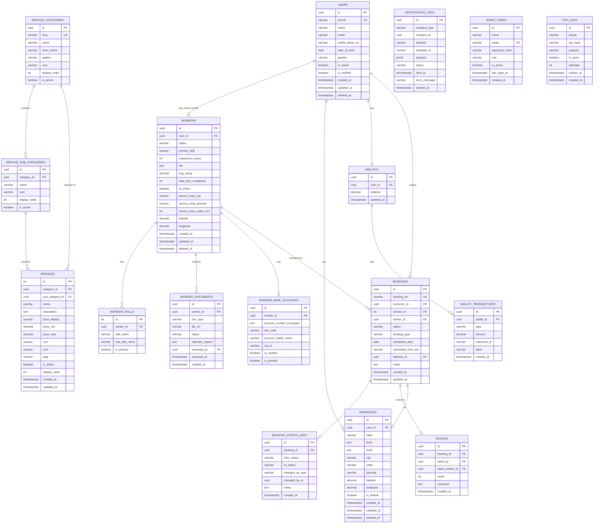

# VSolveHub — Data Models

> **Version:** 1.0 | **Last Updated:** June 2026  
> Stack: PostgreSQL 16 + Django 5 ORM  
> Conventions: UUID PKs for external entities, soft deletes, UTC timestamps, encrypted PII

---

## Design Principles
- **Soft deletes:** `deleted_at TIMESTAMPTZ NULL` on major entities; never hard delete customer/worker/booking data
- **Audit timestamps:** `created_at` + `updated_at` auto-managed on every table
- **PII encryption:** Aadhaar numbers and bank account numbers encrypted with AES-256 using `pgcrypto`
- **Enums:** All state machine fields use Django `TextChoices` (stored as VARCHAR, indexed)
- **UUIDs:** External-facing IDs use `gen_random_uuid()`; internal join tables use integer PKs
- **Time zone:** All timestamps stored as UTC; display as IST (Asia/Kolkata) in UI

---

## Master Entity-Relationship Diagram



---

## Detailed Table Specifications

### 1. `users` — Customer accounts

```sql
CREATE TABLE users (
    id              UUID PRIMARY KEY DEFAULT gen_random_uuid(),
    phone           VARCHAR(15) UNIQUE NOT NULL,        -- E.164 format: +919876543210
    name            VARCHAR(100),
    email           VARCHAR(255),
    profile_photo_url TEXT,
    date_of_birth   DATE,
    gender          VARCHAR(10) CHECK (gender IN ('MALE', 'FEMALE', 'OTHER')),
    is_active       BOOLEAN NOT NULL DEFAULT TRUE,
    is_verified     BOOLEAN NOT NULL DEFAULT FALSE,      -- TRUE after first OTP verify
    created_at      TIMESTAMPTZ NOT NULL DEFAULT NOW(),
    updated_at      TIMESTAMPTZ NOT NULL DEFAULT NOW(),
    deleted_at      TIMESTAMPTZ                          -- soft delete
);

-- Indexes
CREATE INDEX idx_users_phone ON users(phone);
CREATE INDEX idx_users_active ON users(is_active) WHERE deleted_at IS NULL;
```

**Django Model Notes:**
```python
class User(models.Model):
    class Gender(models.TextChoices):
        MALE = 'MALE', 'Male'
        FEMALE = 'FEMALE', 'Female'
        OTHER = 'OTHER', 'Other'

    id = models.UUIDField(primary_key=True, default=uuid.uuid4)
    phone = models.CharField(max_length=15, unique=True)
    # ... etc
```

---

### 2. `workers` — Worker profiles

```sql
CREATE TABLE workers (
    id                      UUID PRIMARY KEY DEFAULT gen_random_uuid(),
    user_id                 UUID NOT NULL REFERENCES users(id),
    status                  VARCHAR(25) NOT NULL DEFAULT 'UNVERIFIED',
                            -- UNVERIFIED | PENDING_VERIFICATION | ACTIVE | REJECTED | SUSPENDED
    primary_skill           VARCHAR(100),                 -- e.g. 'Electrician'
    experience_years        SMALLINT DEFAULT 0,
    bio                     TEXT,
    avg_rating              DECIMAL(3,2) DEFAULT 0.00,   -- 0.00 to 5.00
    total_jobs_completed    INTEGER DEFAULT 0,
    is_online               BOOLEAN NOT NULL DEFAULT FALSE,
    service_area_city       VARCHAR(100),
    service_area_pincode    VARCHAR(10),
    service_area_radius_km  SMALLINT DEFAULT 10,          -- 5 | 10 | 20
    latitude                DECIMAL(9,6),
    longitude               DECIMAL(9,6),
    created_at              TIMESTAMPTZ NOT NULL DEFAULT NOW(),
    updated_at              TIMESTAMPTZ NOT NULL DEFAULT NOW(),
    deleted_at              TIMESTAMPTZ
);

-- Indexes
CREATE UNIQUE INDEX idx_workers_user ON workers(user_id);
CREATE INDEX idx_workers_status ON workers(status);
CREATE INDEX idx_workers_online ON workers(is_online) WHERE status = 'ACTIVE';
CREATE INDEX idx_workers_city ON workers(service_area_city);
```

**Status Enum:**
| Status | Description |
|--------|-------------|
| `UNVERIFIED` | Account created; profile not started |
| `PENDING_VERIFICATION` | Documents submitted; awaiting admin review |
| `ACTIVE` | Admin approved; can receive jobs |
| `REJECTED` | Admin rejected; can edit and resubmit |
| `SUSPENDED` | Admin suspended; cannot receive jobs |

---

### 3. `worker_documents` — Verification documents

```sql
CREATE TABLE worker_documents (
    id              UUID PRIMARY KEY DEFAULT gen_random_uuid(),
    worker_id       UUID NOT NULL REFERENCES workers(id),
    doc_type        VARCHAR(30) NOT NULL,
                    -- AADHAAR_FRONT | AADHAAR_BACK | SKILL_CERTIFICATE | SELFIE | BANK_PASSBOOK
    file_url        TEXT NOT NULL,                        -- S3 pre-signed or permanent URL
    status          VARCHAR(20) NOT NULL DEFAULT 'PENDING',
                    -- PENDING | APPROVED | REJECTED
    rejection_reason TEXT,
    reviewed_by     UUID REFERENCES admin_users(id),
    reviewed_at     TIMESTAMPTZ,
    created_at      TIMESTAMPTZ NOT NULL DEFAULT NOW()
);

-- Indexes
CREATE INDEX idx_worker_docs_worker ON worker_documents(worker_id);
CREATE INDEX idx_worker_docs_status ON worker_documents(status);
```

> **Security Note:** `file_url` should be a path/key, not a public URL. Pre-signed URLs generated on-demand with 15-minute expiry for admin document review.

---

### 4. `worker_bank_accounts` — Payment details

```sql
CREATE TABLE worker_bank_accounts (
    id                      UUID PRIMARY KEY DEFAULT gen_random_uuid(),
    worker_id               UUID NOT NULL REFERENCES workers(id),
    account_number_encrypted TEXT,                        -- AES-256 encrypted via pgcrypto
    ifsc_code               VARCHAR(11),
    account_holder_name     VARCHAR(100),
    upi_id                  VARCHAR(100),
    is_verified             BOOLEAN DEFAULT FALSE,
    is_primary              BOOLEAN DEFAULT TRUE,
    created_at              TIMESTAMPTZ NOT NULL DEFAULT NOW()
);
```

> **Security Note:** `account_number_encrypted` uses `pgp_sym_encrypt(account_number, app_key)`. Never store raw account numbers.

---

### 5. `service_categories` — Top-level service categories

```sql
CREATE TABLE service_categories (
    id              UUID PRIMARY KEY DEFAULT gen_random_uuid(),
    slug            VARCHAR(50) UNIQUE NOT NULL,          -- e.g. 'technician'
    name            VARCHAR(100) NOT NULL,
    short_name      VARCHAR(50),
    tagline         VARCHAR(200),
    icon            VARCHAR(50),
    display_order   SMALLINT DEFAULT 0,
    is_active       BOOLEAN DEFAULT TRUE,
    created_at      TIMESTAMPTZ NOT NULL DEFAULT NOW(),
    updated_at      TIMESTAMPTZ NOT NULL DEFAULT NOW()
);

INSERT INTO service_categories (slug, name, short_name, display_order) VALUES
('construction', 'Construction Labour', 'Construction', 1),
('technician', 'Technician Services', 'Technician', 2),
('manpower', 'Manpower & Support', 'Manpower', 3),
('beautician', 'Beautician & Wedding', 'Beautician', 4),
('events', 'Events & Media', 'Events', 5),
('rental', 'Equipment Rental', 'Rental', 6),
('vehicle', 'Vehicle Services', 'Vehicle', 7),
('accommodation', 'Rooms / PG / Hostel', 'Stay', 8);
```

---

### 6. `services` — Individual bookable services

```sql
CREATE TABLE services (
    id              INTEGER PRIMARY KEY,                  -- range per category (see below)
    category_id     UUID NOT NULL REFERENCES service_categories(id),
    sub_category_id UUID NOT NULL REFERENCES service_sub_categories(id),
    name            VARCHAR(200) NOT NULL,
    description     TEXT,
    price_display   VARCHAR(100),                         -- e.g. '₹500–₹800/day'
    price_min       DECIMAL(10,2),
    price_max       DECIMAL(10,2),
    unit            VARCHAR(30) DEFAULT 'per_job',        -- per_job | per_day | per_hour | on_request
    icon            VARCHAR(50),
    tags            TEXT[],                               -- searchable tags array
    is_active       BOOLEAN DEFAULT TRUE,
    display_order   SMALLINT DEFAULT 0,
    created_at      TIMESTAMPTZ NOT NULL DEFAULT NOW(),
    updated_at      TIMESTAMPTZ NOT NULL DEFAULT NOW()
);

-- Full-text search index
CREATE INDEX idx_services_search ON services USING gin(
    to_tsvector('english', name || ' ' || COALESCE(description, ''))
);
-- Trigram index for fuzzy search
CREATE INDEX idx_services_trgm ON services USING gin(name gin_trgm_ops);
```

**Service ID Ranges:**
| Category | ID Range | Count |
|----------|----------|-------|
| Construction | 1001–1999 | 85 |
| Technician | 2001–2999 | 176 |
| Beautician | 3001–3999 | 98 |
| Events | 4001–4999 | 109 |
| Rental | 5001–5999 | 101 |
| Vehicle | 6001–6999 | 133 |
| Accommodation | 7001–7999 | 93 |
| Manpower | 9001–9999 | 54 |

---

### 7. `bookings` — The core transactional entity

```sql
CREATE TABLE bookings (
    id                  UUID PRIMARY KEY DEFAULT gen_random_uuid(),
    booking_ref         VARCHAR(20) UNIQUE NOT NULL,      -- VSH-0042, VSH-R-0012 (rental)
    booking_type        VARCHAR(20) NOT NULL DEFAULT 'SERVICE',
                        -- SERVICE | RENTAL_ENQUIRY
    customer_id         UUID NOT NULL REFERENCES users(id),
    service_id          INTEGER NOT NULL REFERENCES services(id),
    worker_id           UUID REFERENCES workers(id),      -- NULL until assigned
    status              VARCHAR(25) NOT NULL DEFAULT 'PENDING',
    scheduled_date      DATE NOT NULL,
    scheduled_time_slot VARCHAR(30),                      -- e.g. '9AM-12PM'
    address_id          UUID REFERENCES addresses(id),
    notes               TEXT,
    idempotency_key     VARCHAR(100) UNIQUE,              -- prevent double-submission
    created_at          TIMESTAMPTZ NOT NULL DEFAULT NOW(),
    updated_at          TIMESTAMPTZ NOT NULL DEFAULT NOW()
);

-- Indexes
CREATE INDEX idx_bookings_customer ON bookings(customer_id);
CREATE INDEX idx_bookings_worker ON bookings(worker_id);
CREATE INDEX idx_bookings_status ON bookings(status);
CREATE INDEX idx_bookings_ref ON bookings(booking_ref);
CREATE INDEX idx_bookings_date ON bookings(scheduled_date);
CREATE INDEX idx_bookings_created ON bookings(created_at DESC);
```

**Booking Status Enum:**
| Status | Triggered by |
|--------|-------------|
| `PENDING` | Customer submits booking |
| `CONFIRMED` | Admin reviews and confirms |
| `ASSIGNED` | Admin assigns worker |
| `ON_THE_WAY` | Worker taps 'On the Way' |
| `ARRIVED` | Worker taps 'Arrived' |
| `IN_PROGRESS` | Worker taps 'Start Job' |
| `COMPLETED` | Worker taps 'Mark Complete' |
| `CANCELLED` | Customer or admin cancels |
| `DISPUTED` | Worker raises issue |

---

### 8. `booking_status_logs` — Immutable audit trail

```sql
CREATE TABLE booking_status_logs (
    id              UUID PRIMARY KEY DEFAULT gen_random_uuid(),
    booking_id      UUID NOT NULL REFERENCES bookings(id),
    from_status     VARCHAR(25),                          -- NULL for first entry
    to_status       VARCHAR(25) NOT NULL,
    changed_by_type VARCHAR(20) NOT NULL,                 -- CUSTOMER | WORKER | ADMIN | SYSTEM
    changed_by_id   UUID,                                 -- ID in respective table
    notes           TEXT,
    created_at      TIMESTAMPTZ NOT NULL DEFAULT NOW()
);

-- Indexes
CREATE INDEX idx_status_logs_booking ON booking_status_logs(booking_id);
CREATE INDEX idx_status_logs_created ON booking_status_logs(created_at DESC);
```

> **Immutability:** Rows in this table are NEVER updated or deleted. It is an append-only audit log.

---

### 9. `addresses` — Customer address book

```sql
CREATE TABLE addresses (
    id          UUID PRIMARY KEY DEFAULT gen_random_uuid(),
    user_id     UUID NOT NULL REFERENCES users(id),
    label       VARCHAR(20) DEFAULT 'HOME',               -- HOME | WORK | OTHER
    line1       TEXT NOT NULL,
    line2       TEXT,
    city        VARCHAR(100) NOT NULL,
    state       VARCHAR(100) NOT NULL,
    pincode     VARCHAR(10) NOT NULL,
    latitude    DECIMAL(9,6),
    longitude   DECIMAL(9,6),
    is_default  BOOLEAN DEFAULT FALSE,
    created_at  TIMESTAMPTZ NOT NULL DEFAULT NOW(),
    updated_at  TIMESTAMPTZ NOT NULL DEFAULT NOW(),
    deleted_at  TIMESTAMPTZ
);

-- Constraint: only one default address per user
CREATE UNIQUE INDEX idx_one_default_address
    ON addresses(user_id) WHERE is_default = TRUE AND deleted_at IS NULL;
```

---

### 10. `ratings` — Post-job customer ratings

```sql
CREATE TABLE ratings (
    id              UUID PRIMARY KEY DEFAULT gen_random_uuid(),
    booking_id      UUID UNIQUE NOT NULL REFERENCES bookings(id), -- one rating per booking
    rated_by        UUID NOT NULL REFERENCES users(id),
    rated_worker_id UUID NOT NULL REFERENCES workers(id),
    score           SMALLINT NOT NULL CHECK (score BETWEEN 1 AND 5),
    comment         TEXT CHECK (char_length(comment) <= 300),
    created_at      TIMESTAMPTZ NOT NULL DEFAULT NOW()
);

-- Indexes
CREATE INDEX idx_ratings_worker ON ratings(rated_worker_id);
```

> **After INSERT:** Trigger updates `workers.avg_rating` and `workers.total_jobs_completed`.

---

### 11. `notification_logs` — All outbound notification records

```sql
CREATE TABLE notification_logs (
    id              UUID PRIMARY KEY DEFAULT gen_random_uuid(),
    recipient_type  VARCHAR(20) NOT NULL,                 -- CUSTOMER | WORKER | ADMIN
    recipient_id    UUID NOT NULL,
    channel         VARCHAR(20) NOT NULL,                 -- WHATSAPP | SMS | EMAIL | PUSH
    template_id     VARCHAR(100),                         -- e.g. 'booking_confirmed'
    payload         JSONB,                                -- template variables
    status          VARCHAR(20) NOT NULL DEFAULT 'PENDING',
                    -- PENDING | SENT | DELIVERED | FAILED
    error_message   TEXT,
    sent_at         TIMESTAMPTZ,
    created_at      TIMESTAMPTZ NOT NULL DEFAULT NOW()
);

-- Indexes
CREATE INDEX idx_notif_recipient ON notification_logs(recipient_id, recipient_type);
CREATE INDEX idx_notif_status ON notification_logs(status);
CREATE INDEX idx_notif_created ON notification_logs(created_at DESC);
```

---

### 12. `otp_logs` — OTP tracking (rate limiting + security)

```sql
CREATE TABLE otp_logs (
    id          UUID PRIMARY KEY DEFAULT gen_random_uuid(),
    phone       VARCHAR(15) NOT NULL,
    otp_hash    VARCHAR(255) NOT NULL,                    -- bcrypt hash of OTP
    purpose     VARCHAR(20) NOT NULL,                     -- REGISTER | LOGIN | WORKER_REGISTER
    is_used     BOOLEAN DEFAULT FALSE,
    attempts    SMALLINT DEFAULT 0,                       -- wrong attempt count
    expires_at  TIMESTAMPTZ NOT NULL,                     -- NOW() + 10 minutes
    created_at  TIMESTAMPTZ NOT NULL DEFAULT NOW()
);

-- Indexes
CREATE INDEX idx_otp_phone ON otp_logs(phone, created_at DESC);
```

> **Security:** Never store raw OTP. bcrypt hash with cost factor 10. Mark `is_used = TRUE` immediately on successful verify.

---

### 13. `admin_users` — Admin panel user accounts

```sql
CREATE TABLE admin_users (
    id              UUID PRIMARY KEY DEFAULT gen_random_uuid(),
    name            VARCHAR(100) NOT NULL,
    email           VARCHAR(255) UNIQUE NOT NULL,
    password_hash   VARCHAR(255) NOT NULL,                -- bcrypt
    role            VARCHAR(20) NOT NULL DEFAULT 'SUPPORT',
                    -- SUPER_ADMIN | MANAGER | SUPPORT
    totp_secret     VARCHAR(100),                         -- 2FA secret
    is_active       BOOLEAN DEFAULT TRUE,
    last_login_at   TIMESTAMPTZ,
    created_at      TIMESTAMPTZ NOT NULL DEFAULT NOW()
);
```

---

### 14. `wallets` + `wallet_transactions`

```sql
CREATE TABLE wallets (
    id          UUID PRIMARY KEY DEFAULT gen_random_uuid(),
    user_id     UUID UNIQUE NOT NULL REFERENCES users(id),
    balance     DECIMAL(10,2) NOT NULL DEFAULT 0.00 CHECK (balance >= 0),
    updated_at  TIMESTAMPTZ NOT NULL DEFAULT NOW()
);

CREATE TABLE wallet_transactions (
    id              UUID PRIMARY KEY DEFAULT gen_random_uuid(),
    wallet_id       UUID NOT NULL REFERENCES wallets(id),
    type            VARCHAR(10) NOT NULL CHECK (type IN ('CREDIT', 'DEBIT', 'REFUND')),
    amount          DECIMAL(10,2) NOT NULL CHECK (amount > 0),
    reference_id    VARCHAR(100),                         -- booking_ref or referral_code
    label           VARCHAR(200) NOT NULL,                -- human-readable e.g. 'Referral bonus'
    created_at      TIMESTAMPTZ NOT NULL DEFAULT NOW()
);

CREATE INDEX idx_wallet_txn_wallet ON wallet_transactions(wallet_id, created_at DESC);
```

---

## Schema Additions & Corrections (v1.1)

> Added by the v1.1 audit (see `conventions.md`). These close the gaps that made the
> original model unable to represent the job-offer lifecycle, money, enquiries, and
> taxonomy. **`conventions.md` is authoritative where any field below is described
> elsewhere.**

### Corrections to existing tables

```sql
-- services: add slug for SEO URLs (D-09)
ALTER TABLE services ADD COLUMN slug VARCHAR(160) UNIQUE;            -- /services/[cat]/[slug]

-- bookings: verification gate, admin flags, enquiry payload, price snapshot (D-01/D-08/D-12)
ALTER TABLE bookings ADD COLUMN phone_verified  BOOLEAN NOT NULL DEFAULT FALSE;
ALTER TABLE bookings ADD COLUMN viewed_at       TIMESTAMPTZ;        -- admin "VIEWED"
ALTER TABLE bookings ADD COLUMN is_spam         BOOLEAN NOT NULL DEFAULT FALSE;
ALTER TABLE bookings ADD COLUMN closed_at       TIMESTAMPTZ;        -- admin "CLOSED"
ALTER TABLE bookings ADD COLUMN enquiry_details JSONB;              -- rental/event/PG fields
ALTER TABLE bookings ADD COLUMN quoted_amount   DECIMAL(10,2);      -- snapshot at booking
ALTER TABLE bookings ADD COLUMN final_amount    DECIMAL(10,2);
ALTER TABLE bookings ADD COLUMN currency        VARCHAR(3) NOT NULL DEFAULT 'INR';
-- status enum gains PENDING_VERIFICATION (first state, pre-OTP); see conventions.md D-01

-- workers: liveness heartbeat + re-review state (D-11/D-13)
ALTER TABLE workers ADD COLUMN last_heartbeat TIMESTAMPTZ;          -- updated by online ping
-- status enum gains PARTIAL_REVIEW (D-13)

-- worker_skills: normalise free-text skill to the taxonomy (D-18)
ALTER TABLE worker_skills ADD COLUMN skill_id INTEGER REFERENCES skills(id);
```

### 15. `job_assignments` — the 30-second offer ledger (D-02/D-11)

```sql
CREATE TABLE job_assignments (
    id              UUID PRIMARY KEY DEFAULT gen_random_uuid(),
    booking_id      UUID NOT NULL REFERENCES bookings(id),
    worker_id       UUID NOT NULL REFERENCES workers(id),
    attempt_no      SMALLINT NOT NULL DEFAULT 1,
    status          VARCHAR(12) NOT NULL DEFAULT 'OFFERED',  -- OFFERED|ACCEPTED|DECLINED|EXPIRED
    decline_reason  VARCHAR(40),                             -- busy|too_far|cant_do|other
    offered_at      TIMESTAMPTZ NOT NULL DEFAULT NOW(),
    expires_at      TIMESTAMPTZ NOT NULL,                    -- offered_at + 30s (server timer)
    responded_at    TIMESTAMPTZ,
    created_at      TIMESTAMPTZ NOT NULL DEFAULT NOW()
);
CREATE INDEX idx_assign_booking ON job_assignments(booking_id);
CREATE INDEX idx_assign_worker ON job_assignments(worker_id);
-- Single-active-job invariant: a worker can hold at most one live offer/assignment.
CREATE UNIQUE INDEX idx_one_live_assignment
    ON job_assignments(worker_id) WHERE status IN ('OFFERED','ACCEPTED');
```

> Append-only intent: rows transition OFFERED→(ACCEPTED|DECLINED|EXPIRED) once, then
> are immutable. A Celery task scheduled at `expires_at` flips stale OFFERED→EXPIRED.

### 16. `fcm_devices` — push tokens (D-17)

```sql
CREATE TABLE fcm_devices (
    id          UUID PRIMARY KEY DEFAULT gen_random_uuid(),
    user_id     UUID NOT NULL REFERENCES users(id),
    fcm_token   TEXT UNIQUE NOT NULL,
    platform    VARCHAR(10) NOT NULL,           -- android | ios
    app_type    VARCHAR(10) NOT NULL,           -- customer | worker
    is_active   BOOLEAN NOT NULL DEFAULT TRUE,
    created_at  TIMESTAMPTZ NOT NULL DEFAULT NOW(),
    updated_at  TIMESTAMPTZ NOT NULL DEFAULT NOW()
);
CREATE INDEX idx_fcm_user_active ON fcm_devices(user_id, is_active);
```

### 17. `skills` — canonical skill taxonomy (D-18)

```sql
CREATE TABLE skills (
    id          INTEGER PRIMARY KEY,
    name        VARCHAR(100) UNIQUE NOT NULL,   -- 'Electrician', 'Plumber', ...
    is_active   BOOLEAN NOT NULL DEFAULT TRUE
);
-- A skill can fulfil one or more sub-categories (drives admin worker↔lead matching)
CREATE TABLE skill_sub_categories (
    skill_id        INTEGER NOT NULL REFERENCES skills(id),
    sub_category_id UUID NOT NULL REFERENCES service_sub_categories(id),
    PRIMARY KEY (skill_id, sub_category_id)
);
```

### 18. `job_earnings` — per-job money (D-08)

```sql
CREATE TABLE job_earnings (
    id                UUID PRIMARY KEY DEFAULT gen_random_uuid(),
    booking_id        UUID UNIQUE NOT NULL REFERENCES bookings(id),
    worker_id         UUID NOT NULL REFERENCES workers(id),
    gross_amount      DECIMAL(10,2) NOT NULL,
    commission_rate   DECIMAL(5,2) NOT NULL,          -- e.g. 15.00 (%)
    commission_amount DECIMAL(10,2) NOT NULL,
    net_payable       DECIMAL(10,2) NOT NULL,
    payout_status     VARCHAR(12) NOT NULL DEFAULT 'PENDING', -- PENDING|PROCESSING|PAID
    paid_at           TIMESTAMPTZ,
    created_at        TIMESTAMPTZ NOT NULL DEFAULT NOW()
);
CREATE INDEX idx_earnings_worker ON job_earnings(worker_id, created_at DESC);
```

### 19. `disputes` — backs the DISPUTED status (D-16)

```sql
CREATE TABLE disputes (
    id           UUID PRIMARY KEY DEFAULT gen_random_uuid(),
    booking_id   UUID NOT NULL REFERENCES bookings(id),
    raised_by    VARCHAR(10) NOT NULL,        -- WORKER | CUSTOMER
    raiser_id    UUID NOT NULL,
    issue_type   VARCHAR(40) NOT NULL,        -- not_reachable|wrong_address|extra_work|safety|other
    notes        TEXT,
    resolution   TEXT,
    resolved_by  UUID REFERENCES admin_users(id),
    resolved_at  TIMESTAMPTZ,
    created_at   TIMESTAMPTZ NOT NULL DEFAULT NOW()
);
```

### 20. `cancellations` — reason + penalty + refund (D-16)

```sql
CREATE TABLE cancellations (
    id            UUID PRIMARY KEY DEFAULT gen_random_uuid(),
    booking_id    UUID UNIQUE NOT NULL REFERENCES bookings(id),
    cancelled_by  VARCHAR(10) NOT NULL,       -- CUSTOMER | ADMIN | WORKER | SYSTEM
    reason        TEXT,
    penalty_amount DECIMAL(10,2) DEFAULT 0.00,
    refund_txn_id UUID REFERENCES wallet_transactions(id),
    created_at    TIMESTAMPTZ NOT NULL DEFAULT NOW()
);
```

### 21. `worker_applicants` — web "Join as Worker" lead (F-07)

```sql
CREATE TABLE worker_applicants (
    id           UUID PRIMARY KEY DEFAULT gen_random_uuid(),
    full_name    VARCHAR(100) NOT NULL,
    phone        VARCHAR(15) NOT NULL,
    primary_skill VARCHAR(100),
    experience   VARCHAR(20),
    city         VARCHAR(100),
    availability VARCHAR(20),                 -- FULL_TIME | PART_TIME
    status       VARCHAR(20) NOT NULL DEFAULT 'NEW', -- NEW|SHORTLISTED|ON_HOLD|CONVERTED
    created_at   TIMESTAMPTZ NOT NULL DEFAULT NOW()
);
```

### 22. `contact_enquiries` — contact form / general enquiry (US-C016)

```sql
CREATE TABLE contact_enquiries (
    id          UUID PRIMARY KEY DEFAULT gen_random_uuid(),
    name        VARCHAR(100) NOT NULL,
    phone       VARCHAR(15) NOT NULL,
    email       VARCHAR(255),
    message     TEXT NOT NULL,
    is_suspicious BOOLEAN NOT NULL DEFAULT FALSE,  -- reCAPTCHA 0.3–0.49
    created_at  TIMESTAMPTZ NOT NULL DEFAULT NOW()
);
```

### 23. `cities` — serviced cities for local SEO (D-09)

```sql
CREATE TABLE cities (
    id          UUID PRIMARY KEY DEFAULT gen_random_uuid(),
    slug        VARCHAR(60) UNIQUE NOT NULL,  -- 'warangal'
    name        VARCHAR(100) NOT NULL,
    state       VARCHAR(100) NOT NULL,
    is_active   BOOLEAN NOT NULL DEFAULT TRUE
);
```

### 24. `worker_kyc` + `platform_config` (D-14/D-08)

```sql
-- KYC numbers kept separate from document images and encrypted (D-14)
CREATE TABLE worker_kyc (
    worker_id           UUID PRIMARY KEY REFERENCES workers(id),
    aadhaar_encrypted   TEXT,                 -- AES-256-GCM
    aadhaar_last4       VARCHAR(4),
    aadhaar_verified    BOOLEAN NOT NULL DEFAULT FALSE,
    bank_account_encrypted TEXT,              -- AES-256-GCM
    bank_account_last4  VARCHAR(4),
    bank_ifsc           VARCHAR(11),
    upi_id              VARCHAR(100),
    updated_at          TIMESTAMPTZ NOT NULL DEFAULT NOW()
);
-- worker_documents (existing table) keeps only the image S3 keys; numbers live here.

CREATE TABLE platform_config (
    key         VARCHAR(60) PRIMARY KEY,      -- 'default_commission_rate'
    value       JSONB NOT NULL,
    updated_at  TIMESTAMPTZ NOT NULL DEFAULT NOW()
);
```

---

## Provider Model (v1.2 — Adaptive Provider App)

> Added for `conventions.md` D-24/D-25/D-26. The supply side is no longer "individual
> worker only." `providers` is the umbrella; `workers` becomes the CAPTAIN/PROFESSIONAL
> profile; vendors/hosts/studios get their own catalog tables.

### Corrections to existing tables (provider model)

```sql
-- bookings: archetype + the chosen provider/target for customer-picked archetypes
ALTER TABLE bookings ADD COLUMN archetype        VARCHAR(2) NOT NULL DEFAULT 'A'; -- A|B|C|D|E|F (D-21)
ALTER TABLE bookings ADD COLUMN provider_id      UUID REFERENCES providers(id);    -- chosen vendor/host/studio (D/E/F)
ALTER TABLE bookings ADD COLUMN rental_item_id   UUID REFERENCES rental_items(id);     -- archetype D
ALTER TABLE bookings ADD COLUMN property_listing_id UUID REFERENCES property_listings(id); -- archetype E
ALTER TABLE bookings RENAME COLUMN enquiry_details TO archetype_details;            -- D-21 (was D-12)
ALTER TABLE bookings ADD COLUMN headcount        SMALLINT;          -- archetype B (crew)
```

### 25. `providers` — supply-side umbrella (D-24)

```sql
CREATE TABLE providers (
    id              UUID PRIMARY KEY DEFAULT gen_random_uuid(),
    user_id         UUID UNIQUE NOT NULL REFERENCES users(id),
    provider_type   VARCHAR(15) NOT NULL,    -- CAPTAIN|PROFESSIONAL|RENTAL_VENDOR|PROPERTY_HOST|EVENT_VENDOR
    status          VARCHAR(25) NOT NULL DEFAULT 'UNVERIFIED',  -- shared worker status enum (D-07)
    avg_rating      DECIMAL(3,2) DEFAULT 0.00,
    total_completed INTEGER DEFAULT 0,
    created_at      TIMESTAMPTZ NOT NULL DEFAULT NOW(),
    updated_at      TIMESTAMPTZ NOT NULL DEFAULT NOW(),
    deleted_at      TIMESTAMPTZ
);
CREATE INDEX idx_providers_type_status ON providers(provider_type, status);
```
> `workers` (existing table) becomes the 1:1 profile for `CAPTAIN`/`PROFESSIONAL`
> providers (skills, online, location, service area). `worker_kyc` (D-14) still holds
> their encrypted Aadhaar/bank.

### 26. `vendor_profiles` — business info for RENTAL/PROPERTY/EVENT providers

```sql
CREATE TABLE vendor_profiles (
    provider_id      UUID PRIMARY KEY REFERENCES providers(id),
    business_name    VARCHAR(150),
    gst_number       VARCHAR(15),
    business_proof_s3_key VARCHAR(500),
    owner_aadhaar_last4   VARCHAR(4),
    address          TEXT,
    service_area_city VARCHAR(100),
    created_at       TIMESTAMPTZ NOT NULL DEFAULT NOW()
);
```

### 27. `rental_items` — inventory (archetype D)

```sql
CREATE TABLE rental_items (
    id              UUID PRIMARY KEY DEFAULT gen_random_uuid(),
    provider_id     UUID NOT NULL REFERENCES providers(id),
    service_id      INTEGER REFERENCES services(id),    -- catalog mapping
    name            VARCHAR(200) NOT NULL,
    description     TEXT,
    photos          JSONB,
    price_per_day   DECIMAL(10,2) NOT NULL,
    deposit         DECIMAL(10,2) DEFAULT 0.00,
    total_stock     INTEGER NOT NULL DEFAULT 1,
    delivery_radius_km SMALLINT DEFAULT 10,
    is_active       BOOLEAN NOT NULL DEFAULT TRUE,
    created_at      TIMESTAMPTZ NOT NULL DEFAULT NOW()
);
CREATE INDEX idx_rental_items_provider ON rental_items(provider_id);
-- Availability = total_stock − SUM(qty of overlapping CONFIRMED/IN_USE rentals for the date range).
```

### 28. `property_listings` — accommodation (archetype E)

```sql
CREATE TABLE property_listings (
    id              UUID PRIMARY KEY DEFAULT gen_random_uuid(),
    provider_id     UUID NOT NULL REFERENCES providers(id),
    listing_type    VARCHAR(20) NOT NULL,    -- PG|ROOM|FLAT|HOSTEL|COLIVING
    title           VARCHAR(200) NOT NULL,
    rent            DECIMAL(10,2) NOT NULL,
    deposit         DECIMAL(10,2),
    sharing         VARCHAR(10),             -- SINGLE|DOUBLE|TRIPLE
    gender_policy   VARCHAR(10),             -- MALE|FEMALE|COED
    amenities       JSONB,
    photos          JSONB,
    total_beds      SMALLINT DEFAULT 1,
    free_beds       SMALLINT DEFAULT 1,
    available_from  DATE,
    city            VARCHAR(100),
    pincode         VARCHAR(10),
    latitude        DECIMAL(9,6),
    longitude       DECIMAL(9,6),
    is_active       BOOLEAN NOT NULL DEFAULT TRUE,
    created_at      TIMESTAMPTZ NOT NULL DEFAULT NOW()
);
CREATE INDEX idx_listings_city_active ON property_listings(city, is_active);
```

### 29. `provider_requests` — the inbox (Inbox-Pull, D-25)

```sql
CREATE TABLE provider_requests (
    id              UUID PRIMARY KEY DEFAULT gen_random_uuid(),
    booking_id      UUID NOT NULL REFERENCES bookings(id),
    provider_id     UUID NOT NULL REFERENCES providers(id),
    request_type    VARCHAR(20) NOT NULL,    -- STAFFING|RENTAL|PROPERTY|EVENT_QUOTE
    status          VARCHAR(12) NOT NULL DEFAULT 'PENDING',
                    -- PENDING|ACCEPTED|CONFIRMED|QUOTED|DECLINED|EXPIRED
    quote_amount    DECIMAL(10,2),
    notes           TEXT,
    response_sla_at TIMESTAMPTZ NOT NULL,     -- hours-scale SLA (platform_config); Celery auto-EXPIRES
    responded_at    TIMESTAMPTZ,
    created_at      TIMESTAMPTZ NOT NULL DEFAULT NOW()
);
CREATE INDEX idx_provreq_provider_status ON provider_requests(provider_id, status);
```
> This is the inbox analog of `job_assignments` (which stays the 30s push-dispatch ledger
> for archetypes A/B only).

### 30. `provider_blackout_dates` — calendar blocks (archetypes D/E/F)

```sql
CREATE TABLE provider_blackout_dates (
    id          UUID PRIMARY KEY DEFAULT gen_random_uuid(),
    provider_id UUID NOT NULL REFERENCES providers(id),
    rental_item_id UUID REFERENCES rental_items(id),  -- NULL = whole provider
    blocked_date DATE NOT NULL,
    reason      VARCHAR(100)
);
CREATE INDEX idx_blackout_provider_date ON provider_blackout_dates(provider_id, blocked_date);
```

---

## Index Summary

| Table | Indexed Columns | Reason |
|-------|----------------|--------|
| users | phone | Phone lookup for OTP/auth |
| workers | status, is_online, service_area_city | Admin worker filter |
| services | name (trgm), tsvector | Search |
| bookings | customer_id, worker_id, status, booking_ref, created_at | Dashboard queries |
| booking_status_logs | booking_id, created_at | Status timeline |
| ratings | rated_worker_id | Worker avg rating |
| notification_logs | recipient_id, status | Delivery tracking |
| otp_logs | phone, created_at | Rate limit check |

---

## Django App Structure

```
apps/
├── users/          # User, OTP, Session models + auth views
├── workers/        # Worker, WorkerSkill, WorkerDocument, BankAccount models
├── services/       # Category, SubCategory, Service models
├── bookings/       # Booking, BookingStatusLog, Rating models
├── notifications/  # NotificationLog + dispatch services
├── addresses/      # Address model
├── wallet/         # Wallet, WalletTransaction models
└── admin_panel/    # AdminUser model + admin-specific views
```
