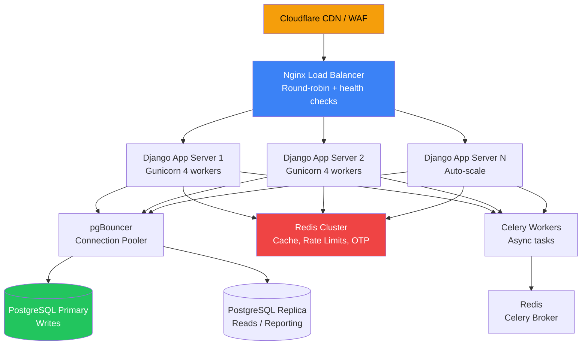
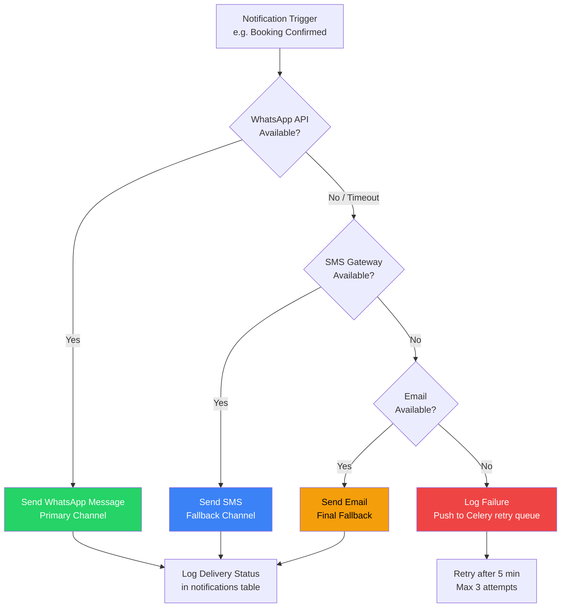
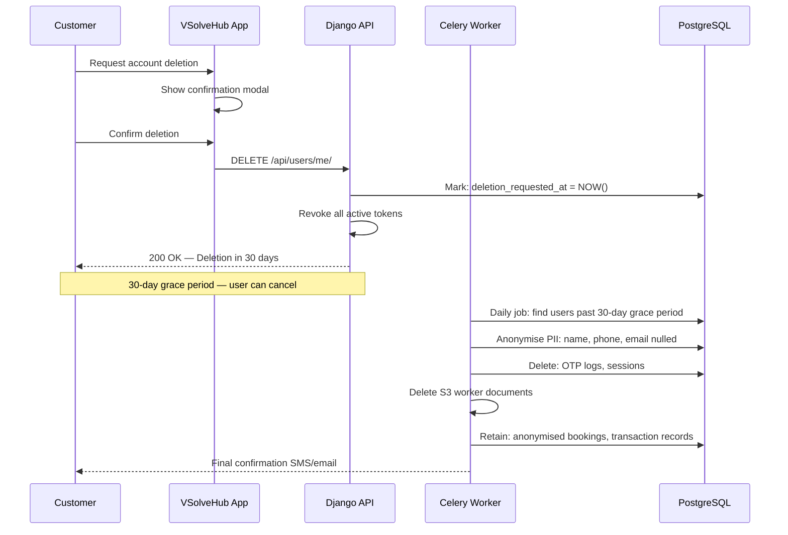
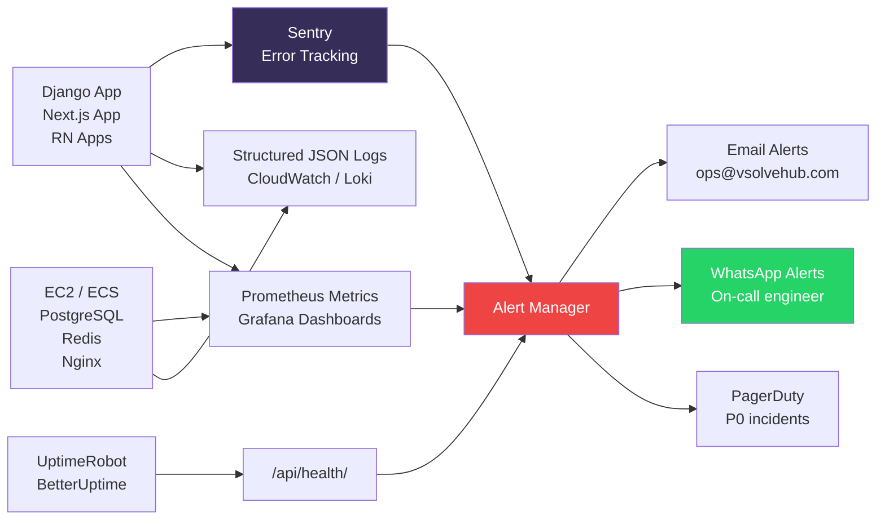

# Non-Functional Requirements (NFR)
**VSolveHub — VSolveHub**
**Version:** 1.0 | **Last Updated:** 2026-06-16 | **Status:** Draft

---

## Table of Contents

1. [Performance Requirements](#1-performance-requirements)
2. [Security Requirements](#2-security-requirements)
3. [Scalability & Reliability](#3-scalability--reliability)
4. [SEO Requirements](#4-seo-requirements)
5. [Accessibility (WCAG 2.1 AA)](#5-accessibility-wcag-21-aa)
6. [Browser & Device Compatibility](#6-browser--device-compatibility)
7. [Data Privacy & Compliance](#7-data-privacy--compliance)
8. [Monitoring & Observability](#8-monitoring--observability)
9. [NFR Summary Table](#9-nfr-summary-table)

---

> [!IMPORTANT]
> All NFRs below are **mandatory baselines**, not aspirational targets. Any feature deployment that violates a P0 NFR must be reverted. NFR violations are tracked as production incidents.

---

## 1. Performance Requirements

### 1.1 Core Web Vitals (Web App — Next.js 15)

Core Web Vitals are Google's ranking signals and directly impact organic discovery in Tier 2/3 markets where users operate on 4G/low-bandwidth connections. All targets are measured at **P75** (75th percentile real-user data via Chrome UX Report).

| Metric | Full Name | Target | Measurement Tool |
|---|---|---|---|
| **LCP** | Largest Contentful Paint | **< 2.5s** | Lighthouse, CrUX, PageSpeed Insights |
| **FID** | First Input Delay | **< 100ms** | CrUX field data |
| **INP** | Interaction to Next Paint | **< 200ms** | CrUX (replaces FID in 2024+) |
| **CLS** | Cumulative Layout Shift | **< 0.1** | Lighthouse, CrUX |
| **TTFB** | Time to First Byte | **< 600ms** | WebPageTest |
| **FCP** | First Contentful Paint | **< 1.8s** | Lighthouse |

**Implementation Guidance:**

```typescript
// next.config.ts — Enable all performance optimizations
const nextConfig = {
  images: {
    formats: ['image/webp', 'image/avif'],
    deviceSizes: [320, 420, 640, 768, 1024, 1280, 1440],
    imageSizes: [16, 32, 48, 64, 96, 128, 256],
    minimumCacheTTL: 86400, // 24h
    remotePatterns: [
      { protocol: 'https', hostname: 'cdn.vsolvehub.com' },
    ],
  },
  compress: true,
  productionBrowserSourceMaps: false,
  experimental: {
    ppr: true, // Partial Pre-rendering (Next.js 15)
  },
};
```

```tsx
// Prioritize LCP image (hero/above-the-fold images)
import Image from 'next/image';

// Above-the-fold: use priority to preload
<Image
  src="/hero-banner.webp"
  alt="Book trusted home services in your city"
  priority
  width={1200}
  height={630}
  sizes="(max-width: 768px) 100vw, 1200px"
  quality={85}
/>

// Non-critical images: lazy load (default behavior)
<Image
  src="/service-thumbnail.webp"
  alt="AC Repair service"
  loading="lazy"
  width={400}
  height={300}
  sizes="(max-width: 640px) 50vw, 400px"
/>
```

---

### 1.2 Rendering Strategy per Page Type

Choosing the correct rendering strategy eliminates unnecessary server load while maintaining freshness guarantees.

| Page Type | Rendering Strategy | Revalidation | Rationale |
|---|---|---|---|
| Home / Landing | **ISR** | `revalidate: 1800` (30 min) | High traffic, low change frequency |
| Category pages (e.g., `/services/construction`) | **ISR** | `revalidate: 3600` (1 hr) | SEO-critical; content changes rarely |
| Service detail (`/services/[slug]`) | **SSR** | Per-request | Price/availability may vary; needs freshness |
| Search results (`/search`) | **SSR** | Per-request | Query-dependent, highly dynamic |
| User profile (`/profile`) | **CSR** | On-demand | Auth-gated, personalized, no SEO value |
| Worker dashboard | **CSR** | On-demand | Real-time job data, auth-gated |
| Admin panel | **CSR** | On-demand | Auth-gated, internal tool |
| Blog / Help Center | **SSG** | `revalidate: 86400` (24 hr) | Static content, maximum cache efficiency |
| Booking confirmation | **SSR** | Per-request | Must show real-time booking status |

```typescript
// app/services/[category]/page.tsx — ISR for category pages
export const revalidate = 3600; // 1 hour

export async function generateStaticParams() {
  const categories = await getServiceCategories();
  return categories.map((cat) => ({ category: cat.slug }));
}

// app/services/[category]/[serviceSlug]/page.tsx — SSR for service detail
export const dynamic = 'force-dynamic';
export const revalidate = 0;

// Streaming for progressive hydration (Next.js 15 + React 19)
import { Suspense } from 'react';

export default function ServicePage() {
  return (
    <>
      <ServiceHero />              {/* Static shell, renders immediately */}
      <Suspense fallback={<PricingSkeleton />}>
        <ServicePricing />         {/* Async: fetches live pricing */}
      </Suspense>
      <Suspense fallback={<ReviewsSkeleton />}>
        <ServiceReviews />         {/* Async: fetches reviews */}
      </Suspense>
    </>
  );
}
```

---

### 1.3 Mobile App Performance (Flutter)

| Metric | Target | Notes |
|---|---|---|
| Cold start time | **< 2s** | Flutter compiles to native ARM; faster than interpreted RN |
| Warm start time | **< 800ms** | App resuming from background |
| Screen transition | **< 300ms** | Flutter Navigator 2.0 animation duration |
| List scroll FPS | **≥ 60 FPS** | `ListView.builder` with lazy rendering; 120 FPS on supported devices |
| Crash-free rate | **≥ 99.5%** | Measured via Firebase Crashlytics (`firebase_crashlytics` package) |
| API-dependent screen render | **< 1.5s** | Including skeleton loading state |

```dart
// Flutter — ListView.builder for worker/service lists
ListView.builder(
  itemCount: services.length,
  itemBuilder: (context, index) => ServiceCard(service: services[index]),
  // Flutter lazily builds only visible items by default — no manual tuning needed
)
```

---

### 1.4 API Performance Targets (Django REST Framework)

| Percentile | Target | Alert Threshold |
|---|---|---|
| P50 (median) | **< 150ms** | — |
| P95 | **< 500ms** | Page fires alert |
| P99 | **< 1000ms (1s)** | PagerDuty / on-call alert |
| P100 (max) | **< 3s** | Hard timeout; return 504 |

**Database connection pooling with pgBouncer:**

```python
# settings/production.py
DATABASES = {
    'default': {
        'ENGINE': 'django.db.backends.postgresql',
        'NAME': env('DB_NAME'),
        'USER': env('DB_USER'),
        'PASSWORD': env('DB_PASSWORD'),
        'HOST': env('DB_HOST'),           # Points to pgBouncer
        'PORT': env('DB_PORT', default='6432'),  # pgBouncer port
        'CONN_MAX_AGE': 0,                # Managed by pgBouncer
        'OPTIONS': {
            'connect_timeout': 5,
            'options': '-c statement_timeout=3000',  # 3s hard timeout per query
        },
    },
    'replica': {
        'ENGINE': 'django.db.backends.postgresql',
        'HOST': env('DB_REPLICA_HOST'),   # Read replica for reporting
    }
}

# Use select_related / prefetch_related to prevent N+1 queries
class BookingListView(generics.ListAPIView):
    def get_queryset(self):
        return (
            Booking.objects
            .select_related('customer', 'worker', 'service')
            .prefetch_related('service__category')
            .filter(customer=self.request.user)
            .order_by('-created_at')
        )
```

```sql
-- Always run EXPLAIN ANALYZE before deploying new queries
EXPLAIN (ANALYZE, BUFFERS, FORMAT JSON)
SELECT b.*, s.name, w.full_name
FROM bookings b
JOIN services s ON b.service_id = s.id
JOIN workers w ON b.worker_id = w.id
WHERE b.customer_id = 42
  AND b.status = 'ACTIVE'
ORDER BY b.created_at DESC
LIMIT 20;

-- Required indexes (must exist pre-launch)
CREATE INDEX CONCURRENTLY idx_bookings_customer_status
    ON bookings(customer_id, status) WHERE status != 'COMPLETED';

CREATE INDEX CONCURRENTLY idx_workers_status_online
    ON workers(status, is_online)
    WHERE status = 'ACTIVE';
```

---

### 1.5 CDN & Static Asset Delivery

| Asset Type | Delivery Method | Cache TTL | Notes |
|---|---|---|---|
| Images (WebP/AVIF) | Cloudflare / CloudFront | 1 year (`immutable`) | Content-hash in filename |
| JS/CSS bundles | Cloudflare / CloudFront | 1 year | Content-hash in filename |
| Fonts | Cloudflare / CloudFront | 1 year | Subset to Latin + Devanagari only |
| API responses | **Not CDN-cached** | N/A | Auth-sensitive |
| Service catalog JSON | Edge cache (Cloudflare Workers KV) | 1 hour | Public, high-read catalog |

---

### 1.6 Lighthouse Score Targets

Measured on both mobile (throttled 4G) and desktop. Tested in CI on every PR to `main`.

| Category | Target Score | Measurement Condition |
|---|---|---|
| **Performance** | **≥ 90** | Mobile, throttled 4G |
| **Accessibility** | **≥ 90** | Desktop + Mobile |
| **SEO** | **≥ 95** | Desktop + Mobile |
| **Best Practices** | **≥ 90** | Desktop + Mobile |
| **PWA** | **Installable** | Passes all PWA checks |

```yaml
# .github/workflows/lighthouse-ci.yml
name: Lighthouse CI
on: [pull_request]
jobs:
  lighthouse:
    runs-on: ubuntu-latest
    steps:
      - uses: actions/checkout@v4
      - name: Run Lighthouse CI
        uses: treosh/lighthouse-ci-action@v11
        with:
          urls: |
            https://staging.vsolvehub.com/
            https://staging.vsolvehub.com/services/construction
          budgetPath: ./lighthouse-budget.json
          uploadArtifacts: true
          temporaryPublicStorage: true
```

---

## 2. Security Requirements

> [!CAUTION]
> Security violations are P0 production incidents. No release may knowingly ship a security regression. All items in this section are non-negotiable.

### 2.1 Authentication & Token Management

| Mechanism | Configuration | Notes |
|---|---|---|
| Access Token (JWT) | **15-minute expiry** | Short-lived; signed with RS256 |
| Refresh Token | **30-day expiry**, HTTP-only cookie | Rotated on every use |
| Refresh Token Rotation | **Enabled** | Old token invalidated immediately on refresh |
| Token Storage (Web) | Access: memory only; Refresh: HTTP-only `Secure` cookie | Never `localStorage` for refresh token |
| Token Storage (Mobile) | Keychain (iOS) / Keystore (Android) | Platform secure enclave |
| Logout | Refresh token revoked server-side, added to Redis blocklist | Ensures immediate invalidation across all devices |

```python
# settings/production.py — SimpleJWT configuration
SIMPLE_JWT = {
    'ACCESS_TOKEN_LIFETIME': timedelta(minutes=15),
    'REFRESH_TOKEN_LIFETIME': timedelta(days=30),
    'ROTATE_REFRESH_TOKENS': True,          # Issue new refresh token on each use
    'BLACKLIST_AFTER_ROTATION': True,       # Invalidate old refresh token
    'ALGORITHM': 'RS256',                   # Asymmetric signing
    'SIGNING_KEY': env('JWT_PRIVATE_KEY'),
    'VERIFYING_KEY': env('JWT_PUBLIC_KEY'),
    'AUTH_HEADER_TYPES': ('Bearer',),
    'TOKEN_OBTAIN_THROTTLE_CLASSES': ['api.throttles.ObtainTokenThrottle'],
}
```

```typescript
// lib/auth/tokenManager.ts — In-memory access token (Web, never localStorage)
class TokenManager {
  private accessToken: string | null = null;

  setAccessToken(token: string) {
    this.accessToken = token;  // Memory only — cleared on page reload/tab close
  }

  getAccessToken(): string | null {
    return this.accessToken;
  }

  async refreshAccessToken(): Promise<string> {
    // Refresh token is in HTTP-only cookie — automatically sent by browser
    const res = await fetch('/api/auth/refresh/', {
      method: 'POST',
      credentials: 'include',  // Include cookies
    });
    if (!res.ok) throw new Error('Session expired');
    const data = await res.json();
    this.setAccessToken(data.access);
    return data.access;
  }
}
export const tokenManager = new TokenManager();
```

---

### 2.2 OTP Security

| Parameter | Value | Notes |
|---|---|---|
| OTP Length | **6 digits** | Numeric only; `secrets.randbelow` |
| OTP Expiry | **10 minutes** | Invalidated on use regardless of expiry |
| OTP Hashing | **bcrypt** (cost factor 12) | Never stored in plain text |
| Max Attempts | **3 per OTP session** | Counter stored in Redis |
| Lockout Duration | **60 seconds** after 3 failures | Redis TTL-based auto-expiry |
| OTP Reuse | **Not allowed** | Single-use; deleted from cache on success |
| OTP Rate Limit | **1 OTP per phone per 60 seconds** | Prevents SMS/WhatsApp cost abuse |
| Delivery Channel | WhatsApp → SMS fallback | See Section 3.5 for degradation flow |

```python
# services/otp_service.py
import bcrypt
import secrets
from django.core.cache import cache

class OTPService:
    OTP_EXPIRY_SECONDS = 600       # 10 minutes
    MAX_ATTEMPTS = 3
    LOCKOUT_SECONDS = 60
    RESEND_COOLDOWN_SECONDS = 60

    def generate_and_store(self, phone: str) -> str:
        cooldown_key = f"otp:cooldown:{phone}"
        if cache.get(cooldown_key):
            raise ThrottledError("Please wait 60 seconds before requesting a new OTP.")

        otp = str(secrets.randbelow(900000) + 100000)  # Cryptographically secure 6-digit OTP
        hashed = bcrypt.hashpw(otp.encode(), bcrypt.gensalt(rounds=12)).decode()

        cache.set(f"otp:hash:{phone}", hashed, timeout=self.OTP_EXPIRY_SECONDS)
        cache.set(f"otp:attempts:{phone}", 0, timeout=self.OTP_EXPIRY_SECONDS)
        cache.set(cooldown_key, True, timeout=self.RESEND_COOLDOWN_SECONDS)

        return otp  # Returned only to delivery service; NEVER logged

    def verify(self, phone: str, otp_input: str) -> bool:
        lockout_key = f"otp:lockout:{phone}"
        if cache.get(lockout_key):
            raise LockedOutError("Too many attempts. Try again in 60 seconds.")

        attempts = cache.get(f"otp:attempts:{phone}", 0)
        if attempts >= self.MAX_ATTEMPTS:
            cache.set(lockout_key, True, timeout=self.LOCKOUT_SECONDS)
            cache.delete(f"otp:hash:{phone}")
            raise LockedOutError("Too many attempts. OTP invalidated.")

        stored_hash = cache.get(f"otp:hash:{phone}")
        if not stored_hash:
            raise ExpiredOTPError("OTP has expired or was already used.")

        if bcrypt.checkpw(otp_input.encode(), stored_hash.encode()):
            cache.delete(f"otp:hash:{phone}")       # Single-use: delete on success
            cache.delete(f"otp:attempts:{phone}")
            return True
        else:
            cache.incr(f"otp:attempts:{phone}")
            return False
```

---

### 2.3 Transport Security

| Requirement | Configuration |
|---|---|
| Protocol | **TLS 1.2+ only** (TLS 1.0/1.1 disabled at Nginx) |
| HSTS | `Strict-Transport-Security: max-age=31536000; includeSubDomains; preload` |
| Certificate | Wildcard `*.vsolvehub.com`; auto-renewed via Let's Encrypt / ACM |
| HTTP redirect | **301 permanent redirect** to HTTPS at Nginx/Cloudflare level |
| Certificate Transparency | Monitored via crt.sh webhook alerts |

```nginx
# nginx/sites-available/vsolvehub.conf
server {
    listen 80;
    server_name vsolvehub.com www.vsolvehub.com;
    return 301 https://$host$request_uri;
}

server {
    listen 443 ssl http2;
    server_name vsolvehub.com www.vsolvehub.com;

    ssl_certificate     /etc/letsencrypt/live/vsolvehub.com/fullchain.pem;
    ssl_certificate_key /etc/letsencrypt/live/vsolvehub.com/privkey.pem;

    ssl_protocols TLSv1.2 TLSv1.3;
    ssl_ciphers ECDHE-ECDSA-AES128-GCM-SHA256:ECDHE-RSA-AES128-GCM-SHA256:ECDHE-ECDSA-AES256-GCM-SHA384:ECDHE-RSA-AES256-GCM-SHA384;
    ssl_prefer_server_ciphers off;
    ssl_session_cache shared:SSL:10m;
    ssl_session_timeout 1d;
    ssl_session_tickets off;

    # Security headers
    add_header Strict-Transport-Security "max-age=31536000; includeSubDomains; preload" always;
    add_header X-Content-Type-Options "nosniff" always;
    add_header X-Frame-Options "DENY" always;
    add_header Referrer-Policy "strict-origin-when-cross-origin" always;
    add_header Permissions-Policy "geolocation=(self), camera=(), microphone=()" always;
}
```

---

### 2.4 CORS Policy

```python
# settings/production.py
CORS_ALLOWED_ORIGINS = [
    "https://vsolvehub.com",
    "https://www.vsolvehub.com",
    "https://app.vsolvehub.com",
    "https://admin.vsolvehub.com",
]
CORS_ALLOWED_ORIGIN_REGEXES = []  # No wildcard patterns
CORS_ALLOW_ALL_ORIGINS = False     # MUST be False in production
CORS_ALLOW_CREDENTIALS = True      # Required for cookie-based refresh tokens
CORS_ALLOWED_METHODS = ['GET', 'POST', 'PUT', 'PATCH', 'DELETE', 'OPTIONS']
CORS_ALLOWED_HEADERS = ['content-type', 'authorization', 'x-csrftoken']
CORS_EXPOSE_HEADERS = ['x-request-id']
CORS_PREFLIGHT_MAX_AGE = 86400    # Cache preflight for 24 hours
```

---

### 2.5 Rate Limiting

| Endpoint Group | Limit | Window | Backend |
|---|---|---|---|
| Public endpoints (`/api/public/*`) | **60 req/min** | Per IP | Redis + `django-ratelimit` |
| Authenticated endpoints | **300 req/min** | Per user ID | Redis |
| OTP request (`/api/auth/otp/send/`) | **1 req/60s** per phone | Per phone number | Redis |
| OTP verify (`/api/auth/otp/verify/`) | **3 attempts** → 60s lockout | Per phone | Redis |
| Login (`/api/auth/token/`) | **5 req/min** | Per IP | Redis |
| File upload | **10 req/min** | Per user | Redis |
| Search | **30 req/min** | Per IP | Redis |
| Admin API | **600 req/min** | Per admin user | Redis |

```python
# api/throttles.py
from rest_framework.throttling import AnonRateThrottle, UserRateThrottle

class PublicAnonThrottle(AnonRateThrottle):
    rate = '60/min'

class AuthenticatedUserThrottle(UserRateThrottle):
    rate = '300/min'

class OTPSendThrottle(AnonRateThrottle):
    scope = 'otp_send'
    rate = '1/min'

class LoginThrottle(AnonRateThrottle):
    scope = 'login'
    rate = '5/min'
```

---

### 2.6 Input Validation

**Server-side (Django serializers):**

```python
# api/serializers/booking_serializer.py
class BookingCreateSerializer(serializers.Serializer):
    service_id = serializers.IntegerField(min_value=1)
    scheduled_date = serializers.DateField()
    scheduled_time = serializers.TimeField()
    address = serializers.CharField(max_length=500, strip=True)
    notes = serializers.CharField(max_length=1000, required=False, allow_blank=True)

    def validate_scheduled_date(self, value):
        if value < date.today():
            raise serializers.ValidationError("Scheduled date cannot be in the past.")
        if value > date.today() + timedelta(days=90):
            raise serializers.ValidationError("Cannot book more than 90 days in advance.")
        return value

    def validate(self, data):
        service = Service.objects.filter(id=data['service_id'], is_active=True).first()
        if not service:
            raise serializers.ValidationError({"service_id": "Service not found or inactive."})
        return data
```

**Client-side (Next.js — react-hook-form + zod):**

```typescript
// lib/validators/booking.schema.ts
import { z } from 'zod';

export const bookingSchema = z.object({
  serviceId: z.number().int().positive(),
  scheduledDate: z.string().refine((d) => {
    const date = new Date(d);
    const today = new Date();
    const maxDate = new Date();
    maxDate.setDate(maxDate.getDate() + 90);
    return date >= today && date <= maxDate;
  }, 'Please select a future date within 90 days'),
  scheduledTime: z.string().regex(/^\d{2}:\d{2}$/, 'Invalid time format'),
  address: z.string().min(10, 'Address too short').max(500).trim(),
  notes: z.string().max(1000).optional(),
});
```

---

### 2.7 SQL Injection Prevention

```python
# RULE: Always use Django ORM. Raw queries only with parameterization.

# CORRECT — ORM (parameterized automatically)
workers = Worker.objects.filter(
    city=city_name,
    status='ACTIVE',
    is_online=True,
)

# CORRECT — Raw SQL when ORM is insufficient: always use %s parameters
from django.db import connection
with connection.cursor() as cursor:
    cursor.execute(
        "SELECT id, full_name FROM workers WHERE city = %s AND is_online = %s",
        [city_name, True]
    )

# NEVER — f-string or % string formatting in queries (SQL injection)
# cursor.execute(f"SELECT * FROM workers WHERE city = '{city_name}'")  # FORBIDDEN
```

---

### 2.8 XSS Prevention

```python
# settings/production.py — Content Security Policy
CSP_DEFAULT_SRC = ("'self'",)
CSP_SCRIPT_SRC = ("'self'", "https://www.googletagmanager.com", "https://cdn.vsolvehub.com")
CSP_STYLE_SRC = ("'self'", "'unsafe-inline'", "https://fonts.googleapis.com")
CSP_IMG_SRC = ("'self'", "data:", "https:", "https://cdn.vsolvehub.com")
CSP_FONT_SRC = ("'self'", "https://fonts.gstatic.com")
CSP_CONNECT_SRC = ("'self'", "https://api.vsolvehub.com")
CSP_FRAME_ANCESTORS = ("'none'",)  # Prevent clickjacking
CSP_FORM_ACTION = ("'self'",)
CSP_REPORT_URI = "/api/csp-report/"
```

```tsx
// NEVER render raw HTML from user input without sanitization
// WRONG: <div dangerouslySetInnerHTML={{ __html: userBio }} />

// CORRECT — Sanitize if rich text is required
import DOMPurify from 'isomorphic-dompurify';
<div dangerouslySetInnerHTML={{
  __html: DOMPurify.sanitize(userBio, { ALLOWED_TAGS: ['b', 'i', 'p', 'br'] })
}} />

// BEST — Render as plain text whenever possible
<p>{userBio}</p>
```

---

### 2.9 File Upload Security

| Parameter | Policy |
|---|---|
| Allowed MIME types | `image/jpeg`, `image/png`, `application/pdf` only |
| Max file size | **5 MB** per file |
| Storage | **Private S3 / GCS bucket** — never public-read ACL |
| File access | Pre-signed URLs (time-limited, max 15 min) |
| Filename sanitization | UUIDs only; original filename discarded to prevent path traversal |
| Virus scanning | ClamAV async scan on upload |
| MIME detection | Via file content (`python-magic`), not file extension |

```python
# api/views/document_upload.py
import uuid
import magic  # python-magic: detect MIME from file content, not extension

ALLOWED_MIME_TYPES = {'image/jpeg', 'image/png', 'application/pdf'}
MAX_FILE_SIZE_BYTES = 5 * 1024 * 1024  # 5 MB

def validate_upload(file) -> None:
    if file.size > MAX_FILE_SIZE_BYTES:
        raise ValidationError("File size must not exceed 5 MB.")

    file.seek(0)
    mime = magic.from_buffer(file.read(2048), mime=True)
    file.seek(0)
    if mime not in ALLOWED_MIME_TYPES:
        raise ValidationError(f"File type '{mime}' is not allowed.")

def generate_safe_s3_key(user_id: int, doc_type: str, mime: str) -> str:
    ext_map = {'image/jpeg': 'jpg', 'image/png': 'png', 'application/pdf': 'pdf'}
    return f"worker-docs/{user_id}/{doc_type}/{uuid.uuid4()}.{ext_map[mime]}"
```

---

### 2.10 Sensitive Data Encryption at Rest

```python
# utils/encryption.py — AES-256-GCM for Aadhaar & bank account numbers
from cryptography.hazmat.primitives.ciphers.aead import AESGCM
import os, base64

class FieldEncryptor:
    """Encrypt/decrypt sensitive PII fields before DB storage."""

    def __init__(self, key_hex: str):
        self.key = bytes.fromhex(key_hex)  # 32-byte key from AWS KMS

    def encrypt(self, plaintext: str) -> str:
        nonce = os.urandom(12)             # 96-bit nonce for GCM
        aesgcm = AESGCM(self.key)
        ciphertext = aesgcm.encrypt(nonce, plaintext.encode(), None)
        return base64.b64encode(nonce + ciphertext).decode()

    def decrypt(self, encoded: str) -> str:
        data = base64.b64decode(encoded.encode())
        nonce, ciphertext = data[:12], data[12:]
        aesgcm = AESGCM(self.key)
        return aesgcm.decrypt(nonce, ciphertext, None).decode()


# models/worker_document.py — Field layout
class WorkerDocument(models.Model):
    worker = models.OneToOneField('Worker', on_delete=models.CASCADE)
    aadhaar_encrypted = models.TextField()       # AES-256-GCM encrypted
    aadhaar_last4 = models.CharField(max_length=4)  # For display: "XXXX XXXX 4321"
    bank_account_encrypted = models.TextField()  # AES-256-GCM encrypted
    bank_account_last4 = models.CharField(max_length=4)
    bank_ifsc = models.CharField(max_length=11)  # Non-sensitive
    selfie_s3_key = models.CharField(max_length=500)
    aadhaar_doc_s3_key = models.CharField(max_length=500)
    # NEVER STORE: raw Aadhaar, raw bank account, full card numbers in plain text
```

---

### 2.11 Admin Panel Security

| Requirement | Implementation |
|---|---|
| **2FA mandatory** | django-otp with TOTP (Google Authenticator / Authy) |
| Admin URL obfuscation | Custom URL path (not `/admin/`) set via env variable |
| IP allowlisting | Nginx restricts admin path to office IPs + VPN CIDR |
| Session timeout | 30-minute idle session expiry for all admin users |
| Audit log | All admin actions logged: user ID, IP, timestamp, action, object ID |
| Least privilege | Roles: Super Admin, Operations Manager, Finance (read-only) |

---

### 2.12 Pre-Launch Penetration Testing

| Test Type | Scope | Timeline |
|---|---|---|
| OWASP Top 10 | All public + authenticated API endpoints | 4 weeks before go-live |
| Authentication bypass | JWT, OTP, refresh token flows | 4 weeks before go-live |
| File upload attacks | Malicious file, path traversal, SSRF | 4 weeks before go-live |
| Business logic abuse | Booking manipulation, price override, worker spoofing | 4 weeks before go-live |
| Mobile app (Android APK) | Static + dynamic analysis | 4 weeks before go-live |
| Remediation deadline | All Critical/High findings must be fixed | 2 weeks before go-live |

---

## 3. Scalability & Reliability

### 3.1 Capacity Targets

| Phase | Concurrent Users | Peak RPS | Infrastructure |
|---|---|---|---|
| **Launch (Month 1–3)** | **1,000** | ~200 RPS | 2× Django app servers (4 vCPU, 8 GB RAM) |
| **Growth (Month 4–12)** | **5,000** | ~1,000 RPS | 4× Django + load balancer |
| **Scale (Year 2+)** | **10,000+** | ~2,000 RPS | Auto-scaling group (6–12× Django) + CDN offload |

---

### 3.2 Horizontal Scaling Architecture



**Key principle:** Django API servers are **fully stateless** — no server-side sessions, no local file storage. All state lives in PostgreSQL or Redis. This enables zero-downtime rolling deployments and horizontal scale-out.

---

### 3.3 Database Strategy

| Concern | Strategy |
|---|---|
| **Write throughput** | Single PostgreSQL primary; all writes routed here |
| **Read scaling** | Streaming replication to 1+ read replicas; reporting queries routed to replica |
| **Connection pooling** | pgBouncer in transaction mode; max 100 server-side connections |
| **Query optimization** | Mandatory EXPLAIN ANALYZE before PR merge for any new query on tables > 10k rows |
| **Migrations** | Zero-downtime (expand-contract pattern); no `ALTER TABLE` locks on tables > 1M rows |
| **Partitioning** | `bookings` table partitioned by `created_at` (monthly) once > 5M rows |
| **Vacuuming** | `autovacuum_vacuum_scale_factor = 0.01` for high-write tables |

---

### 3.4 Caching Strategy (Redis)

| Data | Cache Key Pattern | TTL | Invalidation |
|---|---|---|---|
| Service category list | `services:categories:all` | 1 hour | On admin category publish |
| Service detail | `services:detail:{slug}` | 30 min | On service update |
| Worker availability | `workers:available:{city}:{category}` | 2 min | On online/offline toggle |
| OTP hash | `otp:hash:{phone}` | 10 min | On use or expiry |
| OTP attempt count | `otp:attempts:{phone}` | 10 min | On use or expiry |
| Rate limit counter | `ratelimit:{ip}:{endpoint}` | 1 min sliding window | Auto-expire |
| User session data | `session:{user_id}` | 30 days | On logout |

---

### 3.5 Uptime SLA & Recovery Targets

| Metric | Target |
|---|---|
| **Monthly uptime SLA** | **99.5%** (~3.6 hours allowed downtime/month) |
| Planned maintenance window | Sundays 2:00–4:00 AM IST (announced 48h in advance) |
| RTO (Recovery Time Objective) | **< 30 minutes** for any unplanned outage |
| RPO (Recovery Point Objective) | **< 1 hour** (daily backups + WAL archiving every 5 min) |

---

### 3.6 Health Checks

```python
# api/views/health.py
from django.db import connection
from django.core.cache import cache
from rest_framework.decorators import api_view
from rest_framework.response import Response

@api_view(['GET'])
def health_check(request):
    """
    GET /api/health/
    Used by load balancer and external uptime monitors.
    Returns 200 only when ALL critical dependencies are healthy.
    """
    status = {'status': 'ok', 'checks': {}}

    # Database connectivity
    try:
        with connection.cursor() as cursor:
            cursor.execute("SELECT 1")
        status['checks']['database'] = 'ok'
    except Exception as e:
        status['checks']['database'] = f'error: {str(e)}'
        status['status'] = 'degraded'

    # Redis connectivity
    try:
        cache.set('health_check', 'ok', timeout=5)
        assert cache.get('health_check') == 'ok'
        status['checks']['cache'] = 'ok'
    except Exception as e:
        status['checks']['cache'] = f'error: {str(e)}'
        status['status'] = 'degraded'

    http_status = 200 if status['status'] == 'ok' else 503
    return Response(status, status=http_status)
```

---

### 3.7 Graceful Degradation — Notification Channels



---

### 3.8 Backup & Disaster Recovery

| Item | Policy | Retention |
|---|---|---|
| PostgreSQL full dump | Daily at 2:00 AM IST via `pg_dump` | **30 days** |
| PostgreSQL WAL archiving | Continuous (every 5 minutes) to S3 | 7 days |
| Redis snapshot (RDB) | Every 15 minutes | 3 days |
| S3 media files | Versioning enabled; cross-region replication | Indefinite |
| Application config / secrets | AWS Secrets Manager; IaC in Git | Git history |
| Restore drill | Quarterly test restore to staging environment | Documented per drill |

```bash
#!/bin/bash
# scripts/backup_postgres.sh — Daily backup script (run via cron)
set -euo pipefail

TIMESTAMP=$(date +%Y%m%d_%H%M%S)
BACKUP_FILE="vsolvehub_${TIMESTAMP}.sql.gz"
S3_PATH="s3://vsolvehub-backups/postgres/${BACKUP_FILE}"

pg_dump -h "$DB_HOST" -U "$DB_USER" -d "$DB_NAME" --no-password \
  | gzip \
  | aws s3 cp - "$S3_PATH" --sse aws:kms

# Verify backup is non-empty (sanity check)
SIZE=$(aws s3 ls "$S3_PATH" | awk '{print $3}')
if [ "$SIZE" -lt 1000 ]; then
  echo "ERROR: Backup suspiciously small ($SIZE bytes)" >&2
  exit 1
fi

echo "Backup OK: $S3_PATH ($SIZE bytes)"

# Purge backups older than 30 days
aws s3 ls s3://vsolvehub-backups/postgres/ | awk '{print $4}' | while read -r key; do
  BACKUP_DATE=$(echo "$key" | grep -oP '\d{8}')
  if [[ $(date -d "$BACKUP_DATE" +%s 2>/dev/null) -lt $(date -d "-30 days" +%s) ]]; then
    aws s3 rm "s3://vsolvehub-backups/postgres/$key"
    echo "Deleted old backup: $key"
  fi
done
```

---

## 4. SEO Requirements

### 4.1 Rendering & Indexability Matrix

| Page | Rendering | Indexed | SEO Priority |
|---|---|---|---|
| Home | ISR | Yes | Critical |
| Category page | ISR | Yes | Critical |
| Service detail | SSR | Yes | Critical |
| City+service landing | SSG | Yes | High (local SEO) |
| Blog / Help articles | SSG | Yes | Medium |
| Login / Register | CSR | No (`noindex`) | N/A |
| Profile / Bookings | CSR | No (`noindex`) | N/A |
| Admin panel | CSR | No (`noindex`) | N/A |

---

### 4.2 Metadata Standards

All public pages must have:
- `<title>`: unique, max **60 characters**, keyword-first
- `<meta name="description">`: unique, max **160 characters**, action-oriented with city/service name
- Canonical URL: matches the indexed URL (no trailing slash inconsistency)

```typescript
// app/services/[category]/page.tsx — Metadata API (Next.js 15)
export async function generateMetadata({ params }: Props): Promise<Metadata> {
  const category = await getCategory(params.category);

  return {
    title: `${category.name} Services in ${category.cityName} | VSolveHub`,
    description: `Book trusted ${category.name.toLowerCase()} professionals in ${category.cityName}. Verified workers, transparent pricing, instant booking. Starting ₹${category.startingPrice}.`,
    alternates: {
      canonical: `https://vsolvehub.com/services/${params.category}`,
    },
    openGraph: {
      title: `${category.name} Services | VSolveHub`,
      description: `Trusted ${category.name.toLowerCase()} services in your city.`,
      url: `https://vsolvehub.com/services/${params.category}`,
      siteName: 'VSolveHub',
      images: [{
        url: `https://cdn.vsolvehub.com/og/${params.category}.jpg`,
        width: 1200,
        height: 630,
        alt: `${category.name} services by VSolveHub`,
      }],
      locale: 'en_IN',
      type: 'website',
    },
    twitter: {
      card: 'summary_large_image',
      title: `${category.name} Services | VSolveHub`,
      description: `Book trusted ${category.name.toLowerCase()} professionals near you.`,
      images: [`https://cdn.vsolvehub.com/og/${params.category}.jpg`],
    },
    robots: {
      index: true,
      follow: true,
      googleBot: { index: true, follow: true, 'max-image-preview': 'large' },
    },
  };
}
```

---

### 4.3 Structured Data (JSON-LD)

Every service page must include a `<script type="application/ld+json">` with:

```typescript
// components/seo/ServiceStructuredData.tsx
export function ServiceStructuredData({ service, category, city }: Props) {
  const schema = {
    "@context": "https://schema.org",
    "@graph": [
      {
        "@type": "Service",
        "@id": `https://vsolvehub.com/services/${service.slug}#service`,
        "name": service.name,
        "description": service.description,
        "provider": {
          "@type": "LocalBusiness",
          "name": "VSolveHub",
          "url": "https://vsolvehub.com",
          "areaServed": { "@type": "City", "name": city.name },
          "priceRange": `₹${service.minPrice}–₹${service.maxPrice}`,
        },
        "serviceType": category.name,
        "offers": {
          "@type": "Offer",
          "price": service.basePrice,
          "priceCurrency": "INR",
          "availability": "https://schema.org/InStock",
        },
      },
      {
        "@type": "BreadcrumbList",
        "itemListElement": [
          { "@type": "ListItem", "position": 1, "name": "Home", "item": "https://vsolvehub.com" },
          { "@type": "ListItem", "position": 2, "name": category.name, "item": `https://vsolvehub.com/services/${category.slug}` },
          { "@type": "ListItem", "position": 3, "name": service.name, "item": `https://vsolvehub.com/services/${service.slug}` },
        ],
      },
      {
        "@type": "FAQPage",
        "mainEntity": service.faqs.map((faq) => ({
          "@type": "Question",
          "name": faq.question,
          "acceptedAnswer": { "@type": "Answer", "text": faq.answer },
        })),
      },
    ],
  };

  return (
    <script
      type="application/ld+json"
      dangerouslySetInnerHTML={{ __html: JSON.stringify(schema) }}
    />
  );
}
```

---

### 4.4 Sitemap & robots.txt

```typescript
// app/sitemap.ts — Auto-generated sitemap (submitted to Google Search Console)
import { MetadataRoute } from 'next';

export default async function sitemap(): Promise<MetadataRoute.Sitemap> {
  const [categories, services, cities] = await Promise.all([
    getServiceCategories(),
    getAllServices(),
    getAllServicedCities(),
  ]);

  const staticPages = [
    { url: 'https://vsolvehub.com', lastModified: new Date(), changeFrequency: 'daily' as const, priority: 1.0 },
    { url: 'https://vsolvehub.com/about', lastModified: new Date(), changeFrequency: 'monthly' as const, priority: 0.5 },
    { url: 'https://vsolvehub.com/contact', lastModified: new Date(), changeFrequency: 'monthly' as const, priority: 0.5 },
  ];

  const categoryPages = categories.map((cat) => ({
    url: `https://vsolvehub.com/services/${cat.slug}`,
    lastModified: cat.updatedAt,
    changeFrequency: 'weekly' as const,
    priority: 0.9,
  }));

  // City+service landing pages (critical for local SEO in Tier 2/3 cities)
  const cityServicePages = cities.flatMap((city) =>
    categories.map((cat) => ({
      url: `https://vsolvehub.com/${city.slug}/${cat.slug}`,
      lastModified: new Date(),
      changeFrequency: 'weekly' as const,
      priority: 0.85,
    }))
  );

  return [...staticPages, ...categoryPages, ...cityServicePages];
}
```

```typescript
// app/robots.ts
import { MetadataRoute } from 'next';

export default function robots(): MetadataRoute.Robots {
  return {
    rules: [{
      userAgent: '*',
      allow: '/',
      disallow: ['/admin/', '/api/', '/profile/', '/bookings/', '/worker/', '/login', '/register', '/_next/'],
    }],
    sitemap: 'https://vsolvehub.com/sitemap.xml',
    host: 'https://vsolvehub.com',
  };
}
```

---

## 5. Accessibility (WCAG 2.1 AA)

> [!NOTE]
> Accessibility improves usability for all users — especially on small screens in bright sunlight, which is the default Tier 2/3 usage context. It also prevents legal exposure as accessibility legislation matures in India.

### 5.1 Standards & Testing

| Criterion | Requirement |
|---|---|
| Conformance level | **WCAG 2.1 Level AA** |
| Automated testing | axe-core in CI (zero critical violations gate PR merges) |
| Manual testing | NVDA + Chrome, VoiceOver + Safari before each major release |
| Mobile testing | TalkBack (Android), VoiceOver (iOS) |

---

### 5.2 Color & Contrast

| Text Type | Minimum Contrast Ratio | Against |
|---|---|---|
| Normal text (< 18pt) | **4.5:1** | Background |
| Large text (≥ 18pt or ≥ 14pt bold) | **3:1** | Background |
| UI components (buttons, inputs, focus rings) | **3:1** | Adjacent colors |

```css
/* Design system tokens — all WCAG AA verified */
:root {
  --color-primary:          #1a56db;  /* 5.2:1 on white */
  --color-primary-dark:     #1e429f;  /* 7.1:1 on white */
  --color-text-primary:     #111827;  /* 17.2:1 on white */
  --color-text-secondary:   #374151;  /* 9.7:1 on white */
  --color-error:            #dc2626;  /* 4.8:1 on white */
  --color-success:          #15803d;  /* 5.5:1 on white */
  /* Avoid: #9ca3af on white = 2.9:1 (FAIL for normal text) */
}
```

---

### 5.3 Keyboard Navigation

| Element | Required Keyboard Behavior |
|---|---|
| Buttons | Focusable; activated with `Enter` or `Space` |
| Links | Focusable; activated with `Enter` |
| Modals / Dialogs | Focus trapped inside; `Esc` closes; focus returns to trigger element |
| Dropdowns | `Arrow` keys navigate; `Enter` selects; `Esc` closes |
| Date pickers | Fully keyboard-navigable calendar |
| Tab order | Logical visual order; no unexpected focus jumps |
| Skip link | `<a href="#main-content">Skip to main content</a>` at every page top |

```tsx
// components/ui/Modal.tsx — Focus trap (accessibility requirement)
import FocusTrap from 'focus-trap-react';

export function Modal({ isOpen, onClose, title, children }: ModalProps) {
  return isOpen ? (
    <FocusTrap focusTrapOptions={{ escapeDeactivates: true, onDeactivate: onClose }}>
      <div role="dialog" aria-modal="true" aria-labelledby="modal-title">
        <h2 id="modal-title">{title}</h2>
        <button onClick={onClose} aria-label="Close dialog">✕</button>
        {children}
      </div>
    </FocusTrap>
  ) : null;
}
```

```css
/* Visible focus ring — must NOT be suppressed */
:focus-visible {
  outline: 3px solid #1a56db;
  outline-offset: 2px;
  border-radius: 2px;
}
/* ❌ Never: :focus { outline: none; } without :focus-visible replacement */
```

---

### 5.4 Screen Reader Support

```tsx
// Icon-only buttons MUST have aria-label
<button aria-label="Add to favourites">
  <HeartIcon aria-hidden="true" />
</button>

// Loading state announced to screen readers
<div aria-live="polite" aria-atomic="true">
  {isLoading && <span className="sr-only">Loading services, please wait...</span>}
</div>

// Form field with error — linked via aria-describedby
<div>
  <label htmlFor="phone">Mobile Number</label>
  <input
    id="phone"
    type="tel"
    aria-required="true"
    aria-invalid={!!phoneError}
    aria-describedby={phoneError ? 'phone-error' : undefined}
  />
  {phoneError && (
    <span id="phone-error" role="alert" className="error-text">
      {phoneError}
    </span>
  )}
</div>

// Search results count announced
<section aria-label="Search results" aria-live="polite">
  {results.length > 0 && (
    <p className="sr-only">{results.length} services found for "{query}"</p>
  )}
</section>
```

---

### 5.5 Touch Targets (Mobile)

Minimum **48×48px** touch target for all interactive elements (WCAG 2.5.5 + Google Material Design).

```css
.btn, .link, .icon-btn, input[type="checkbox"], input[type="radio"] {
  min-width: 48px;
  min-height: 48px;
}

/* Small visual element: expand touch area with padding */
.icon-btn--small {
  width: 24px;   /* Visual */
  height: 24px;
  padding: 12px; /* Touch area = 48px */
}
```

---

### 5.6 Semantic HTML & Language

```html
<!DOCTYPE html>
<html lang="en" dir="ltr">
<head>
  <meta charset="UTF-8" />
  <meta name="viewport" content="width=device-width, initial-scale=1.0" />
</head>
<body>
  <a href="#main-content" class="skip-link">Skip to main content</a>
  <header role="banner">
    <nav aria-label="Main navigation">...</nav>
  </header>
  <main id="main-content" role="main">
    <h1>One H1 per page only</h1>
    <!-- Heading hierarchy: h1 → h2 → h3; no skipping levels -->
  </main>
  <footer role="contentinfo">...</footer>
</body>
</html>
```

```tsx
// Images: meaningful vs decorative
<Image src="/plumber-at-work.jpg" alt="Licensed plumber fixing a kitchen sink" />
<Image src="/decorative-divider.svg" alt="" aria-hidden="true" />

// Every input must have a visible, associated label
<label htmlFor="city-select">Select your city</label>
<select id="city-select" name="city">...</select>
```

---

## 6. Browser & Device Compatibility

### 6.1 Web Browser Support Matrix

| Browser | Versions Supported | India Market Share (est.) |
|---|---|---|
| **Chrome** | Latest 2 (stable + 1 prev) | ~60% |
| **Samsung Internet** | Latest 2 | ~15% |
| **Firefox** | Latest 2 | ~5% |
| **Safari** | Latest 2 (iOS + macOS) | ~8% |
| **Edge** | Latest 2 | ~5% |
| **UC Browser / Opera Mini** | Best-effort (degraded OK) | ~7% |

> [!WARNING]
> UC Browser and Opera Mini use proxy-based rendering with significant JavaScript limitations. These represent a meaningful share of Tier 2/3 traffic. Critical flows (booking, OTP entry) must be tested. Graceful degradation is acceptable; complete failure is not.

---

### 6.2 Mobile OS Support

| Platform | Minimum Version | Coverage |
|---|---|---|
| **Android (Flutter app)** | **Android 6.0 (API 23)** | ~98% of Indian Android users |
| **iOS (Flutter app)** | **iOS 12+** | ~99% of Indian iPhone users |
| **Android (Web)** | Android 9+ (Chrome 80+) | — |
| **iOS (Web)** | iOS 14+ (Safari 14+) | — |

---

### 6.3 Responsive Breakpoints

| Name | Range | Layout |
|---|---|---|
| `xs` (Mobile S) | 320px – 479px | Single column, full-width cards |
| `sm` (Mobile L) | 480px – 639px | Single column, larger touch targets |
| `md` (Tablet) | 640px – 1023px | 2-column grid |
| `lg` (Desktop S) | 1024px – 1279px | 3-column grid with sidebar |
| `xl` (Desktop L) | 1280px – 1439px | 4-column grid |
| `2xl` (Wide) | ≥ 1440px | Max-width container, centered |

---

### 6.4 Progressive Web App (PWA)

| Requirement | Implementation |
|---|---|
| Web App Manifest | `/public/manifest.json` with icons (192px, 512px), theme color, start URL |
| Service Worker | Offline fallback page; shell caching; stale-while-revalidate for catalog API |
| Offline experience | "You're offline" page shown; pending bookings queued for retry |
| Install prompt | "Add to Home Screen" nudge shown after user's 2nd visit |
| HTTPS | Required (covered in Section 2.3) |

```json
// public/manifest.json
{
  "name": "VSolveHub — Home Services",
  "short_name": "VSolveHub",
  "description": "Book trusted local services instantly",
  "start_url": "/",
  "display": "standalone",
  "background_color": "#ffffff",
  "theme_color": "#1a56db",
  "orientation": "portrait",
  "icons": [
    { "src": "/icons/icon-192.png", "sizes": "192x192", "type": "image/png", "purpose": "maskable any" },
    { "src": "/icons/icon-512.png", "sizes": "512x512", "type": "image/png", "purpose": "maskable any" }
  ],
  "categories": ["business", "utilities"],
  "lang": "en-IN"
}
```

---

## 7. Data Privacy & Compliance

### 7.1 India's DPDP Act 2023 (Digital Personal Data Protection)

VSolveHub complies with India's **DPDP Act 2023** (Digital Personal Data Protection). Key obligations:

| Obligation | VSolveHub Implementation |
|---|---|
| **Lawful purpose** | Data collected only for service delivery, worker verification, and payment processing |
| **Data minimisation** | No unnecessary fields on registration; only collect what is needed |
| **Explicit consent** | Consent checkbox on registration (unchecked by default); separate opt-in for marketing |
| **Right to access** | Users can view all their data via Profile → My Data |
| **Right to correction** | Users can edit profile data at any time |
| **Right to erasure** | Account deletion processed within 30 days |
| **Data fiduciary** | VSolveHub is the data fiduciary; workers/customers are data principals |
| **Grievance officer** | Named officer with contact details published in Privacy Policy |
| **Data breach** | Notify DPDP Board within 72 hours of discovery; notify affected users within 7 days |

---

### 7.2 Consent Management

```tsx
// components/auth/RegisterForm.tsx — Consent UX pattern
<fieldset>
  <legend className="sr-only">Terms and consent</legend>

  {/* Required — cannot proceed without */}
  <label className="consent-label">
    <input
      type="checkbox"
      {...register('agreeToTerms', { required: 'You must accept the Terms of Service to continue' })}
      aria-required="true"
    />
    I agree to the <Link href="/terms">Terms of Service</Link> and{' '}
    <Link href="/privacy">Privacy Policy</Link>
    <span aria-hidden="true"> *</span>
  </label>

  {/* Optional — pre-unchecked, affirmative opt-in required */}
  <label className="consent-label">
    <input
      type="checkbox"
      defaultChecked={false}
      {...register('marketingConsent')}
    />
    Send me promotional offers via WhatsApp/SMS (optional)
  </label>
</fieldset>
```

---

### 7.3 Data Retention Policy

| Data Category | Retention Period | Deletion Method |
|---|---|---|
| Booking records | **3 years** | Soft delete; hard purge after 3 years |
| OTP logs (phone + timestamp only) | **90 days** | Auto-purge via Celery periodic task |
| Deleted user PII (name, phone, email) | **30 days** | Hard purge via Celery after grace period |
| Payment transaction records | **7 years** (GST compliance) | Anonymised after 3 years; raw retained for audit |
| Worker document images (S3) | **3 years post last booking** | Deleted from S3 via lifecycle policy |
| Server access logs (IP, User-Agent) | **90 days** | Log rotation |
| Error logs (Sentry) | **90 days** | Sentry retention policy |

---

### 7.4 Right to Erasure (Account Deletion Flow)



---

### 7.5 Aadhaar Data Handling

> [!CAUTION]
> Aadhaar numbers are regulated under UIDAI guidelines. VSolveHub stores only the **last 4 digits** for display and the **AES-256-GCM encrypted full number** for KYC only. Raw Aadhaar numbers must never appear in logs, error messages, API responses, or analytics dashboards.

```python
# models/worker_document.py
class WorkerDocument(models.Model):
    worker = models.OneToOneField('Worker', on_delete=models.CASCADE)

    # Storage design:
    aadhaar_encrypted = models.TextField()          # AES-256-GCM; key from AWS KMS
    aadhaar_last4 = models.CharField(max_length=4)  # Display only: "XXXX XXXX 4321"
    aadhaar_verified = models.BooleanField(default=False)

    bank_account_encrypted = models.TextField()     # AES-256-GCM
    bank_account_last4 = models.CharField(max_length=4)
    bank_ifsc = models.CharField(max_length=11)     # Non-sensitive

    selfie_s3_key = models.CharField(max_length=500)
    aadhaar_doc_s3_key = models.CharField(max_length=500)

# Serializer — NEVER expose encrypted fields in API output
class WorkerDocStatusSerializer(serializers.ModelSerializer):
    aadhaar_display = serializers.SerializerMethodField()

    def get_aadhaar_display(self, obj):
        return f"XXXX XXXX {obj.aadhaar_last4}"  # Masked

    class Meta:
        model = WorkerDocument
        fields = ['aadhaar_display', 'aadhaar_verified', 'bank_account_last4']
        # Excluded: aadhaar_encrypted, bank_account_encrypted, s3_keys
```

---

## 8. Monitoring & Observability

### 8.1 Observability Architecture



---

### 8.2 Error Tracking (Sentry)

```python
# settings/production.py
import sentry_sdk
from sentry_sdk.integrations.django import DjangoIntegration
from sentry_sdk.integrations.celery import CeleryIntegration
from sentry_sdk.integrations.redis import RedisIntegration

sentry_sdk.init(
    dsn=env('SENTRY_DSN'),
    integrations=[
        DjangoIntegration(transaction_style='url', middleware_spans=True),
        CeleryIntegration(monitor_beat_tasks=True),
        RedisIntegration(),
    ],
    environment=env('ENVIRONMENT'),
    release=env('APP_VERSION'),
    traces_sample_rate=0.1,       # 10% of requests traced
    profiles_sample_rate=0.05,    # 5% profiled
    send_default_pii=False,       # DPDP compliance: no PII in Sentry
    before_send=scrub_sensitive_data,  # Strip phone numbers, Aadhaar from events
)
```

```typescript
// lib/sentry.ts — Next.js client-side Sentry
import * as Sentry from '@sentry/nextjs';

Sentry.init({
  dsn: process.env.NEXT_PUBLIC_SENTRY_DSN,
  environment: process.env.NEXT_PUBLIC_ENV,
  tracesSampleRate: 0.1,
  replaysSessionSampleRate: 0.05,  // 5% session replay
  replaysOnErrorSampleRate: 1.0,   // 100% replay on errors
  integrations: [
    Sentry.replayIntegration({ maskAllText: true, blockAllMedia: false }),
  ],
});
```

---

### 8.3 Structured Logging (JSON)

All production log lines must be **machine-parseable JSON**. No plain-text log lines.

```python
# settings/production.py — JSON logging configuration
LOGGING = {
    'version': 1,
    'disable_existing_loggers': False,
    'formatters': {
        'json': {
            '()': 'pythonjsonlogger.jsonlogger.JsonFormatter',
            'format': '%(asctime)s %(levelname)s %(name)s %(message)s',
            'rename_fields': {
                'asctime': 'timestamp',
                'levelname': 'level',
                'name': 'logger',
            },
        },
    },
    'handlers': {
        'console': { 'class': 'logging.StreamHandler', 'formatter': 'json' },
    },
    'root': { 'handlers': ['console'], 'level': 'INFO' },
    'loggers': {
        'django': { 'level': 'WARNING' },
        'django.request': { 'level': 'ERROR' },
        'api': { 'level': 'INFO', 'propagate': True },
    },
}
```

**Required fields in every log line:**

```json
{
  "timestamp": "2026-06-16T12:34:56.789Z",
  "level": "INFO",
  "logger": "api.bookings",
  "message": "Booking created successfully",
  "request_id": "req_7f3a8b2c",
  "user_id": 1042,
  "booking_id": 5521,
  "duration_ms": 142,
  "environment": "production"
}
```

> [!CAUTION]
> PII fields (phone number, email, Aadhaar, full name) must **never** appear in log lines. Implement a log scrubber middleware that replaces sensitive patterns with `[REDACTED]` before emission.

---

### 8.4 Infrastructure Metrics (Prometheus + Grafana)

| Metric | Warning Threshold | Critical Threshold |
|---|---|---|
| CPU usage | > 80% for 5 min | > 95% for 2 min |
| Memory usage | > 85% for 5 min | > 95% for 2 min |
| Disk usage | > 80% | > 90% |
| PostgreSQL pool saturation | > 80% | > 95% |
| API error rate (5xx) | > 0.5% for 10 min | > 1% for 5 min |
| API P95 response time | > 800ms | > 1500ms |
| Redis memory usage | > 80% | > 95% |
| Celery queue depth | > 500 tasks | > 2000 tasks |

---

### 8.5 Uptime Monitoring

| Monitor | Tool | Interval | Alert |
|---|---|---|---|
| External HTTP check | UptimeRobot / BetterUptime | Every 1 minute | Email + WhatsApp |
| `/api/health/` endpoint | UptimeRobot | Every 1 minute | Alert if non-200 received |
| SSL cert expiry | UptimeRobot | Weekly | Alert if < 14 days remaining |
| Database availability | Internal Prometheus | Every 30 seconds | PagerDuty on failure |

---

### 8.6 Alert Policy & Response SLAs

| Condition | Severity | Channels | Response SLA |
|---|---|---|---|
| Uptime check fails | **P0 — Critical** | PagerDuty + WhatsApp + Email | 15 minutes |
| Error rate > 1% for 5 min | **P0 — Critical** | PagerDuty + WhatsApp | 15 minutes |
| Error rate 0.5%–1% for 10 min | **P1 — High** | WhatsApp + Email | 1 hour |
| API P95 > 1.5s for 5 min | **P1 — High** | WhatsApp + Email | 1 hour |
| CPU > 95% for 2 min | **P1 — High** | WhatsApp + Email | 1 hour |
| Disk > 80% | **P2 — Medium** | Email | Next business day |
| Celery queue > 2000 tasks | **P2 — Medium** | Email | Next business day |
| SSL expiry < 14 days | **P2 — Medium** | Email | 48 hours |

---

### 8.7 Django Management Command — System Health Check

```python
# management/commands/check_system_health.py
from django.core.management.base import BaseCommand
from django.db import connection
from django.core.cache import cache
import requests

class Command(BaseCommand):
    help = 'Run system health checks — use in cron or CI pipeline'

    def handle(self, *args, **options):
        errors = []

        # 1. Database
        try:
            with connection.cursor() as c:
                c.execute("SELECT COUNT(*) FROM django_migrations")
            self.stdout.write('  Database ......... OK')
        except Exception as e:
            errors.append(f'Database FAILED: {e}')

        # 2. Redis
        try:
            cache.set('health_test', '1', timeout=5)
            assert cache.get('health_test') == '1'
            self.stdout.write('  Redis ............ OK')
        except Exception as e:
            errors.append(f'Redis FAILED: {e}')

        # 3. WhatsApp API (WATI)
        try:
            res = requests.get(
                'https://app.wati.io/api/v1/template/list',
                timeout=5,
                headers={'Authorization': f'Bearer {settings.WATI_API_KEY}'}
            )
            if res.status_code == 200:
                self.stdout.write('  WhatsApp API ..... OK')
            else:
                errors.append(f'WhatsApp API returned {res.status_code}')
        except Exception as e:
            errors.append(f'WhatsApp API FAILED: {e}')

        # 4. Celery workers
        try:
            from celery import current_app
            stats = current_app.control.inspect(timeout=3).stats()
            if stats:
                self.stdout.write(f'  Celery ........... OK ({len(stats)} workers)')
            else:
                errors.append('Celery: No workers responding')
        except Exception as e:
            errors.append(f'Celery FAILED: {e}')

        if errors:
            self.stderr.write('\nHealth check FAILED:')
            for err in errors:
                self.stderr.write(f'  - {err}')
            raise SystemExit(1)

        self.stdout.write(self.style.SUCCESS('\nAll systems healthy'))
```

```bash
# Cron: run health check every 5 minutes; alert via external monitor on exit code 1
*/5 * * * * /app/venv/bin/python manage.py check_system_health >> /var/log/vsolvehub/health.log 2>&1
```

---

## 9. NFR Summary Table

| # | Category | Requirement | Measurable Target | Priority |
|---|---|---|---|---|
| 1.1 | Performance | LCP | **< 2.5s** (P75, mobile) | P0 |
| 1.2 | Performance | INP (replaces FID) | **< 200ms** (P75) | P0 |
| 1.3 | Performance | CLS | **< 0.1** (P75) | P0 |
| 1.4 | Performance | TTFB | **< 600ms** | P1 |
| 1.5 | Performance | API P95 response time | **< 500ms** | P0 |
| 1.6 | Performance | API P99 response time | **< 1,000ms** | P0 |
| 1.7 | Performance | Mobile app cold start | **< 3s** | P0 |
| 1.8 | Performance | Screen transition (mobile) | **< 300ms** | P1 |
| 1.9 | Performance | Lighthouse Performance | **≥ 90** (mobile, 4G) | P1 |
| 1.10 | Performance | Lighthouse SEO | **≥ 95** | P1 |
| 1.11 | Performance | Lighthouse Accessibility | **≥ 90** | P1 |
| 1.12 | Performance | Crash-free rate (mobile) | **≥ 99.5%** | P0 |
| 2.1 | Security | JWT access token lifetime | **15 minutes** | P0 |
| 2.2 | Security | JWT refresh token lifetime | **30 days** with rotation | P0 |
| 2.3 | Security | OTP expiry | **10 minutes**, single-use | P0 |
| 2.4 | Security | OTP max attempts | **3**, then 60s lockout | P0 |
| 2.5 | Security | TLS version | **TLS 1.2+ only** | P0 |
| 2.6 | Security | HSTS | **max-age=31536000; preload** | P0 |
| 2.7 | Security | Public rate limit | **60 req/min/IP** | P0 |
| 2.8 | Security | Authenticated rate limit | **300 req/min/user** | P0 |
| 2.9 | Security | File upload size limit | **≤ 5 MB** | P0 |
| 2.10 | Security | Sensitive data encryption | **AES-256-GCM** at rest | P0 |
| 2.11 | Security | Admin 2FA | **Required (TOTP)** | P0 |
| 2.12 | Security | Penetration test | **Before go-live; all Critical/High fixed** | P0 |
| 3.1 | Scalability | Launch concurrent users | **1,000** | P0 |
| 3.2 | Scalability | Scale concurrent users | **10,000+** | P1 |
| 3.3 | Reliability | Monthly uptime SLA | **99.5%** | P0 |
| 3.4 | Reliability | RTO | **< 30 minutes** | P0 |
| 3.5 | Reliability | RPO | **< 1 hour** | P0 |
| 3.6 | Reliability | DB backup retention | **30 days** | P0 |
| 3.7 | Reliability | OTP log retention | **90 days** | P1 |
| 3.8 | Reliability | Health endpoint | `GET /api/health/` returns 200 | P0 |
| 4.1 | SEO | Sitemap | **Auto-generated; GSC submitted** | P1 |
| 4.2 | SEO | Structured data (JSON-LD) | **On all public pages** | P1 |
| 4.3 | SEO | Canonical URLs | **Set on all pages** | P1 |
| 4.4 | SEO | Open Graph + Twitter Card | **All public pages** | P1 |
| 4.5 | SEO | Page metadata | **Unique title (≤60 chars), description (≤160 chars)** | P1 |
| 5.1 | Accessibility | WCAG conformance | **2.1 Level AA** | P1 |
| 5.2 | Accessibility | Color contrast (normal text) | **≥ 4.5:1** | P1 |
| 5.3 | Accessibility | Color contrast (large text/UI) | **≥ 3:1** | P1 |
| 5.4 | Accessibility | Touch target size | **≥ 48×48px** | P1 |
| 5.5 | Accessibility | Keyboard navigation | **All interactive elements** | P1 |
| 5.6 | Accessibility | Screen reader support | **NVDA + VoiceOver tested pre-release** | P1 |
| 6.1 | Compatibility | Browser support | **Chrome, Firefox, Safari, Edge — latest 2** | P0 |
| 6.2 | Compatibility | Android minimum (app) | **Android 9 (API 28)** | P0 |
| 6.3 | Compatibility | iOS minimum (app) | **iOS 14+** | P0 |
| 6.4 | Compatibility | Responsive range | **320px – 1440px** | P0 |
| 6.5 | Compatibility | PWA | **Installable; offline fallback page** | P1 |
| 7.1 | Privacy | Compliance framework | **DPDP Act 2023** | P0 |
| 7.2 | Privacy | Booking data retention | **3 years** | P0 |
| 7.3 | Privacy | Deleted user PII | **Hard-purged within 30 days** | P0 |
| 7.4 | Privacy | Right to erasure | **Processed within 30 days** | P0 |
| 7.5 | Privacy | Aadhaar storage | **Encrypted (AES-256-GCM); last-4 only displayed** | P0 |
| 8.1 | Observability | Error tracking | **Sentry on production + staging** | P0 |
| 8.2 | Observability | Uptime monitoring | **External monitor; 1-min checks** | P0 |
| 8.3 | Observability | Alert on error rate | **> 1% triggers PagerDuty + WhatsApp** | P0 |
| 8.4 | Observability | Log format | **Structured JSON; no PII in logs** | P1 |
| 8.5 | Observability | Metrics dashboard | **Prometheus + Grafana** | P1 |

---

> **Total NFRs:** 55 measurable targets across 8 categories
>
> **P0 (Non-negotiable, launch blockers):** 36 requirements
>
> **P1 (Required before public launch, with defined timelines):** 19 requirements

---

*Document maintained by: Product & Engineering Team, VSolveHub*
*Review cycle: Quarterly or on major architecture changes*
*Next review: 2026-09-16*
*Owner: CTO / Head of Engineering*
