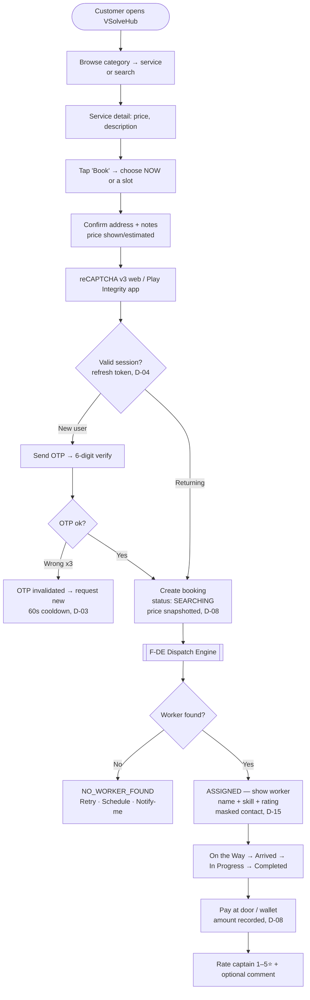
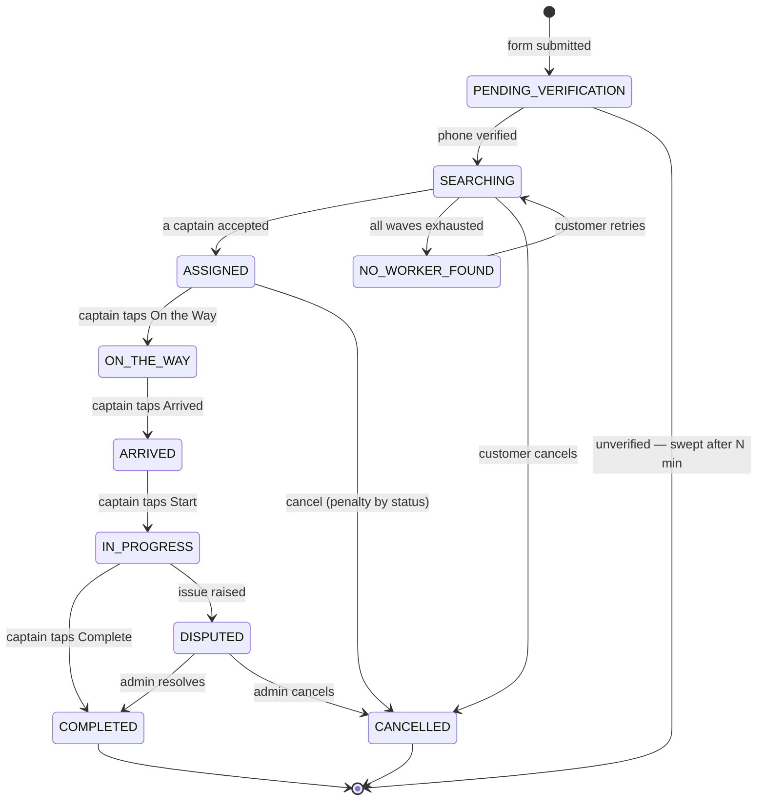
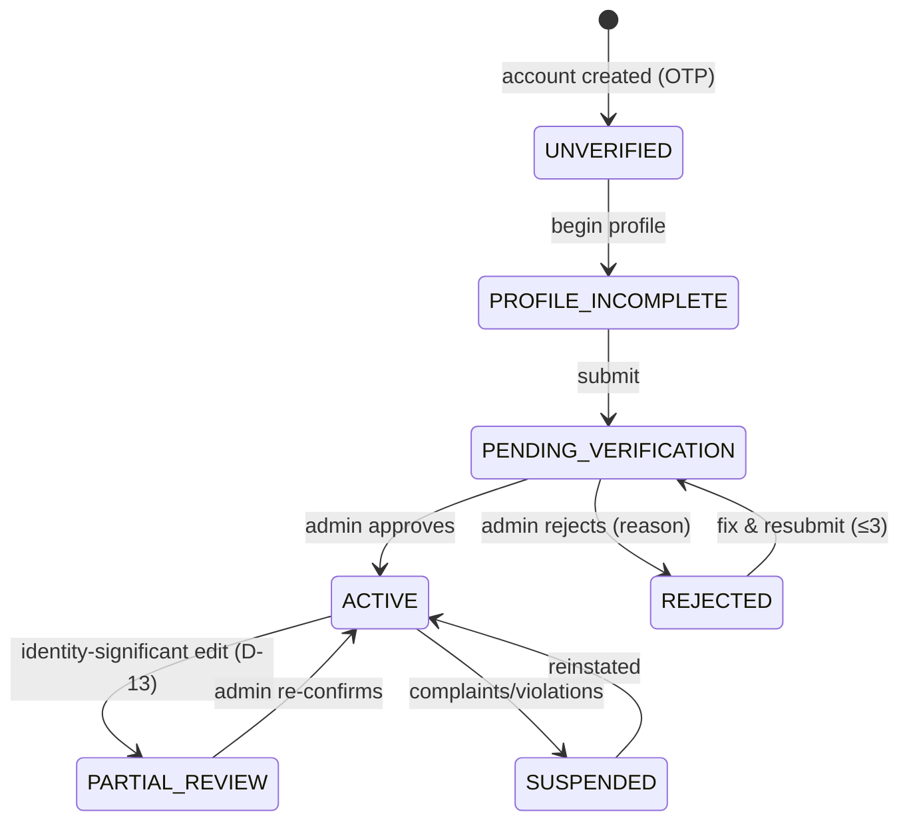
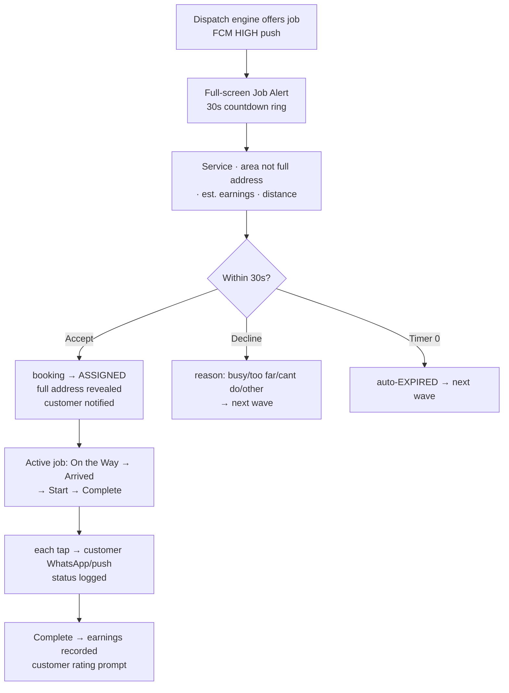
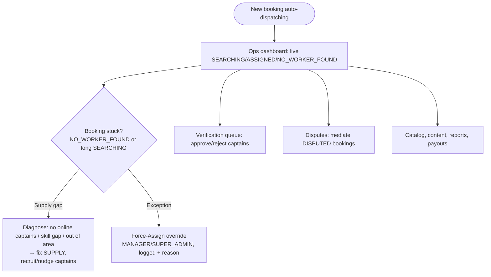

# VSolveHub — User Flows & Diagrams

> **Version:** 1.4 | **Last Updated:** 2026-06-17
> **Phase 1 scope:** direct booking of workers — the dispatch model only (Captain mode,
> Archetypes **A & B**, Push-Dispatch). No admin assignment. See `conventions.md`
> D-20/D-21/D-27.
> Non-dispatch archetypes (C Staffing, D Rental, E Property, F Quote) + the Partner Web
> Portal are **Phase 2** — summarised at the end, not built in Phase 1.
> Every flow covers: happy path · error path · empty state · edge cases.

---

## Flow Index (Phase 1)

| # | Flow | Actors | Trigger |
|---|------|--------|---------|
| [F-01](#f-01-customer-direct-booking-archetype-a) | Customer Direct Booking (Archetype A) | Customer | Wants a service now / at a slot |
| [F-01b](#f-01b-crew-booking-archetype-b) | Crew / Daily-wage Booking (Archetype B) | Customer | Needs N workers for a day |
| [F-DE](#f-de-the-dispatch-engine) | The Dispatch Engine | System | A booking is verified |
| [F-02](#f-02-captain-onboarding--verification) | Captain Onboarding & Verification | Captain | Installs Provider App |
| [F-03](#f-03-captain-job-acceptance-30s) | Captain Job Acceptance (30s) | Captain | Dispatch engine offers a job |
| [F-04](#f-04-customer-status-tracking) | Customer Status Tracking | Customer | After booking is assigned |
| [F-05](#f-05-new-customer-onboarding-web) | New Customer Onboarding (Web) | Customer | First visit |
| [F-06](#f-06-admin-operations-no-assignment) | Admin Operations (no assignment) | Admin | Monitoring / verification / disputes |

---

## F-DE: The Dispatch Engine

The heart of Phase 1. Triggered when a booking becomes `phone_verified`. No admin.

```mermaid
flowchart TD
    A[Booking phone-verified\nstatus: SEARCHING] --> B[Build eligible pool:\nworkers ACTIVE + ONLINE\n+ skill matches sub-category\n+ within service area\n+ no live assignment]
    B --> C{Pool empty?}
    C -->|Yes| D[status: NO_WORKER_FOUND\nOffer: Retry · Schedule later · Notify me]
    C -->|No| E[Rank: distance → rating → idle-time fairness]
    E --> F[Offer WAVE to top N\njob_assignments OFFERED\nexpires_at = now()+30s\nFCM HIGH push]
    F --> G{Accept within 30s?}
    G -->|First ACCEPT wins| H[booking → ASSIGNED\nvoid other offers\ncustomer notified]
    G -->|all decline/expire| I{More workers?}
    I -->|Yes| J[next wave\nattempt_no += 1] --> F
    I -->|No| D
```

- Timer is **server-authoritative** (`conventions.md` D-11): a Celery task at `expires_at`
  flips stale `OFFERED → EXPIRED`. The client countdown is cosmetic.
- Wave size/count in `platform_config`.
- **Single-active-job invariant** (D-11): a captain holds at most one `OFFERED`/`ASSIGNED`
  at a time (partial unique index + `SELECT … FOR UPDATE`).

---

## F-01: Customer Direct Booking (Archetype A)

End-to-end "book a captain." Covers new (OTP) and returning (refresh-token) users.



### Booking status state machine (dispatch)



### Booking submission sequence

```mermaid
sequenceDiagram
    participant C as Customer
    participant D as Django API
    participant DB as PostgreSQL
    participant Q as Celery
    participant FCM as Firebase
    participant W as Captain (Provider App)

    C->>D: POST /api/v1/bookings/ (form + reCAPTCHA, Idempotency-Key)
    D->>D: verify reCAPTCHA + validate
    D->>DB: INSERT booking (PENDING_VERIFICATION)
    alt new user
        D->>C: OTP required
        C->>D: POST /api/v1/auth/otp/verify/
    end
    D->>DB: booking → SEARCHING (phone_verified=true)
    D->>Q: enqueue dispatch(booking_id)
    Q->>DB: build pool + INSERT job_assignments (OFFERED, +30s)
    Q->>FCM: HIGH push to wave workers
    W->>D: POST /api/v1/jobs/{id}/accept/
    D->>DB: assignment ACCEPTED; booking → ASSIGNED
    D->>C: notify — captain assigned
```

### Edge cases
| Scenario | Handling |
|---|---|
| No captain online for skill/area | `NO_WORKER_FOUND` → Retry / Schedule / Notify-me (no silent fail) |
| Network drop on submit | retry with same `Idempotency-Key`; no double booking |
| Captain accepts then cancels | booking re-enters `SEARCHING`; re-dispatch; captain reliability flagged |
| Customer cancels after assign | penalty per status (D-16 `cancellations`) |
| Same service booked twice | allowed; two bookings, two dispatches |
| Slot in the past / >90 days | validation error (D-19) |

---

## F-01b: Crew Booking (Archetype B)

Same as F-01, plus a **headcount** (e.g. "3 masons, tomorrow, full-day"). The engine
offers to multiple captains until the crew fills; the booking tracks `filled / required`.
Partial fill → keep offering remaining slots; if unfilled by the slot time →
`NO_WORKER_FOUND` for the remainder, customer notified.

---

## F-02: Captain Onboarding & Verification

> Rapido-style strict gate. **No captain receives a dispatch until `status = ACTIVE`.**
> (Detail unchanged from `apps/worker_app.md` — now "Captain mode" of the Provider App;
> stack is Flutter, D-23.)

Stages: Register (phone+OTP) → Profile (name, DOB 18+, **live selfie**) → Skills
(primary + sub-skills mapped to sub-categories, D-18; service area + radius) → Documents
(Aadhaar front/back, optional skill cert, bank/UPI; Aadhaar number encrypted, D-14) →
Review & Submit → `PENDING_VERIFICATION` → Admin review → `ACTIVE` (push+WhatsApp) or
`REJECTED` (reason; resubmit up to 3×).



---

## F-03: Captain Job Acceptance (30s)

> **Trigger = the dispatch engine (F-DE), not an admin.** Everything else (30s accept,
> decline reasons, status updates) is the Rapido captain mechanic.



### Edge cases
| Scenario | Handling |
|---|---|
| Captain offline mid-wave | not in pool; never offered |
| App killed during 30s | server timer expires it → next wave |
| Accept at ~0s, lag | server validates `expires_at`; if past, treated as expired |
| 5 declines in a row | reliability flag → admin review |
| Status update offline | queued locally, synced on reconnect |

---

## F-04: Customer Status Tracking

Timeline: `SEARCHING → ASSIGNED → ON_THE_WAY → ARRIVED → IN_PROGRESS → COMPLETED`.
Current step highlighted + timestamped. After assign: captain name + skill + rating
(masked contact, D-15). `NO_WORKER_FOUND` shows Retry/Schedule/Notify. Polling every 30s
(WebSocket later). Cancelled → reason + timestamp. Completed → inline rating.

---

## F-05: New Customer Onboarding (Web)

First visit → browse freely (no account) → pick service → Book → form → **OTP (new) /
refresh-token (returning, D-04)** → booking created `SEARCHING` → dispatch → confirmation
+ WhatsApp. (Booking is created **after** verification, not before — D-04/D-05.)

---

## F-06: Admin Operations (no assignment)

> Admins do **not** assign captains (D-20). Admin = monitoring + supply.



Lead/assignment state machine (F-04 in v1.0) is **removed** — dispatch is automatic.

---

## Phase 2 Preview (not built in Phase 1)

These archetypes + the Partner Web Portal are designed (`conventions.md` D-21/D-24/D-26)
but **deferred** (D-27). Flows to be authored when Phase 2 begins:

| Archetype | Provider | Flow shape | Status set |
|---|---|---|---|
| **C Staffing** | Professional | browse/request → shortlist → trial → engage | `REQUESTED→SHORTLISTED→TRIAL→ENGAGED→CLOSED` |
| **D Rental** | Rental Vendor | pick item+dates → availability → deposit → deliver/return | `REQUESTED→CONFIRMED→OUT_FOR_DELIVERY→IN_USE→RETURNED→CLOSED` |
| **E Property** | Property Host | browse listings → viewing → token → book | `ENQUIRY→VIEWING_SCHEDULED→TOKEN_PAID→BOOKED→CLOSED` |
| **F Quote** | Event Vendor | enquiry → quote → advance → execute | `ENQUIRY→QUOTED→ADVANCE_PAID→IN_PROGRESS→COMPLETED` |

All Phase-2 leads use **Inbox-Pull** (`provider_requests`), not the 30s dispatch engine
(D-25).
