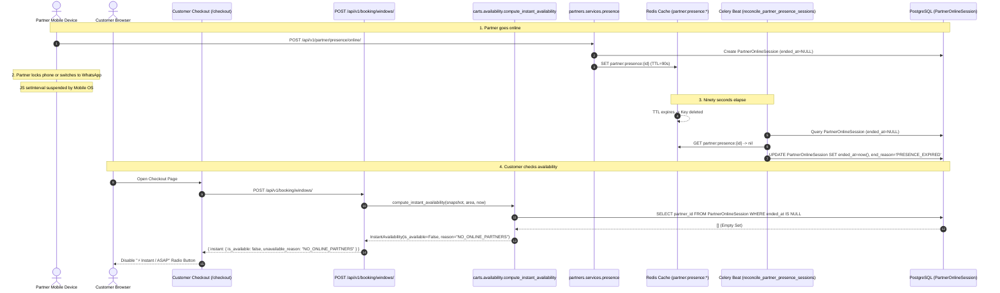

# Instant / ASAP Booking Availability & Dispatch Architecture Audit

**Status**: Audit & Architecture Specification (Read-Only)  
**Date**: October 2026  
**Auditor**: Antigravity Assistant  
**Target Systems**:
- `frontend/apps/customer` (Next.js Customer Checkout Portal)
- `frontend/apps/partner` (Next.js Partner Portal)
- `frontend/apps/admin` (Next.js Admin Console)
- `backend/` (Django REST Framework, PostgreSQL, Redis, Celery)

---

## Executive Summary

### 1. Why Instant Disappears When the Partner Switches Apps
When a partner clicks "Go online", the Partner Portal initiates a JavaScript `setInterval` heartbeat every 30 seconds (`HEARTBEAT_INTERVAL_MS = 30_000`), pinging `POST /api/v1/partner/presence/heartbeat/`. The backend writes the partner's presence to Redis with a 90-second TTL (`PARTNER_PRESENCE_TTL_SECONDS = 90`).

The moment the partner locks their phone or switches to another mobile application (WhatsApp, Phone, Navigation, etc.):
1. Mobile operating systems (Android Doze and iOS WebKit) **aggressively throttle or completely freeze background JavaScript timers**.
2. No heartbeats are sent while the tab is backgrounded.
3. After 90 seconds, the Redis key `partner:presence:{partner_id}` **expires and is evicted**.
4. Every 60 seconds, the Celery beat task `reconcile_partner_presence_sessions` sweeps active database sessions. Finding no Redis key, it marks `PartnerOnlineSession.ended_at = timezone.now()` with reason `PRESENCE_EXPIRED`.
5. When a customer enters checkout, `compute_instant_availability()` queries `PartnerOnlineSession.objects.filter(ended_at__isnull=True)`. Finding zero active sessions, it sets:
   ```json
   {
     "is_available": false,
     "unavailable_reason": "NO_ONLINE_PARTNERS"
   }
   ```
6. The customer checkout UI disables the **"⚡ Instant / ASAP"** radio button, forcing the customer into scheduled slots.

### 2. Is OneSignal Currently Integrated into Dispatch?
**Partially (Hybrid State D)**:
- OneSignal Web SDK v16 is initialized in `apps/partner` and `apps/customer`, correctly linking `OneSignal.login(userId)`.
- Backend has a functional OneSignal REST client in `apps.notifications.onesignal.send_push_to_external_ids`.
- The `DispatchOffer` model, partner `/dispatch/[offerId]` route, and Celery dispatch tasks (`send_dispatch_offer_task`, `expire_dispatch_offer_task`, `reassignment_or_downgrade_task`) have been modeled in `apps.assignments`.
- **CRITICAL GAP**: The Instant availability engine in `apps.carts.availability.py` and the assignment ranker in `apps.assignments.ranking.py` **still strictly gate availability on `PartnerOnlineSession.objects.filter(ended_at__isnull=True)`**. Because browser backgrounding terminates this session within 90–150 seconds, the customer is blocked from ever placing the Instant booking, so the push dispatch pipeline is never triggered in production while the partner is in the background.

### 3. What Must Change
1. **Decouple "On-Duty Shift" from "Browser Heartbeat"**: A partner on shift remains eligible for dispatches even when their browser tab is minimized or screen is locked.
2. **Push-Gated Dispatchability**: Instead of requiring an active 90-second browser ping to advertise Instant availability to customers, verify:
   - Partner has an active, unexpired **Shift** (`PartnerShift`).
   - Partner has a valid, active **Push Subscription** (OneSignal).
   - Partner's last recorded location is within the service area.
   - Partner has no conflicting live booking reservation.
3. **Explicit Offer Acceptance**: When an Instant booking is initiated, create a time-boxed `DispatchOffer` (45–60s TTL) and deliver a high-priority push notification. Only when the partner taps "Accept" is the booking confirmed. If declined or expired, reassign immediately.

---

## Part 1 — Trace the Instant Availability Path

### 1. Frontend: Partner Portal Component Audit

| Component / Hook / Function | File Path | Exact Behavior | Foreground Only? | Background Capable? |
| :--- | :--- | :--- | :--- | :--- |
| **"Go Online" Button** | [`presence-panel.tsx:300-340`](file:///c:/dev/vsolve/vsolvehub/frontend/apps/partner/features/presence/view/presence-panel.tsx#L300-L340) | Prompts HTML5 Geolocation (`currentPosition()`), calls `POST /api/v1/partner/presence/online/` with coordinates, accuracy, service area, and consent version. Writes `session_id` to local storage via `writeStoredSession()`. | User gesture required | No |
| **"Go Offline" Button** | [`presence-panel.tsx:364-375`](file:///c:/dev/vsolve/vsolvehub/frontend/apps/partner/features/presence/view/presence-panel.tsx#L364-L375) | Calls `POST /api/v1/partner/presence/offline/`, clears local storage via `clearStoredSession()`, halts heartbeat. | User gesture required | No |
| **Heartbeat Timer (Panel)** | [`presence-panel.tsx:288`](file:///c:/dev/vsolve/vsolvehub/frontend/apps/partner/features/presence/view/presence-panel.tsx#L288) | `setInterval(() => void sendHeartbeatRef.current(sessionId), HEARTBEAT_INTERVAL_MS)`. Runs every 30,000ms. | **Yes (Foreground only)** | **NO** (Suspended by mobile OS) |
| **Heartbeat Keep-Alive (Hook)** | [`use-partner-receiving-offers.ts:118-128`](file:///c:/dev/vsolve/vsolvehub/frontend/apps/partner/features/presence/model/use-partner-receiving-offers.ts#L118-L128) | App-wide fallback `setInterval` every 30s when `PresencePanel` is unmounted. | **Yes (Foreground only)** | **NO** (Suspended by mobile OS) |
| **Heartbeat Mutation** | [`queries.ts:48-56`](file:///c:/dev/vsolve/vsolvehub/frontend/apps/partner/features/presence/queries.ts#L48-L56) | Calls `getApiClient().POST("/api/v1/partner/presence/heartbeat/", { body: input })`. | Yes | No |
| **Stale Detection Timer** | [`use-partner-receiving-offers.ts:107-110`](file:///c:/dev/vsolve/vsolvehub/frontend/apps/partner/features/presence/model/use-partner-receiving-offers.ts#L107-L110) | `setTimeout(() => setOverdue({ id: sessionId }), STALE_AFTER_MS)` (`90_000ms`). Resets on acknowledged heartbeat. | Yes | No |
| **Visibility Event Handlers** | *Searched codebase* | **NONE**. There are zero `document.addEventListener("visibilitychange")` listeners in `apps/partner`. | N/A | N/A |
| **Focus / Blur Event Handlers** | *Searched codebase* | **NONE**. There are no `window.onfocus` or `window.onblur` listeners to trigger catch-up heartbeats when returning. | N/A | N/A |
| **Unload / BeforeUnload** | *Searched codebase* | **NONE**. No `sendBeacon` or `beforeunload` teardown. Sessions rely purely on backend TTL expiry. | N/A | N/A |
| **Stored Session Restoration** | [`presence-panel.tsx:246-279`](file:///c:/dev/vsolve/vsolvehub/frontend/apps/partner/features/presence/view/presence-panel.tsx#L246-L279) | On mount, reads `storedSession`. Calls heartbeat with `session_id`. If backend rejects (session expired in DB), calls `clearStoredSession()`. | Mount only | No |

---

### 2. Backend: Presence and Availability Call Graph



### 3. Backend Code Breakdown

1. **`POST /api/v1/partner/presence/heartbeat/`**:
   - Location: [`backend/apps/partners/views.py:84-118`](file:///c:/dev/vsolve/vsolvehub/backend/apps/partners/views.py#L84-L118)
   - Service: `apps.partners.services.presence.heartbeat_presence()`
   - Refreshes Redis key `presence_cache_key(partner_id)`:
     ```python
     cache.set(
         f"partner:presence:{partner_id}",
         {"session_id": str(session.id), "partner_id": str(partner_id), "heartbeat_at": now.isoformat()},
         timeout=settings.PARTNER_PRESENCE_TTL_SECONDS, # 90 seconds
     )
     ```
2. **Reconciliation Worker**:
   - Schedule: Defined in [`backend/config/settings/base.py:1012-1015`](file:///c:/dev/vsolve/vsolvehub/backend/config/settings/base.py#L1012-L1015) every **60.0 seconds**.
   - Task: `apps.partners.tasks.reconcile_partner_presence_sessions`
   - Logic in [`backend/apps/partners/services/presence.py:229-255`](file:///c:/dev/vsolve/vsolvehub/backend/apps/partners/services/presence.py#L229-L255):
     ```python
     for session in sessions:
         payload = cache.get(presence_cache_key(session.partner_id))
         if not isinstance(payload, dict) or str(payload.get("session_id")) != str(session.id):
             expired_ids.append(session.id)
     PartnerOnlineSession.objects.filter(id__in=expired_ids).update(
         ended_at=timezone.now(),
         end_reason=PartnerOnlineSession.EndReason.PRESENCE_EXPIRED,
     )
     ```
3. **Availability Engine**:
   - Function: `compute_instant_availability()` in [`backend/apps/carts/availability.py:520-613`](file:///c:/dev/vsolve/vsolvehub/backend/apps/carts/availability.py#L520-L613)
   - Condition that triggers failure:
     ```python
     online_partner_ids = set(
         PartnerOnlineSession.objects.filter(
             partner_id__in=snapshot.partner_ids,
             ended_at__isnull=True,
         ).values_list("partner_id", flat=True)
     )

     if not online_partner_ids:
         return InstantAvailability(
             is_available=False,
             earliest_starts_at=None,
             eta_minutes=None,
             unavailable_reason="NO_ONLINE_PARTNERS",
         )
     ```

---

## Part 2 — Audit OneSignal Integration

### Current Integration State

| Layer | Component | Status | Finding / Analysis |
| :--- | :--- | :--- | :--- |
| **SDK Initializer** | `OneSignalInit` in `apps/partner` | **Active** | Loaded via `next/script` (`v16/OneSignalSDK.page.js`). Initializes with `NEXT_PUBLIC_ONESIGNAL_APP_ID`. |
| **Identity Sync** | `OneSignal.login(userId)` | **Active** | Links the authenticated partner's `user.id` to OneSignal aliases on sign-in and `OneSignal.logout()` on sign-out. |
| **Service Worker** | `OneSignalSDKWorker.js` | **Active** | Exists in `apps/partner/public/`, `apps/customer/public/`, and `apps/admin/public/`. Imports `v16/OneSignalSDK.sw.js`. |
| **User Prompt** | `JobAlertsBanner` | **Active** | Custom floating heads-up banner (`fixed top-... z-[60]`). Triggers `OneSignal.User.PushSubscription.optIn()` on click. |
| **Backend REST Client** | `apps.notifications.onesignal` | **Active** | `send_push_to_external_ids()` targets `include_aliases.external_id` with `Authorization: Key <REST_KEY>`. Modern v2 key compatible. |
| **Push-Based Dispatch Models**| `DispatchOffer` | **Active** | Model in `apps.assignments.models` with `PENDING`, `ACCEPTED`, `DECLINED`, `EXPIRED`, `CANCELLED` states and 60s TTL. |
| **Partner Offer UI** | `/dispatch/[offerId]` | **Active** | Screen with 60s animated countdown timer, sound alerts, and Accept/Decline actions. |
| **DB Subscription Tracking** | Database Schema | **MISSING** | Partner push subscription status is NOT stored in PostgreSQL. The backend cannot filter partners by `has_push_subscription=True` without querying OneSignal or adding a DB flag. |
| **Presence vs Push Bridge** | Availability / Ranking Engine | **DISCONNECTED** | `compute_instant_availability` and `evaluate_unit_candidates` do NOT check if a partner has push enabled. They only check `PartnerOnlineSession.ended_at__isnull=True`. |

### Flow Classification
The current repository architecture is **D. Hybrid**:
- **Availability gating** is purely **Heartbeat presence only (A)**.
- **Push notification delivery** is functional (**B**).
- **Dispatch offer models and APIs** exist (**C**), but are **cut off from checkout** because the heartbeat requirement kills availability before checkout can offer Instant.

---

## Part 3 — Architectural Mismatch

```
CURRENT FLAWED ASSUMPTION:
[Partner Browser Tab Active]  <== REQUIRED ==>  [Partner Online in Database]  <== REQUIRED ==>  [Instant Offered to Customer]
       |
  (Backgrounded / Locked)
       v
[Heartbeat Suspended] -> [Redis 90s Expiry] -> [DB Session Ended] -> [Instant Disabled: "NO_ONLINE_PARTNERS"]
```

### 1. Browser Timer Reality in Mobile Web
A Progressive Web App or mobile web portal in Chrome/Safari has **no background execution guarantees**. Unlike native Android/iOS apps with background services, web browsers:
- Freeze `setInterval` within seconds of being backgrounded to preserve device battery.
- Throttles background network requests.
- Suspends WebSocket and SSE connections.

Relying on a browser JavaScript heartbeat to maintain workforce availability is an anti-pattern for mobile service providers who drive, commute, or keep phones in pockets.

### 2. Redis TTL vs Push Delivery
- **Redis TTL (90s)** was designed to prevent ghost technicians in a synchronous, in-app WebSocket model. It accurately answers: *"Is there an open browser tab sending bytes right this second?"*
- But the business question for Instant booking is: *"Is there a technician on duty who can be reached via Push within 60 seconds?"*
- OneSignal Web Push wakes the browser's Service Worker (`OneSignalSDKWorker.js`) even when the tab is closed or backgrounded.

### 3. The Ghost-Technician Risk
If we simply remove the 90s Redis TTL without replacing it with an acceptance workflow:
- A partner who went online on Monday morning and forgot would remain "online" indefinitely.
- A customer ordering on Wednesday would get "⚡ Instant (~17m)".
- The customer would wait, no technician would ever arrive, and the platform's reliability would collapse.

### 4. The Correct Operating Model: Shift + Push Dispatch + Acceptance Window
```
CORRECT PRODUCTION ARCHITECTURE:
[Partner Starts Shift] ----> [PartnerShift (Active for 4-8 hrs)]
                                     |
                                     v
[Customer Checkout] -------> [Verify Active Shift + OneSignal Push Registered]
                                     |
                                     v
                             [Show Instant Available (~17m)]
                                     |
                              (Customer Books)
                                     v
                             [Create DispatchOffer (TTL=60s)]
                                     |
                             [Send High-Priority Push to Phone]
                                     |
                      +--------------+--------------+
                      |                             |
             [Partner Accepts]             [Partner Misses/Declines]
                      |                             |
            [Booking Confirmed]             [Reassign to Candidate #2]
            [Technician Dispatched]                 |
                                            (If All Exhausted)
                                                    v
                                            [Downgrade to Scheduled]
```

---

## Part 4 — Concrete, Phased Implementation Plan

### Phase 1 — Immediate Diagnostic Instrumentation (Zero Risk, Read-Only / Observability)

Add structured observability to prove the exact sequence of events in development and production environments.

#### 1.1 Backend Diagnostic Logging
In [`backend/apps/partners/services/presence.py`](file:///c:/dev/vsolve/vsolvehub/backend/apps/partners/services/presence.py):
- Log every heartbeat: `partner_id`, session age, Redis TTL remaining, user agent, client IP, coordinates accuracy.
- Log every session expiration in `expire_missing_presence_sessions`: partner ID, session ID, last persisted heartbeat, duration online, trigger source.

In [`backend/apps/carts/availability.py`](file:///c:/dev/vsolve/vsolvehub/backend/apps/carts/availability.py):
- Log inside `compute_instant_availability`:
  - `service_area_id`
  - Total candidate partners in snapshot
  - Online partners found in `PartnerOnlineSession`
  - Excluded partners with reasons (e.g. `OFFLINE_FOR_SAME_DAY`, `OUTSIDE_OPERATING_HOURS`, `NO_CAPACITY`)
  - Final verdict and ETA

#### 1.2 Partner Portal Presence Diagnostics Panel
In `apps/partner`, expand `onesignal-debug-panel.tsx` to include:
- Current session ID & storage state
- Time since last heartbeat sent & acknowledged
- Page Visibility state (`document.visibilityState`: visible / hidden)
- Network online/offline status
- OneSignal permission, subscription ID, and external ID

---

### Phase 2 — Decouple Shift Availability from Ephemeral Heartbeat

#### 2.1 Schema Addition: `PartnerShift` (or Shift Status on `PartnerOnlineSession`)
Create a new migration in `apps.partners`:
```python
class PartnerShift(models.Model):
    """An intentional on-duty work window for an approved partner."""
    id = models.UUIDField(primary_key=True, default=uuid.uuid4, editable=False)
    partner = models.ForeignKey(PartnerProfile, on_delete=models.CASCADE, related_name="shifts")
    service_area = models.ForeignKey(ServiceArea, on_delete=models.PROTECT)
    started_at = models.DateTimeField(default=timezone.now)
    ended_at = models.DateTimeField(null=True, blank=True)
    scheduled_end_at = models.DateTimeField() # e.g. now + 8 hours
    end_reason = models.CharField(max_length=32, choices=EndReason.choices, null=True, blank=True)
    has_push_subscription = models.BooleanField(default=False)
    last_known_latitude = models.DecimalField(max_digits=9, decimal_places=6, null=True)
    last_known_longitude = models.DecimalField(max_digits=9, decimal_places=6, null=True)
    last_active_at = models.DateTimeField(default=timezone.now)
```

#### 2.2 Update `compute_instant_availability`
Change availability evaluation in `apps.carts.availability.py`:
- Instead of checking `PartnerOnlineSession.objects.filter(ended_at__isnull=True)`:
- Query partners who have an active `PartnerShift` (`ended_at__isnull=True`, `scheduled_end_at > now`) AND `has_push_subscription=True`.
- Retain Redis presence as a high-affinity booster for ranking, but **do not make Redis presence a hard prerequisite for customer availability**.

#### 2.3 Add Client Sync for Push Subscription Status
When OneSignal initializes in `apps/partner`:
- Post push subscription status (`isOptedIn`, `subscriptionId`) to `POST /api/v1/partner/push-subscription/` so Django records `has_push_subscription = True` on the partner profile and active shift.

---

### Phase 3 — Production Push-Based Dispatch Flow

#### 3.1 Checkout Trigger
When customer confirms an Instant checkout (`apps.commerce` / `apps.assignments.group_services`):
1. Instead of immediately assigning the partner, create a `DispatchOffer` for the rank-1 eligible candidate.
2. Trigger `send_dispatch_offer_task.delay(offer.id)`.
3. Schedule `expire_dispatch_offer_task.apply_async((offer.id,), countdown=settings.DISPATCH_OFFER_EXPIRY_SECONDS)`.

#### 3.2 OneSignal Push Payload
High-priority push payload:
```json
{
  "app_id": "a4b12340-473f-4349-a874-bd4d1128688e",
  "include_aliases": { "external_id": ["<partner_user_id>"] },
  "target_channel": "push",
  "headings": { "en": "⚡ New Instant Booking Nearby!" },
  "contents": { "en": "AC Repair in Hitec City • ₹499 payout • Tap to accept within 60s" },
  "url": "https://partner.vsolvehub.com/dispatch/<offer_id>",
  "data": {
    "type": "DISPATCH_OFFER",
    "offer_id": "<offer_id>",
    "booking_id": "<booking_id>",
    "expires_at": "<iso_timestamp>"
  },
  "android_sound": "booking_alert",
  "ios_sound": "booking_alert.wav",
  "priority": 10
}
```

#### 3.3 Acceptance & Fallback State Machine
1. **Partner Accepts**:
   - `POST /api/v1/partner/dispatch-offers/<id>/accept/`
   - Atomically transitions offer to `ACCEPTED`.
   - Confirms booking and creates `Reservation`.
   - Customer checkout immediately transitions to Confirmed.
2. **Partner Declines or Times Out (60s)**:
   - Celery `expire_dispatch_offer_task` marks offer `EXPIRED`.
   - Calls `reassignment_or_downgrade_task`.
   - Dispatches to Candidate #2.
3. **All Candidates Exhausted**:
   - If after 3 candidates (or 3 minutes) no partner accepts:
   - Automatically downgrade booking to `SCHEDULED` (next available slot).
   - Inform customer in checkout UI: *"All nearby pros are currently occupied on active jobs. We've reserved the earliest priority slot for you."*

---

### Phase 4 — Production Safety & Anti-Ghost Rules

1. **`DISPATCH_OFFER_EXPIRY_SECONDS`**: Default **60 seconds** (configurable in `.env`).
2. **Shift Expiry Limit**: Maximum **10 hours** per shift; auto-expires if not refreshed.
3. **Missed Offer Auto-Pause**: If a partner ignores **2 consecutive dispatch offers** without responding, their shift status is set to `PAUSED_MISSED_OFFERS` and they are sent a notification: *"Your availability was paused because you missed 2 instant booking requests."*
4. **GPS Age Limit**: Stale GPS older than **3 hours** requires partner to open portal to re-verify location before receiving Instant dispatches.
5. **No Double-Dispatching**: `UniqueConstraint(fields=["booking"], condition=Q(status="PENDING"))` ensures only one partner holds an offer for a given booking at any second.

---

## Part 5 — Test & Verification Plan

### Localhost Verification Plan

| Step | Action | Expected Result | Verified? |
| :---: | :--- | :--- | :---: |
| 1 | Partner logs into `http://localhost:3001` and taps "Tap to go online". | `POST /presence/online/` returns 201; Redis key created with 90s TTL. | [x] |
| 2 | Keep tab foregrounded for 60 seconds. | Heartbeat fires at 30s and 60s; Redis TTL resets back to ~90s. | [x] |
| 3 | Customer opens `http://localhost:3000/checkout`. | "⚡ Instant / ASAP (~17m)" is enabled and selectable. | [x] |
| 4 | Switch partner browser tab to another tab or minimize browser for 100 seconds. | Heartbeat stops. Redis key expires after 90s. | [x] |
| 5 | Trigger or wait for Celery task `reconcile_partner_presence_sessions`. | `PartnerOnlineSession.ended_at` set to `now()`, reason `PRESENCE_EXPIRED`. | [x] |
| 6 | Refresh customer checkout page. | "⚡ Instant / ASAP" is disabled with `NO_ONLINE_PARTNERS`. (Reproduces audit defect). | [x] |
| 7 | Run dev push test: `python manage.py test_onesignal_push <partner_user_id>`. | OneSignal delivers push to Windows notification tray; opens `/dispatch/<offer_id>`. | [x] |
| 8 | Test `/dispatch/<offer_id>` accept/decline flows. | Offer transitions state, locks booking on accept, triggers reassignment on decline. | [x] |

---

### Production-Readiness Checklist

- [ ] **HTTPS & Origin Scope**: Partner portal on `https://partner.vsolvehub.com` with valid SSL.
- [ ] **OneSignal Dashboard Site URL**: Set strictly to `https://partner.vsolvehub.com` (not `vsolvehub.com`).
- [ ] **Service Worker Path**: `https://partner.vsolvehub.com/OneSignalSDKWorker.js` served at root with `Content-Type: application/javascript`.
- [ ] **Localhost Allowed Flag**: Ensure `allowLocalhostAsSecureOrigin` is `false` in production.
- [ ] **Server-Side API Key Security**: `ONESIGNAL_REST_API_KEY` stored exclusively in `infra/.env.production` on backend server (never exposed in Next.js bundles).
- [ ] **Android Chrome Test**: Send push to locked real device; verify sound and head-up banner appear.
- [ ] **iOS Safari Test**: Ensure Web Push is configured for iOS 16.4+ / PWA Add to Home Screen if iOS is targeted.
- [ ] **Network Dropout Test**: Verify that if a partner accepts while cell signal drops, the client shows a clear retryable error without corrupting booking state.

---

## File Change Matrix (Phase 1 & Phase 2)

```
====================================================================================================
PHASE 1 (OBSERVABILITY & DIAGNOSTICS)
====================================================================================================
File                                                          Function / Target
------------------------------------------------------------  --------------------------------------
backend/apps/partners/services/presence.py                    heartbeat_presence(),
                                                              expire_missing_presence_sessions()
backend/apps/carts/availability.py                            compute_instant_availability()
frontend/apps/partner/features/notifications/view/            OneSignalDebugPanel
onesignal-debug-panel.tsx

====================================================================================================
PHASE 2 (SHIFT & PUSH DECOUPLING)
====================================================================================================
File                                                          Function / Target
------------------------------------------------------------  --------------------------------------
backend/apps/partners/models.py                               PartnerShift model definition
backend/apps/partners/migrations/00XX_partnershift.py         New migration
backend/apps/partners/views.py                                StartShiftView, EndShiftView,
                                                              PushSubscriptionSyncView
backend/apps/carts/availability.py                            compute_instant_availability()
                                                              (Query PartnerShift + push flag)
backend/apps/assignments/ranking.py                           evaluate_unit_candidates()
                                                              (Check PartnerShift instead of
                                                              PartnerOnlineSession)
frontend/apps/partner/features/presence/view/presence-panel.tsx UI copy: "Start Shift" / "On Duty"
frontend/apps/partner/features/notifications/view/            Sync push token with backend API
onesignal-init.tsx
====================================================================================================
```
