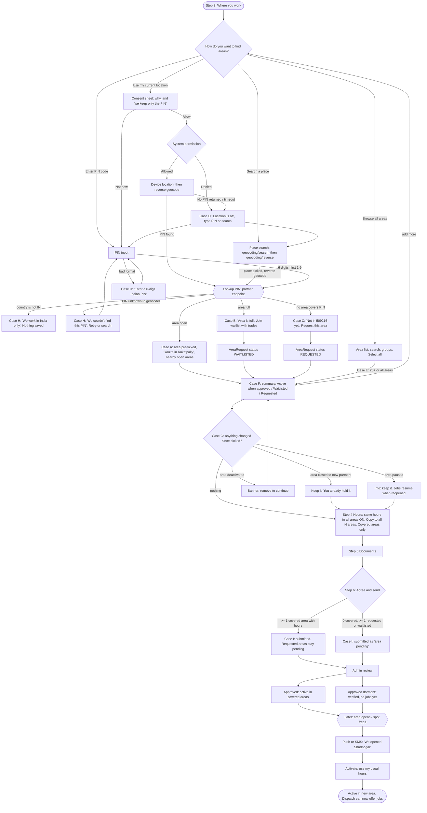
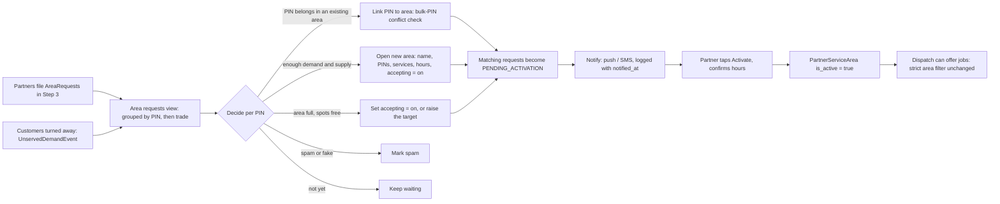
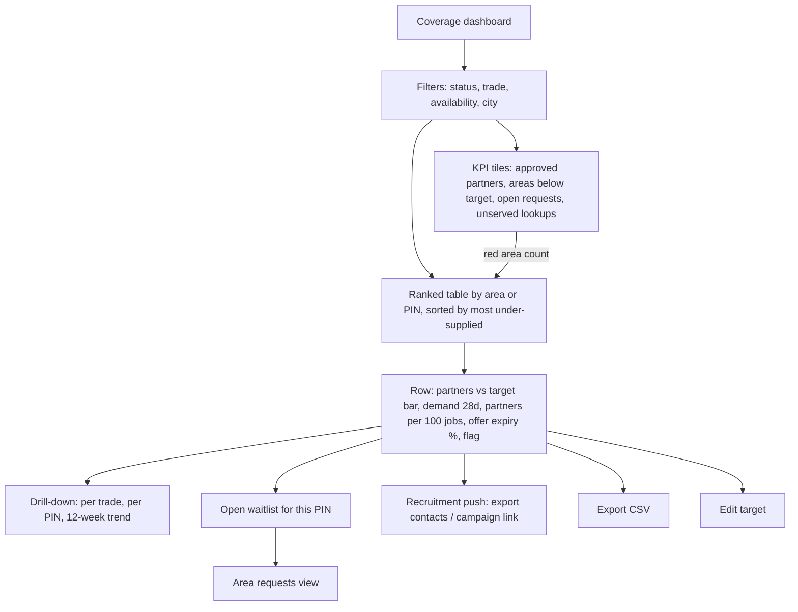
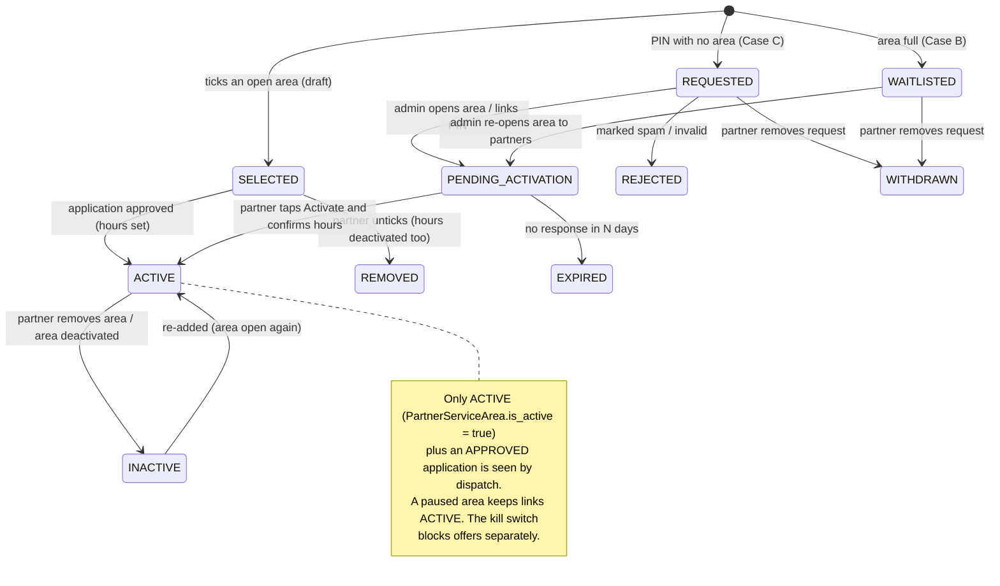

# Partner onboarding Step 3 "Where you work": updated flow (proposal)

> **Status:** design proposal only. Nothing here is built. The clickable mock is
> [`index.html`](./index.html) (open it by double-clicking; it uses mock data only).
>
> Paths below are relative to the repo root (`vsolvehub/`). Links go up two folders from this doc.
> Sections marked **TODAY** describe the code as read on 2026-11-19. Sections marked
> **PROPOSED** are the design.

## Design principles

1. No limit on how many areas a partner can select.
2. A partner is never blocked or lost because their area is not in the system.
3. "Use my current location" only **suggests and pre-selects an existing area**. It never
   creates one. Typing a PIN or searching a place works just as well.
4. Location is optional and asked for only after consent. We keep only the PIN (or a location
   rounded to about 1 km), never exact coordinates (DPDP).
5. Dispatch keeps using the area as a strict filter for jobs. Nothing pending or requested ever
   reaches dispatch.
6. Admin can see partner counts per area and per PIN, and act on low-supply areas.
7. Web and phone behave the same. New rules live in `@vsolve/query`, as already agreed for
   onboarding.

---

## 0. TODAY: what the code does now

### Partner (web and phone)

| # | Behaviour | Source |
|---|---|---|
| T1 | Area list comes from `GET /api/v1/service-areas/`, which returns every area where `is_active = true` and `is_accepting_partners = true`. Not paged, not grouped. | [partners/urls.py:47](../../backend/apps/partners/urls.py#L47), [views/partner_application.py:80-91](../../backend/apps/partners/views/partner_application.py#L80-L91), [selectors.py:50-54](../../backend/apps/partners/selectors.py#L50-L54) |
| T2 | "Continue" is disabled until at least one area is ticked. | [areas-step.tsx:13](../../frontend/apps/partner/features/application/view/areas-step.tsx#L13) |
| T3 | **Dead end:** if no areas come back, the screen shows a static message and there is no way forward. | [areas-step.tsx:35-44](../../frontend/apps/partner/features/application/view/areas-step.tsx#L35-L44) |
| T4 | Areas are checkboxes, with "Select all" when there are 2 or more. **No limit on the number.** | [areas-step.tsx:58-73](../../frontend/apps/partner/features/application/view/areas-step.tsx#L58-L73), [:75](../../frontend/apps/partner/features/application/view/areas-step.tsx#L75) |
| T5 | **Silent help text:** "Can't find your area? … Ask us from Help". Nothing is recorded. | [areas-step.tsx:94](../../frontend/apps/partner/features/application/view/areas-step.tsx#L94) |
| T6 | The phone screen is a port of the web screen but has **hard-coded English text**, even though translation catalogs exist. | [mobile areas-step.tsx](../../frontend/mobile/apps/partner/src/features/application/view/areas-step.tsx), [mobile i18n apply.ts:194](../../frontend/mobile/apps/partner/src/i18n/catalogs/apply.ts#L194) |
| T7 | There is no location or PIN lookup in Step 3. The customer app already has device location ([locate-device.ts](../../frontend/apps/customer/features/addresses/locate-device.ts)). Reverse geocoding and place search exist at `/geocoding/reverse/` and `/geocoding/search/`, throttled at 30/min. | [locations/urls.py:16-17](../../backend/apps/locations/urls.py#L16-L17), [geocoding.py:21-32](../../backend/apps/locations/geocoding.py#L21-L32), [geocoding.py:201-210](../../backend/apps/locations/geocoding.py#L201-L210), [settings/base.py:249](../../backend/config/settings/base.py#L249) |
| T8 | Saving checks that every area is active and accepting partners. If not, the **whole save** fails with "One or more selected service areas are unavailable." | [services/application.py:225-246](../../backend/apps/partners/services/application.py#L225-L246) |
| T9 | Saving checks that every chosen service is enabled in at least one chosen area. | [services/application.py:104-145](../../backend/apps/partners/services/application.py#L104-L145) |
| T10 | Saving activates the ticked links and deactivates unticked ones. **Hours for an unticked area are not touched.** | [services/application.py:86-100](../../backend/apps/partners/services/application.py#L86-L100) |
| T11 | Step 4 hours are stored **per area**. Presets fill every area. A hand-added shift defaults to the **first** area. | [schedule-step.tsx:60-68](../../frontend/apps/partner/features/application/view/schedule-step.tsx#L60-L68), [availability-editor.tsx:102](../../frontend/apps/partner/features/application/view/availability-editor.tsx#L102), [availability-editor.tsx:160-180](../../frontend/apps/partner/features/application/view/availability-editor.tsx#L160-L180) |
| T12 | Submit requires at least one active area, and hours for **every** area. | [services/application.py:110-123](../../backend/apps/partners/services/application.py#L110-L123), [:419-426](../../backend/apps/partners/services/application.py#L419-L426), [readiness.ts:129-135](../../frontend/apps/partner/features/application/model/readiness.ts#L129-L135) |
| T13 | After approval, areas cannot be changed. Editing is allowed only in DRAFT or CHANGES_REQUIRED. | [models/onboarding.py:186-188](../../backend/apps/partners/models/onboarding.py#L186-L188), [services/application.py:182](../../backend/apps/partners/services/application.py#L182) |

### Admin

| # | Behaviour | Source |
|---|---|---|
| T14 | **No areas screen in the admin console.** Areas, PINs and services are managed only through basic Django admin registration. | [locations/admin.py](../../backend/apps/locations/admin.py) |
| T15 | **The review screen shows only a count**: "Coverage Areas: N service areas". | [review-detail.tsx:437-444](../../frontend/apps/admin/features/partner-review/view/review-detail.tsx#L437-L444) |
| T16 | The directory shows an area count. The partner record shows area names. | [partner-directory.tsx:197](../../frontend/apps/admin/features/partners/view/partner-directory.tsx#L197), [partner-record.tsx:159-160](../../frontend/apps/admin/features/partners/view/partner-record.tsx#L159-L160) |
| T17 | Approval is refused if any active area has no hours. | [partners/services/review.py:257-279](../../backend/apps/partners/services/review.py#L257-L279) |
| T18 | An area can be paused with the kill switch. That blocks new bookings and offers, but **not onboarding**. | [locations/pauses.py](../../backend/apps/locations/pauses.py), [selectors.py:50-54](../../backend/apps/partners/selectors.py#L50-L54) |
| T19 | **One PIN can be in two areas.** Uniqueness is only per (area, PIN) pair. The customer check then picks the area that comes first alphabetically. | [locations/models.py:86-92](../../backend/apps/locations/models.py#L86-L92), [locations/services.py:99-142](../../backend/apps/locations/services.py#L99-L142) |
| T20 | **Customers turned away as outside the service area are not recorded.** | [locations/services.py:113](../../backend/apps/locations/services.py#L113) |

### Dispatch

| # | Behaviour | Source |
|---|---|---|
| T21 | The partner's active area link is a strict filter. Ranking is by stable UUID (`service_area_stable_uuid`), **not distance**. | [assignments/ranking.py:44](../../backend/apps/assignments/ranking.py#L44), [:283-293](../../backend/apps/assignments/ranking.py#L283-L293), [assignments/services.py:47-51](../../backend/apps/assignments/services.py#L47-L51), [carts/availability.py:435-439](../../backend/apps/carts/availability.py#L435-L439) |

---

## 1. Partner journey: today vs proposed

| Moment | TODAY | PROPOSED |
|---|---|---|
| Arrive on Step 3 | A flat list of open areas (T1, T4) | A "Find areas near you" card: **Use my current location**, **Enter PIN code**, or **Search a place**, plus "Browse all areas" |
| Location | Not offered (T7) | Optional. A consent sheet first ("we keep only your PIN"), then the system prompt. Denied or no PIN means PIN entry or search (case D) |
| Area found and open | Partner must spot it in the list | **Case A:** pre-ticked, with a "You're in Kukatpally" banner and nearby open areas to add |
| Area full | Hidden, so the partner assumes we don't operate there | **Case B:** "Gachibowli is full right now", then **Join waitlist** (with their trades). Never blocks |
| No area covers the PIN | Dead end (T3) or silent help text (T5) | **Case C:** "We're not in 509216 yet", then **Request this area**, which saves an `AreaRequest`. Never blocks |
| Many areas | Long flat grid (T4) | **Case E:** search, grouping by city or zone, "Select all" (overall and per group), a selected-count chip. No limit |
| Mixed result | Not possible | **Case F:** summary in three groups: Active when approved, Waitlisted, Requested |
| Hours (Step 4) | Per-area editor; new shifts default to the first area (T11) | "Same hours in all areas" **on by default**, plus "Copy these hours to all N areas". Hours only for covered areas |
| Area changes mid-application | Whole save fails (T8) | **Case G:** areas you already hold stay. A closed area gets a "Remove to continue" banner. A paused area gets an info note |
| Bad PIN or outside India | Not applicable | **Case H:** six-digit check, then geocoder check. Fake PIN shows "We couldn't find 599999". A non-IN country shows "We work in India only" (nothing saved) |
| Submit | Needs at least 1 area with hours (T12) | **Case I:** can submit with **at least 1 covered area** (hours needed only for those) **or with only requested/waitlisted areas** (sent as "area pending") |
| After approval | Areas fixed (T13) | Partner gets "We opened your area", then a one-tap **Activate** (reusing their usual hours). Self-serve to add an open area or remove one |

---

## 2. Partner journey flowchart



### Case notes

| Case | Trigger | What the partner sees | What is stored |
|---|---|---|---|
| **A** | PIN maps to an area that is active and accepting partners | Area pre-ticked, banner, nearby open areas | `PartnerServiceArea` (today's model) once saved |
| **B** | PIN maps to an area with `is_accepting_partners = false` | "Full right now", then Join waitlist (trades preset from "Your work") | `AreaRequest(matched_area, status=WAITLISTED)` |
| **C** | No area has this PIN, or the PIN isn't in `PostalCode` | "Not here yet", Request this area, then a confirmation | `AreaRequest(postal_code, city, state, verified, status=REQUESTED)` |
| **D** | Permission denied, unsupported, timeout, or no PIN from geocoder | Friendly fallback: PIN box plus place search on the same screen | Nothing until a PIN is checked |
| **E** | Partner wants 20+ or every area | Search, groups (city or zone), Select all overall and per group, "23 selected" chip | Same links as today, saved in one batch |
| **F** | Any mix of A, B and C | Three-group summary. Hours only for "Active when approved" | As above |
| **G** | Area paused, closed to new partners, or deactivated after being picked | Paused: info note, keep. Closed to new partners: keep (already held). Deactivated: "Remove to continue" | Server keeps held links (change from T8) |
| **H** | Bad format, PIN unknown to geocoder, or outside India | Inline error, retry or search. Outside India: polite stop, nothing saved | Nothing |
| **I** | Submitting with some or all areas pending | Submit screen lists pending areas with "No jobs here until it opens" | Application plus `AreaRequest`s linked to it |

**Location rules (DPDP):** ask only when the partner taps the button. The consent sheet explains
the purpose before the OS prompt. Store **PIN, city, state and source** (GPS / PIN / SEARCH); if a
location is kept at all, round it to 2 decimals (about 1 km). The raw device location is used once
for the reverse-geocode call and never saved. Delete `AreaRequest`s on drafts abandoned for longer
than the retention period.

---

## 3. Admin journey

### 3a. From area request to active partner



### 3b. Application review screen (PROPOSED changes to [review-detail.tsx:437-444](../../frontend/apps/admin/features/partner-review/view/review-detail.tsx#L437-L444))

- **Area names, not a count.** Chips grouped by city, folded after 10, each showing whether it has hours set.
- **Requested but unavailable:** a separate block listing `AreaRequest`s. Each shows PIN, place,
  "verified / unverified" and status (REQUESTED or WAITLISTED), with inline actions **Link to
  existing area** and **Mark spam**.
- **Trade vs area-service mismatch:**
  - Flag any chosen area where **none** of the partner's services are enabled ("Miyapur: no AC repair").
  - Flag any service with zero coverage. The server already refuses that today ([services/application.py:134-145](../../backend/apps/partners/services/application.py#L134-L145)), so it should not appear unless rules changed after submit.
- **Changed since submit:** flag areas deactivated or closed since the partner picked them.

### 3c. Approval rules when some areas are pending

| Situation | Allowed actions | Notes |
|---|---|---|
| At least 1 covered area with hours, plus pending areas | **Approve** | Pending requests stay open. They never block approval and never reach dispatch |
| At least 1 covered area, but a mismatch flag | **Approve without the flagged area**, or **Request changes** | Removing an area from the review screen is a new admin action |
| 0 covered areas, at least 1 pending | **Approve dormant** or **Keep on waitlist** | Dormant means verified but no jobs: dispatch sends nothing because there are no active links (T21). Whether to run paid checks early is an open question (Q1) |
| A chosen area was deactivated after submit | **Request changes** | Same rule as today's submit check |
| Hours missing for a covered area | Blocked | Unchanged (T17) |

### 3d. Areas management (new console screen; Django admin improved first)

- List of areas: name, city or zone, PIN count, services count, accepting partners on or off,
  paused, partners, target.
- Create or edit an area: name, city or zone, `state_code`, timezone, PIN chips, service toggles
  grouped by trade, operating windows, **accepting partners** switch, target per trade.
- **Bulk PIN upload** (CSV `pin,area_slug` or pasted list): dry run first, then apply.
  - Invalid rows (bad format, unknown PIN) are rejected.
  - **Conflict** rows ("500032 is already in Gachibowli") ask the admin to *Move* or *Skip*.
  - Proposed rule: one PIN belongs to one area only.
- Deactivating an area first shows "N partners and M confirmed bookings affected", then notifies those partners.

---

## 4. Admin tracking dashboard flow



**Low-supply flag** (per area and trade):

- 🔴 **Critical:** below 30% of target, *or* offer expiry above 25%, *or* demand with zero partners.
- 🟠 **Low:** 30–70% of target, *or* fewer than 8 partners per 100 jobs in the last 28 days.
- 🟢 **Healthy:** otherwise.
- ⚪ **Gap:** a PIN with requests or turned-away demand but no area.

Thresholds are editable per area. Admins get a daily summary of areas that turned red.

**Per-PIN counts:** partners choose *areas*, not PINs, so "partners per PIN" means **partners
covering that PIN** (area → PINs → partners). A future optional `home_postal_code` would give
"partners living in this PIN".

Mock data used in the presentation: **500001 = 100 partners**, **500002 = 50 partners**, and
500072 = 64, 500032 = 41 (area full), 500049 = 18, 500050 = 12, 509216 = 0 (no area, 38 requests).

---

## 5. Partner-area link states



**Where each state lives:**

| States | Lives in |
|---|---|
| SELECTED, ACTIVE, INACTIVE, REMOVED | `PartnerServiceArea` (today's model, plus `disabled_at` and `disabled_reason`) |
| REQUESTED, WAITLISTED, PENDING_ACTIVATION, REJECTED, WITHDRAWN, EXPIRED | New `AreaRequest` |

This split keeps dispatch reading exactly what it reads today.

---

## 6. Data implied (text sketch only; nothing created)

```
AreaRequest                         # waitlist and "area interest"
  id                uuid
  user              FK identity.User
  application       FK PartnerApplication, nullable
  postal_code       char(6)          # normalised
  postal_code_ref   FK PostalCode, nullable
  city, state       char             # from geocoder
  country_code      char(2)
  approx_lat/lng    decimal(5,2) null  # ~1 km; optional
  source            GPS | PIN | SEARCH | ADMIN
  verified          bool             # geocoder confirmed the PIN
  skills            M2M Skill        # trades for that place
  matched_area      FK ServiceArea, nullable
  status            REQUESTED | WAITLISTED | PENDING_ACTIVATION | ACTIVATED | WITHDRAWN | REJECTED | EXPIRED
  notified_at, activated_at, created_at, updated_at
  unique(user, postal_code)

UnservedDemandEvent                 # customer turned away (anonymous)
  id, postal_code, variant FK null, reason_code, source WEB|APP, created_at

AreaSupplyTarget
  service_area FK, skill FK null, target_partners int, alert_below int, updated_by, updated_at
  unique(service_area, skill)

AreaChangeRequest (approved partners adding a full or requested area)
  partner FK, add M2M, remove M2M, status, reviewer FK, decided_at, reason_code

Changes to existing models
  ServiceArea           + city (or FK ServiceZone)
  ServiceAreaPostalCode   unique(postal_code), after cleaning up overlaps
  PostalCode            + district, centroid lat/lng   # India Post import, later
  PartnerServiceArea    + disabled_at, disabled_reason
  PartnerProfile        + home_postal_code (optional, later)
New endpoint
  GET /partner/service-areas/lookup?postal_code=   -> {status: OPEN|FULL|NONE|INVALID|OUTSIDE_INDIA, areas[], place{city,state,country}}
```

**Can be built from existing data:**

| Feature | Existing data used |
|---|---|
| Partners per area, split by application status, trade and hours | `PartnerServiceArea`, `PartnerApplication.status`, partner service links, `PartnerAvailabilityRule` |
| Partners covering a PIN | area → PINs → partners |
| Demand per area | `Quote` and `FulfilmentUnit` service area, `CustomerRequirement.service_area` |
| Offer outcomes per area | `PartnerOffer` and `DispatchOffer` statuses |
| Online hours | `PartnerOnlineSession` |
| Area names on the review screen | already in `service_area_ids` |

**Needs new data:** waitlist and requests, turned-away customer demand, targets, city grouping,
removal history (`disabled_at`), home PIN, PIN centre points for a map.

---

## 7. Open questions and assumptions

**Questions**

1. **Verification cost.** Should "area pending" applicants get paid background checks before their area opens (dormant approval), or only once it opens?
2. **PIN overlap.** Should each PIN belong to exactly one area? Are current overlaps mistakes?
3. **Targets.** Per area, or per area and trade? Who owns them?
4. **Self-serve after approval.** May partners add **open** areas themselves? (Proposed: yes. Full or requested areas go through a request.)
5. **Notification channel** for "We opened your area": push, SMS, WhatsApp? Which provider?
6. **Geocoding.** Is the Google key live in production, and is the cost OK for partner lookups? Or should the India Post PIN import come first?
7. **Grouping.** What is the unit above an area: city, district or zone?
8. **Activation window.** How long should PENDING_ACTIVATION wait before EXPIRED (proposed: 14 days, then one reminder)?

**Assumptions**

- The truncated brief ended at "PIN 500001 = 100 partners, PIN …". I assumed **500002 = 50**
  (from the earlier brief) and added other PINs as mock data.
- Code was read, not production data. Area and PIN counts are unknown.
- Phone and web Step 3 behave the same except for the hard-coded phone text (T6).
- Distance-aware ranking (partners with many areas getting far-away jobs) is out of scope for this
  flow. It is noted as a long-term follow-up.
