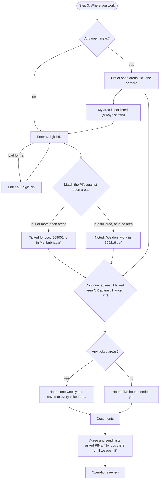

# Partner onboarding Step 3 "Where you work": simple flow

> **Status:** design agreed on 2026-11-19. **Phase 1a is built** on the backend, web and phone
> (partner flow, rule changes, `PartnerAreaRequest`, review screen and queue tab). Phase 1b
> (Operations Areas / Area requests / Coverage lite) has backend services in place. Phase 2 is not started.
>
> This replaces the first proposal in commit `e4b78ad2` (GPS lookup, waitlists, activation, four new
> tables). The owner judged that proposal too heavy for this step.
>
> - **Partner side:** the simple flow in section 1.
> - **Operations console:** the admin slides in [`index.html`](./index.html), with the changes
>   listed in section 3.
>
> The **partner** slides in `index.html` still show the first proposal (GPS, waitlist, Activate).
> They are out of date until they are redrawn.
>
> Paths are relative to the repo root (`vsolvehub/`); links go up two folders from this doc.

## Design principles

1. Step 3 stays **one screen** with **one extra input**: "My area is not listed".
2. A partner is never blocked or lost because their area is not set up yet.
3. No GPS and no maps calls. The partner types a PIN. Place names come from our own PIN table.
4. No new statuses for partners or for requests. The state of an asked PIN is **worked out live**
   from the areas and PINs at that moment.
5. Dispatch does not change. A partner only gets jobs in areas they actively hold.
6. Web and phone behave the same. Shared rules live in `@vsolve/query`. All text comes from the
   en / te / hi catalogs.
7. The Operations console follows the admin slides in `index.html`.

---

## 0. TODAY: what the code does now

These are unchanged from the first proposal and were checked again on 2026-11-19. T22–T25 are new.

### Partner (web and phone)

| # | Behaviour | Source |
|---|---|---|
| T1 | The area list comes from `GET /api/v1/service-areas/`: every area where `is_active` and `is_accepting_partners` are true. Not paged and not grouped. | [partners/urls.py:47](../../backend/apps/partners/urls.py#L47), [selectors.py:50-54](../../backend/apps/partners/selectors.py#L50-L54) |
| T2 | "Continue" stays disabled until at least one area is ticked. | [areas-step.tsx:13](../../frontend/apps/partner/features/application/view/areas-step.tsx#L13) |
| T3 | **Dead end:** if no areas come back, the screen shows a static message and there is no way forward. | [areas-step.tsx:35-44](../../frontend/apps/partner/features/application/view/areas-step.tsx#L35-L44) |
| T4 | Areas are checkboxes, with "Select all" when there are 2 or more. No limit on how many. | [areas-step.tsx:58-73](../../frontend/apps/partner/features/application/view/areas-step.tsx#L58-L73) |
| T5 | **Silent help text:** "Can't find your area? … Ask us from Help". Nothing is recorded. | [areas-step.tsx:94](../../frontend/apps/partner/features/application/view/areas-step.tsx#L94) |
| T6 | The phone screen has **hard-coded English** even though translation catalogs exist. | [mobile areas-step.tsx](../../frontend/mobile/apps/partner/src/features/application/view/areas-step.tsx) |
| T7 | Step 3 has no PIN lookup. | — |
| T8 | When saving, if any ticked area is no longer open, the **whole save** fails with "One or more selected service areas are unavailable." | [services/application.py:225-246](../../backend/apps/partners/services/application.py#L225-L246) |
| T9 | Saving checks that every chosen service is offered in at least one chosen area. | [services/application.py:104-145](../../backend/apps/partners/services/application.py#L104-L145) |
| T10 | Saving activates the ticked links and deactivates the unticked ones. | [services/application.py:86-100](../../backend/apps/partners/services/application.py#L86-L100) |
| T11 | Step 4 hours are stored **per area**. Presets fill every area; a shift added by hand goes to the **first** area. | [availability-editor.tsx:102](../../frontend/apps/partner/features/application/view/availability-editor.tsx#L102), [:160-180](../../frontend/apps/partner/features/application/view/availability-editor.tsx#L160-L180) |
| T12 | Submitting needs hours for **every** chosen area. | [services/application.py:419-426](../../backend/apps/partners/services/application.py#L419-L426), [readiness.ts:129-135](../../frontend/apps/partner/features/application/model/readiness.ts#L129-L135) |
| T13 | After approval, the partner cannot change areas. Editing is allowed only in DRAFT or CHANGES_REQUIRED. | [models/onboarding.py:186-188](../../backend/apps/partners/models/onboarding.py#L186-L188) |
| T22 | **Submitting needs at least one active area link**, checked in two places. | [services/base.py:131-150](../../backend/apps/partners/services/base.py#L131-L150), [services/application.py:110-123](../../backend/apps/partners/services/application.py#L110-L123) |

### Operations

| # | Behaviour | Source |
|---|---|---|
| T14 | No areas screen in the console. Areas, PINs and services are managed only in Django admin. | [locations/admin.py](../../backend/apps/locations/admin.py) |
| T15 | The review screen shows only a count: "Coverage Areas: N service areas". | [review-detail.tsx:437-444](../../frontend/apps/admin/features/partner-review/view/review-detail.tsx#L437-L444) |
| T17 | Approval is refused if any active area has no hours. | [services/review.py:257-279](../../backend/apps/partners/services/review.py#L257-L279) |
| T18 | Pausing an area (kill switch) blocks bookings and offers, but not onboarding. | [locations/pauses.py](../../backend/apps/locations/pauses.py) |
| T19 | One PIN can be in two areas. The customer check then picks whichever area comes first alphabetically. | [locations/models.py:86-92](../../backend/apps/locations/models.py#L86-L92), [locations/services.py:99-142](../../backend/apps/locations/services.py#L99-L142) |
| T20 | Customers turned away as outside the service area are not recorded. | [locations/services.py:113](../../backend/apps/locations/services.py#L113) |
| T23 | **Approval also needs at least one active area link.** The hours check only looks at linked areas. | [services/review.py:355-362](../../backend/apps/partners/services/review.py#L355-L362) |
| T24 | Operations can edit a partner's hours after approval, but not their areas. | [partners/urls.py:194-196](../../backend/apps/partners/urls.py#L194-L196) |
| T25 | A `PostalCode` table holds the city and state for each PIN we have loaded. | [locations/models.py:27-33](../../backend/apps/locations/models.py#L27-L33) |

### Dispatch

| # | Behaviour | Source |
|---|---|---|
| T21 | The partner's active area link is a strict filter. Ranking does not use distance. **Unchanged by this design.** | [assignments/ranking.py:283-293](../../backend/apps/assignments/ranking.py#L283-L293), [assignments/services.py:47-51](../../backend/apps/assignments/services.py#L47-L51) |

---

## 1. Partner flow (agreed)



### Cases

| Case | When | What the partner sees | What is stored |
|---|---|---|---|
| **A** | Ticks an open area from the list | Ticked, as today | `PartnerServiceArea` (today's model) |
| **B** | Types a PIN that is in one or more open areas | Those areas are ticked and named: "509001 is in Mahbubnagar. We ticked it." If the PIN is in two areas, both are ticked. | `PartnerServiceArea` |
| **C** | Types a PIN that is in an area **not accepting partners** | "We're not adding partners in Gachibowli right now. We've noted 500032." | `PartnerAreaRequest` |
| **D** | Types a PIN that **no area covers** | "We don't work in 509216 yet. We've noted it. You can still send your application." | `PartnerAreaRequest` |
| **E** | Bad format (not 6 digits, or starts with 0) | "Enter a 6-digit PIN" | Nothing |
| **F** | **No open areas at all** (today's dead end) | The PIN box takes the list's place; then case C or D | As C or D |
| **G** | A ticked area closes before the save | The server names it. The app removes only that area and says "Gachibowli stopped taking new partners. We removed it." The other areas are kept. | That link is deactivated |
| **H** | An asked PIN gets covered while the application is still a draft or sent back | Step 3 shows "509216 is now in Shadnagar. Tick it." | Nothing new; this is the live status |
| **I** | Submitting with **zero ticked areas** | Hours step skipped. After sending, the status reads "In review. Waiting for your area to open." | Application plus its requests |

**Rules for the PIN box:**

- 6 digits, first digit 1–9 (the existing `indian_postal_code_validator`).
- At most **5** asked PINs per application, and no repeats.
- The place name comes from `PostalCode` if we have that PIN. Otherwise Operations sees it tagged
  "Not in our PIN list". It is still saved; a typed PIN never fails because of this.
- The match happens on the device: each area in the existing list now carries its `postal_codes`.
  No new partner endpoint and no geocoder call.

### Hours (Step 4)

- **One weekly editor, the same hours for all areas.** Saving writes the same rules to every ticked
  area. Storage stays per area, so the approval check (T17) and the Operations hours screen (T24)
  do not change.
- If an older draft already has different hours per area, the editor shows the first area's
  hours with the note "Saving uses these hours for all your areas."
- With zero ticked areas, the step says "No hours needed yet. You'll set them when your area
  opens," and "Continue" goes straight to Documents.

### Rule changes (server and app)

| Rule | Today | New |
|---|---|---|
| Submit, services track | Needs at least 1 active area (T22) | Needs **at least 1 active area OR at least 1 asked PIN** |
| Services offered in the chosen areas (T9) | Always checked | Checked only when at least 1 area is ticked; unchanged otherwise |
| Hours for every area (T12) | Every chosen area | Every **ticked** area (with zero ticked areas there is nothing to check) |
| A closed area on save (T8) | Whole save fails | The error lists `unavailable_service_area_ids`; the app removes those areas and says why |
| `readiness.ts` | Areas and hours always needed | Same as the new server rules, in `@vsolve/query` so web and phone share them |
| Approve (T23) | Needs at least 1 active area | **Unchanged.** Zero-area applications stay in review as "Area pending" (see Q1) |
| Phone text (T6) | Hard-coded English | Moved to the catalogs |

---

## 2. When an asked PIN gets an area

Operations opens an area, adds the PIN to an existing area, or switches an area back to accepting
partners. What happens next depends on where each asking partner is:

| Partner's application | What happens | Partner taps |
|---|---|---|
| Draft or sent back for changes | Notified: "We now work in 509216 (Shadnagar)." Step 3 shows it ready to tick (case H). | Tick it, set hours |
| Submitted or under review | Their row shows **Ready · now in Shadnagar**. The reviewer clicks **Send back to add it**, which is the existing Request changes with the message filled in. | Tick it, set hours, resend |
| Approved (they had other areas) | Operations adds the area for them, copying their usual hours, and they are notified: "You'll now get jobs in Shadnagar." | Nothing (see Q3) |

A request counts as **Done** on its own once the partner holds an area that covers that PIN.
Nothing needs closing by hand.

---

## 3. Operations console (design = the admin slides in `index.html`)

The four admin slides stay as designed. The changes below line them up with the simple flow.

### 3a. Application review (slide "Application A-1042")

**Kept as designed:**

- The **Where they work** card: area chips with zone and hours ✓.
- The trade/area mismatch flag with **Approve without Miyapur**.
- The line confirming every chosen service is offered in at least one area.
- The **Requested, not available** table.
- The "Rest of the application" summary and the decision bar.

**Changed:**

- Request statuses are the live ones:

  | Status | Meaning |
  |---|---|
  | Waiting | No area covers the PIN |
  | Area full | An area covers it but isn't taking partners |
  | Ready · now in X | An open area covers it now |
  | Done | The partner holds an area covering it |
  | Not valid | Operations dismissed it |

- The "Check" column reads **In our PIN list ✓ / ✗**, not "found on map". There is no geocoder.
- Row actions:
  - Ready → **Send back to add it**
  - Waiting → **Link PIN to an area…** (opens the Areas screen)
  - Not in our PIN list → **Mark not valid** (was "Mark spam")
- The "Approval rules" panel loses "Approve dormant" and "Keep on waitlist". It now reads: "No
  ticked areas → can't approve yet; stays in Area pending."
- With zero ticked areas, a banner shows across the top: "Area pending. Approve once an area
  covers 509216." The Approve button explains why it can't go ahead.
- The Approve button label becomes "Approve · 2 areas, 1 asked PIN stays open".

### 3b. Review queue (an addition; not in `index.html`)

- A new **Area pending** tab beside the existing ones (All in-review, Unassigned, Mine, Changes
  requested).
- A tag on each row: `Area pending · 509216`, `Ready · now in Shadnagar`, or `2 areas · 1 PIN asked`.
- File: [review-queue.tsx](../../frontend/apps/admin/features/partner-review/view/review-queue.tsx).

### 3c. Area requests (slide "Area requests")

**Kept as designed:**

- One row per PIN: place, kind pill, number of partners, date first asked, and the action.
- The trade filter, the per-trade split when a row is opened, and CSV export.
- The "Open new area" form: name, zone, PINs, services pre-ticked from trades with 5 or more
  asks, and the accepting switch.

**Changed:**

- The kinds are: no area, area full, PIN not in an area, and not in our PIN list. There is no
  "nearest area" suggestion, because suggesting one needs distances; the action is **Link to an
  area…** with a picker instead.
- The trades are the asking partners' own trades. They are not copied onto the request.
- The status filter is Open / Ready / Done / Not valid, all worked out live. "Notified" uses
  `notified_at`.
- The notify step uses the existing partner notifications (push and in-app). Its note no longer
  mentions PENDING_ACTIVATION, the Activate tap or a 14-day reminder. It shows the table from
  section 2 instead.
- The **Customer lookups 28d** column and the **Target** field in the form wait for Phase 2.

### 3d. Areas (slide "Areas")

**Kept as designed:**

- The area list: name, zone, PIN count, services on/total, partners, the accepting switch, and
  live or paused.
- The edit panel: accepting switch, paused note, PIN chips to add or remove, and service toggles
  grouped by trade.
- **+ New area**, and **Bulk PIN upload** (dry run first, then Move or Skip on conflicts).

**Changed:**

- The help text next to the accepting switch reads "Partners who type its PIN are noted as Area
  full," not "Join waitlist".
- **Target per trade** waits for Phase 2.
- The conflict rule in bulk upload depends on Q2 (one PIN, one area).
- This screen replaces Django admin for day-to-day area work. Django admin stays as a fallback.

### 3e. Partner coverage (slide "Partner coverage")

**Phase 1, a "lite" version built from data we already have:**

- Partners covering each area and PIN (area → PINs → partners), filtered by status, trade and zone.
- Open asked PINs per area.
- Bookings and offer-expiry per area over 28 days.
- CSV export.

**Phase 2:**

- Targets, the "vs target" bars and the red/amber/green flags.
- Customers turned away.
- The 12-week trend.
- The recruitment push.

---

## 4. Data and contract (sketch only; nothing created)

```
PartnerAreaRequest                        # one PIN a partner asked for
  id              uuid
  application     FK PartnerApplication   on delete cascade (also covered by account erasure)
  postal_code     char(6)                 validated by indian_postal_code_validator
  created_at      datetime
  notified_at     datetime null           set when Operations notifies about this PIN
  dismissed_at    datetime null           "Mark not valid"
  dismissed_by    FK User null
  unique(application, postal_code); at most 5 per application (service rule)

  Status is worked out live, not stored:
    Not valid  dismissed_at is set
    Done       partner holds an active link to an area covering the PIN
    Ready      an active area accepting partners covers the PIN
    Area full  an active area covers the PIN but is not accepting partners
    Waiting    no active area covers the PIN
  Place name: join to PostalCode; "Not in our PIN list" when missing.
  Trades: the partner's own active skills.

ServiceArea           + zone char           # Phase 1: grouping on Areas, Requests, Coverage
ServiceAreaPostalCode   unique(postal_code) # only if Q2 = yes, after cleaning up overlaps

Phase 2 only
  AreaSupplyTarget(service_area, skill null, target_partners, alert_below)
  UnservedDemandEvent(postal_code, variant null, reason_code, source, created_at)
  Weekly coverage snapshots (for the trend)
```

**Contract changes**

| For | Change |
|---|---|
| Partner | The `service-areas` list items gain `postal_codes[]` |
| Partner | The application gains `requested_postal_codes[]` (write) and `area_requests[]` (read: PIN, place, status, covering area) |
| Partner | The save error for closed areas gains `unavailable_service_area_ids[]` |
| Operations | The review application gains `area_requests[]` with status and covering area. The queue gains an `area_pending` filter |
| Operations | Area requests: list grouped by PIN, notify, mark not valid |
| Operations | Areas: list, create, update, PINs add and remove, services toggle, bulk upload preview and apply |
| Operations | A partner's areas: add an area to an approved partner (copies their hours); remove an area during review ("Approve without X") |
| Operations | Coverage lite: read only |

---

## 5. Build order

| Phase | Scope | Size |
|---|---|---|
| **1a** | The partner flow (section 1) on web and phone, the rule changes, `PartnerAreaRequest`, the review screen (3a) and the queue tab (3b) | M |
| **1b** | Area requests (3c), Areas with bulk upload (3d), Coverage lite (3e), adding an area to an approved partner, `zone` on areas | L |
| **2** | Targets and flags, customers turned away, the trend, the recruitment push, and target fields on the Areas and Requests screens | M |

Phase 1a alone fixes everything the partner sees: no dead end, no lost partners, no whole-save
failure, one set of hours, and the phone text in the right language. It also gives Operations
area names and asked PINs on every application.

---

## 6. Open questions (with the default we'll use)

1. **Can partners with zero areas be approved?** Default: **no**. They stay in review as "Area
   pending" until an area covers their PIN, because approved partners can't change their areas
   (T13).
2. **Can one PIN be in only one area?** Default: **yes**, after cleaning up today's overlaps (T19).
   This also sets the bulk-upload conflict rule.
3. **Approved partner whose asked PIN opens:** add the area directly with their usual hours, or ask
   them first? Default: **add directly and notify**, since they asked for it.
4. **Maximum asked PINs per application:** default **5**.
5. **Grouping above an area:** default **zone** (Hyderabad West, Central, South), as in the mock.
6. **Notification channel:** default **the existing partner notifications (push and in-app)**.
7. **Is the 1a / 1b / 2 phase split right?**
