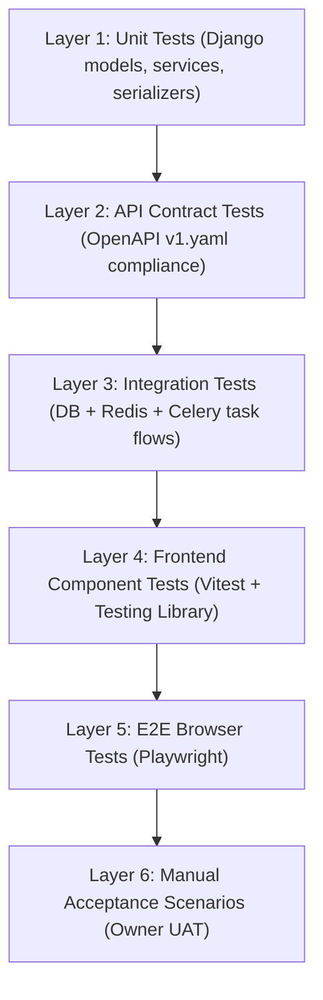
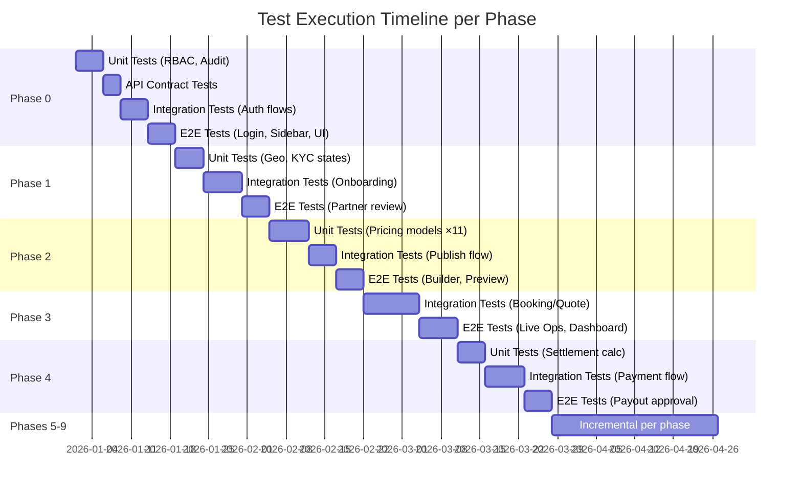

# V Solve Hub — Super App Admin Dashboard Roadmap v2: Gap Analysis, Test Strategy & Missing Parts Audit

> **Purpose:** Analyze the Roadmap v2 document against the existing codebase, identify every gap, missing part, under-specified area, and define a comprehensive testing strategy per phase. **No implementation — document only.**

---

## 1. Codebase Reality Check — What Already Exists

Before analyzing gaps, the roadmap must be grounded in what the codebase already has. The existing platform is **not greenfield** — significant infrastructure is already built across M1 and M2.

### 1.1 Existing Backend Apps (20 Django apps)

| Django App | What It Already Provides | Roadmap Assumption Gap |
| :--- | :--- | :--- |
| `identity` | `User`, `Role`, `UserRole`, `OtpChallenge`, `UserSession` with stepped-up auth | Roadmap §38/§39 proposes "AdminUser" and "AdminRole" — **the existing `User`/`Role`/`UserRole` model already covers this**. Building separate admin identity models would violate the single-user-multi-role architecture. |
| `catalog` | `Category`, `Service`, `ServiceVariant` with 8 fulfilment archetypes (A1–A10), `A1VariantConfiguration`, `M2VariantConfiguration`, `A7VariantConfiguration`, `A10VariantConfiguration`, `TaskRate`, `PricingPolicy`, `CancellationPolicy` | Roadmap §7/§8 proposes a "5-tier taxonomy" — **the existing 4-tier model (`Category → Subcategory → Service → ServiceVariant`) already exists** with archetype-specific configuration tables. |
| `locations` | `ServiceArea`, `PostalCode` with `state_code`, `is_accepting_partners` | Roadmap §19 proposes a "6-tier geographic hierarchy" — **only 3 tiers currently exist** (`ServiceArea → PostalCode`, with `state_code` as a field, not a separate entity). Country/State/City/Zone are not separate models. |
| `partners` | `PartnerCapability` (with 8+ archetypes), `PartnerDocumentUpload`, `PartnerBusinessProfile`, `PartnerScheduleChangeAudit`, `CrewMember`, `PartnerIdentityCluster` | Roadmap §5 proposes "14 partner types" — **the existing model uses capability-based archetypes**, not discrete partner type models. |
| `commerce` | `PaymentAttempt`, `PaymentAllocation`, `Refund`, `DocumentSequence`, `FinancialException` | Roadmap §14 treats payments as future — **core payment infrastructure already exists** with allocation-based money model (ADR-0003). |
| `payouts` | `PartnerLedgerEntry`, payout batch support | Roadmap §15 treats settlement as future — **partner earnings ledger already exists**. |
| `assignments` | `PartnerOffer`, `Reservation`, `DispatchCommandAudit`, `AssignmentAttempt` | Roadmap §9 booking engine is partially built — **offer/accept/dispatch/recovery already exist**. |
| `carts` | `Cart`, `CartItem`, `CheckoutSession`, `FulfilmentPlan`, `FulfilmentPlanSet`, `ServiceCompatibilityRule` | Cart and checkout infrastructure already exists. |
| `cases` | `OperationsCase` with multiple subject types, settlement approval | Roadmap §28 proposes a new "Support Center" — **Operations case system already exists** with subject types, SLA, and resolution tracking. |
| `ratings` | Ratings app exists | Roadmap §32 treats this as future — **schema already exists**. |
| `notifications` | `KillSwitch` with scoped notification controls | Roadmap §29 partially covered. |
| `requirements` | `CustomerRequirement`, `Proposal`, `SiteVisit`, `VendorInvitation`, `WorkItem`, `PartnerRateItem`, `CommercialPolicy`, `RevisionRequest`, `PriceBook` — full M2 A5 project engine | Roadmap §10/§11 quote management — **the A5 project engine with proposals, milestones, BOQ, rate cards, and revision requests already exists**. |
| `rentals` | `RentalAsset`, `AssetReservation`, `RentalBooking`, `RentalDamageLine`, `RentalAssetCategoryProfile` | Roadmap §20 treats rental as future vertical — **A7 rental engine already exists** (ADR-0011). |
| `stays` | `Property`, `UnitType`, `StayReservation`, `PropertyPolicy`, `PropertyVisitRequest` | Roadmap §24 treats stays as future — **A9 stay engine already exists** (ADR-0011). |
| `listings` | `ListingApplication`, `Application` | Roadmap §23 treats jobs as future — **A10 listing engine exists**. |
| `fulfilment` | Fulfilment extension models | Fulfilment tracking infrastructure exists. |
| `pricing` | `TaskRate`, `PricingPolicy`, `CancellationPolicy`, `CancellationPolicyBand` | Roadmap §12 — **pricing primitives already exist**. |
| `foundation` | `IdempotencyRecord` | Cross-cutting infrastructure. |
| `health` | Readiness probe | Roadmap §41 — basic health check already exists. |

### 1.2 Existing Admin Frontend (19 feature modules)

The `frontend/apps/admin` app already has these feature modules built:

| Feature Module | Existing Capability |
| :--- | :--- |
| `session` / `profile` | Operations shell with role-based access, login, session management |
| `dashboard` | Home dashboard (exists, partially built) |
| `cases` / `m2-cases` | Operations case management (M1 + M2 cases) |
| `partners` / `partner-review` / `partner-availability` | Partner management, KYC review, availability |
| `payouts` / `finance` | Payout batches, financial views |
| `dispatch-recovery` / `manual-offer` / `assisted-checkout` | Booking dispatch, manual intervention tools |
| `m2-requests` / `m2-rate-cards` / `m2-work-items` | M2 workforce/project operations |
| `compatibility-rules` | Service compatibility configuration |
| `kill-switches` | Notification kill switches |

### 1.3 Existing Fulfilment Archetypes (8 built or in-progress)

| Archetype | Status | Roadmap Phase |
| :--- | :--- | :--- |
| `A1_TASK_VISIT` | **Built (M1)** | Phase 3 re-proposes this |
| `A2_INSPECTION_FIRST` | **Designed (delivery roadmap M2)** | Not explicitly mentioned |
| `A3_TIME_BLOCK` | **Built (M2)** — rate cards, crew dispatch | Phase 6 re-proposes this |
| `A5_CUSTOM_PROJECT` | **Built (M2)** — proposals, milestones, BOQ | Phase 3/6 re-proposes this |
| `A7_RENTAL` | **Built (M3 spec, ADR-0011)** — asset reservation, deposit, damage | Phase 6 re-proposes this |
| `A8_TRIP` | **Designed (delivery roadmap M6)** | Phase 6 maps to this |
| `A9_STAY` | **Built (M3 spec, ADR-0011)** — property, unit types, check-in/out | Phase 6 re-proposes this |
| `A10_LISTING` | **Built (M3 spec)** — listing application, moderation | Phase 6 re-proposes this |

---

## 2. Gap Analysis — What the Roadmap v2 Gets Wrong, Omits, or Under-Specifies

### 2.1 Critical Architectural Gaps

| # | Gap | Severity | Detail |
| :--- | :--- | :--- | :--- |
| **G-01** | **Roadmap ignores the existing archetype-driven architecture** | 🔴 CRITICAL | The platform uses `ServiceVariant.fulfilment_archetype` as the sole lifecycle discriminator (see `00-product-scope-and-principles.md`). The roadmap's Phase 6 "Vertical Control Centers" treats rides, construction, manpower, etc. as separate new modules — but they are **configurations of existing archetype engines**, not new codebases. The roadmap should specify which archetypes each vertical configures, not propose duplicate engines. |
| **G-02** | **Roadmap proposes new identity models that conflict with existing schema** | 🔴 CRITICAL | "AdminUser", "AdminRole", "Permission" models proposed in Phase 0 conflict with the existing `User`, `Role`, `UserRole` system. The platform already has `is_staff`, `is_superuser`, and `UserRole` with `revoked_at` for role lifecycle. Building parallel admin identity is an architectural violation. |
| **G-03** | **No mention of the OpenAPI contract boundary** | 🔴 CRITICAL | Per `AGENTS.md`, the contract (`contracts/openapi/v1.yaml`) is the single source of truth between backend and frontend. The roadmap mentions no contract governance — every new admin endpoint must be published through `v1.yaml` and the generated TypeScript client must be used. No direct DB access from frontend. |
| **G-04** | **Roadmap assumes greenfield for features that already exist** | 🟡 HIGH | Payment center, settlement, partner management, KYC, cases, ratings, rentals, stays, and listings all have existing Django models and admin features. The roadmap should specify **what's new vs. what extends existing** for each item. |
| **G-05** | **No mention of the outbox/Celery dispatch architecture** | 🟡 HIGH | Per ADR-0002 and ADR-0006, all async work flows through an outbox with visibility deadlines. The roadmap's Phase 9 "background jobs" section doesn't acknowledge this existing architecture. |
| **G-06** | **"No-Code Service Builder" contradicts the archetype model** | 🟡 HIGH | §8 proposes services can be created "without code" — but `ServiceVariant` activation validates configuration required by its archetype (per `00-product-scope-and-principles.md`). The builder must know which archetype is being configured, not treat all services as generic forms. |
| **G-07** | **Missing A2_INSPECTION_FIRST archetype** | 🟡 HIGH | The roadmap never mentions the A2 inspection-first archetype, which is a distinct lifecycle in the delivery roadmap (M2). Construction diagnostics, AC servicing, and computer repair all use this. |

### 2.2 Missing Features & Under-Specified Areas

| # | Missing Item | Roadmap Section | What's Missing |
| :--- | :--- | :--- | :--- |
| **M-01** | **Idempotency and concurrency controls** | §9, §14, §15 | The platform uses `IdempotencyRecord` and provider reconciliation (ADR-0003, ADR-0004). The roadmap doesn't specify that admin override actions (reassign, refund, cancel) must be idempotent and concurrency-safe. |
| **M-02** | **Maker-checker for payout batches** | §15 | The existing `payouts` app already has Operations-reviewed batch settlement. The roadmap mentions "two-step approval" but doesn't specify integration with the existing `PartnerLedgerEntry` → batch → bank export flow. |
| **M-03** | **Service compatibility rules** | §7, §8 | The admin already has a `compatibility-rules` feature module and `ServiceCompatibilityRule` model. The roadmap's category management doesn't mention these. |
| **M-04** | **Cancellation policy configuration** | §7, §12 | `CancellationPolicy` and `CancellationPolicyBand` already exist. The roadmap mentions "cancellation rules" but doesn't specify the existing band-based model. |
| **M-05** | **Dispatch recovery and manual offers** | §9 | Existing `dispatch-recovery` and `manual-offer` admin modules are not referenced. These are critical operations tools already built. |
| **M-06** | **Kill switches for notifications** | §29 | Existing `KillSwitch` model with scoped notification controls is not referenced. |
| **M-07** | **Financial exception handling** | §14, §15 | `FinancialException` model exists. The roadmap doesn't mention how the admin handles payment exceptions, reconciliation failures, or provider ambiguity. |
| **M-08** | **Assisted checkout** | §9 | The admin has an `assisted-checkout` feature for Operations-assisted booking creation. Not mentioned in the roadmap. |
| **M-09** | **Partner presence and location** | §3, §5 | `PARTNER_PRESENCE_TTL_SECONDS`, `PARTNER_LOCATION_MAX_ACCURACY_METERS`, `PARTNER_LOCATION_STALE_SECONDS` are already configured. Live ops should consume this, not redesign it. |
| **M-10** | **Document storage integration** | §6 | Supabase storage is already configured with `PARTNER_DOCUMENT_BUCKET`, upload/review URL TTL, and orphan retention. The roadmap treats document storage as undecided. |
| **M-11** | **Rate cards and commercial policies** | §12, §13 | M2 rate card system (`m2-rate-cards` feature, `CommercialPolicy`, `PriceBook`) already exists. The roadmap's "11 pricing models" don't reference the existing rate card architecture. |
| **M-12** | **Work items and custom work reviews** | §10, §11 | `WorkItem`, `PartnerRateItem`, `CustomWorkItemReview` exist for M2 project work. The roadmap's "Quotation Builder" doesn't reference these. |
| **M-13** | **Proposal revision and scope summary** | §10, §11 | `Proposal.scope_summary`, `RevisionRequest`, `Proposal.margin_bps`, `Proposal.misc_bps` — existing financial proposal infrastructure not referenced. |
| **M-14** | **Customer wallet scope limitation** | §16 | Per M3 README: wallet means **customer prepaid INR balance only** — not partner wages, not A3 settlement. The roadmap's "V Coins Management" should reference this constraint. |
| **M-15** | **India-specific compliance framework** | §25, §34 | Roadmap v2 correctly removed HIPAA/GDPR but doesn't positively state which framework applies. The Digital Personal Data Protection Act, 2023 (DPDP Act) is the applicable Indian law. GST/TDS treatment is already partially modeled in `commerce`. |
| **M-16** | **Mobile apps (M4 scope)** | Not addressed | M4 delivers Customer App + Partner App + Rapido + AI Chatbot. The admin dashboard roadmap doesn't address admin controls for mobile app management, push notification targeting by platform, or app-specific feature flags — despite §43 "App Version Management" being listed. |
| **M-17** | **Rapido / real-time vehicle service** | §20 | M4 includes a full Rapido ride service with live GPS tracking, fare engine, Google Maps integration. The roadmap's "Vehicle & Ride Control Center" doesn't reference the Rapido-specific requirements from `milestones.md`. |
| **M-18** | **MSG91 OTP provider integration** | §39 | Production OTP delivery uses MSG91 (M3 scope). The roadmap mentions "2FA/OTP" but doesn't specify the MSG91 integration or the existing `OTP_PROVIDER` configuration system. |
| **M-19** | **Vendor subscriptions and premium listings** | §13 | M3 scope includes "Vendor Subscription Plans · Premium Listings" — the roadmap's fee engine doesn't explicitly cover subscription-based partner monetization. |
| **M-20** | **Evidence and document policies** | §9, §10 | The platform has evidence policies per archetype (photo upload rules, OTP verification, proof of work). The roadmap doesn't mention configuring these through the admin. |
| **M-21** | **Crew member management** | §5, §22 | `CrewMember` model with `phone_suffix` exists for M2 workforce. The roadmap's manpower section doesn't reference crew management. |
| **M-22** | **Property visit requests** | §24 | `PropertyVisitRequest` exists in the stays app. The roadmap's property section doesn't mention site visit scheduling for prospective tenants/guests. |
| **M-23** | **Stay condition evidence and damage** | §24 | `StayConditionEvidence`, damage line types, ID document hashing — existing stay-specific features not referenced. |

---

## 3. Comprehensive Test Strategy — Per Phase

### 3.1 Testing Architecture (6 Layers)

### 3.2 Cross-Phase Testing Requirements

| Test Category | Applies To | Rationale |
| :--- | :--- | :--- |
| **Permission matrix tests** | Every phase | Every endpoint and UI action must verify all 12 roles × 8 permissions. An Analyst must not be able to approve a refund. |
| **Audit log verification** | Every phase | Every write operation must produce an audit record. Tests must assert `actor_id`, `action_type`, `old_value`, `new_value`. |
| **Idempotency tests** | Phases 3, 4, 5 | Retrying an admin action (refund, dispatch, approval) must not duplicate the effect. |
| **Concurrency tests** | Phases 3, 4 | Two admins approving the same payout batch simultaneously must not double-pay. |
| **Contract drift tests** | Every phase | `spectacular --validate` and `generate:check` must pass after every backend change. |
| **Rollback tests** | Phases 0, 2 | Configuration rollback must restore the previous version and audit the rollback action. |

---

### 3.3 Phase-Specific Test Scenarios

#### Phase 0 — Foundation Tests

| ID | Scenario | Type | Pass Criteria |
| :--- | :--- | :--- | :--- |
| P0-T01 | Admin login with valid OTP | E2E | Session created, correct role returned, audit log entry written |
| P0-T02 | Admin login with invalid OTP | E2E | Login rejected, no session created, failed attempt logged |
| P0-T03 | 2FA step-up for high-risk action | Integration | Step-up challenge issued, action blocked until verified |
| P0-T04 | Role assignment by Super Admin | API | `UserRole` created, permission matrix applied, audit logged |
| P0-T05 | Role assignment by non-Super Admin | API | 403 Forbidden returned |
| P0-T06 | Audit log immutability | Unit | No DELETE/UPDATE operation on audit log table succeeds |
| P0-T07 | Audit log completeness | Integration | Every write endpoint produces exactly one audit record |
| P0-T08 | Config version creation on change | Unit | Changing any config entity creates a new version with diff |
| P0-T09 | Config rollback restores previous | Integration | Rollback to version N-1 restores exact field values |
| P0-T10 | Sidebar visibility by role | E2E | Analyst sees only "Reports" group; Finance sees "Money" group |
| P0-T11 | Global control bar renders | E2E | Search trigger, notification badge, approvals counter, city selector all visible |
| P0-T12 | Session timeout and forced logout | Integration | Expired session returns 401; concurrent session limit enforced |
| P0-T13 | Dual authorization for sensitive action | E2E | First approver submits, second approver confirms, action executes only after both |
| P0-T14 | IP/device logging on login | Unit | Login event records IP address and device user agent |
| P0-T15 | Design system token consistency | Visual | All UI components use defined color tokens (`#0B192C`, `#FF6500`, `#F8FAFC`) |

#### Phase 1 — Geography, Identity & KYC Tests

| ID | Scenario | Type | Pass Criteria |
| :--- | :--- | :--- | :--- |
| P1-T01 | Create new service area with postal codes | API + E2E | ServiceArea created, PostalCodes linked, audit logged |
| P1-T02 | Activate service area for specific categories | API | Only selected categories serviceable in that area |
| P1-T03 | Geographic pricing override | Integration | Price for same service differs between two areas with different overrides |
| P1-T04 | Customer 360° profile view | E2E | Profile, booking history, V Coins balance, ratings, complaints all displayed |
| P1-T05 | Customer account suspension | API + E2E | Customer cannot book after suspension; audit logged; reversal works |
| P1-T06 | Partner onboarding (happy path) | E2E | Application submitted → documents uploaded → KYC reviewed → approved → capabilities active |
| P1-T07 | Partner onboarding (rejection) | E2E | Rejected with reason → partner notified → resubmission flow |
| P1-T08 | KYC document expiry alert | Integration | Document nearing expiry triggers alert to partner and operations |
| P1-T09 | KYC state machine integrity | Unit | Every transition (`Pending→Under Review→Verified→Rejected→Expired`) validated; invalid transitions rejected |
| P1-T10 | Partner ranking calculation | Unit | Weighted formula produces expected score given known inputs |
| P1-T11 | Partner ranking updates on new rating | Integration | New customer rating recalculates partner rank |
| P1-T12 | Bulk partner data export | API | CSV export contains all partner fields; respects role permissions |
| P1-T13 | Approval queue for KYC | E2E | Pending KYC items appear in approval center; approve/reject flows work |
| P1-T14 | Partner capability archetype validation | Unit | Partner cannot be approved for A7_RENTAL capability without valid vehicle/asset documents |
| P1-T15 | Concurrent KYC approval | Integration | Two reviewers approving same document simultaneously doesn't create duplicate approval records |

#### Phase 2 — Marketplace & Pricing Tests

| ID | Scenario | Type | Pass Criteria |
| :--- | :--- | :--- | :--- |
| P2-T01 | Create category → subcategory → service → variant | E2E | Full hierarchy created with all CMS attributes |
| P2-T02 | Variant activation validates archetype config | Unit | A1 variant without `TaskRate` cannot activate; A7 variant without asset profile cannot activate |
| P2-T03 | Draft → Preview → Publish lifecycle | E2E | Draft service visible in preview mode only; published service visible to customers |
| P2-T04 | Preview across Customer/Partner/Web viewports | E2E | Service renders correctly in all three preview targets |
| P2-T05 | Each of 11 pricing models calculates correctly | Unit (×11) | Fixed, Per Unit, Per KM, Per Hour, Per Day, Per Sq.Ft, Per KG, Per Item, Per Point, Per Project, Quote-Based all produce correct paise amounts |
| P2-T06 | Multi-dimensional pricing override | Integration | City-level override takes precedence over global; area-level over city-level |
| P2-T07 | Platform fee calculation — flat | Unit | Flat fee deducted correctly from partner earnings |
| P2-T08 | Platform fee calculation — percentage | Unit | Percentage fee calculated on correct base amount |
| P2-T09 | Platform fee cap enforcement | Unit | Daily/monthly commission cap prevents over-charging |
| P2-T10 | Service compatibility rules | Integration | Incompatible services cannot be added to same cart/fulfilment unit |
| P2-T11 | Cancellation policy configuration | Unit | Band-based cancellation charges calculated correctly per time window |
| P2-T12 | No-Code builder — all field types | E2E | Text, number, select, multi-select, photo, date, location fields all configurable and render correctly |
| P2-T13 | Category approval gate | E2E | New category requires approval before publishing |
| P2-T14 | Category archive/disable | API | Archived category not visible to customers; existing bookings unaffected |
| P2-T15 | Pricing policy effective dates | Unit | Future-dated pricing does not apply until effective date |

#### Phase 3 — Execution Engine Tests

| ID | Scenario | Type | Pass Criteria |
| :--- | :--- | :--- | :--- |
| P3-T01 | Booking lifecycle — all 10 stages | Integration | Each stage transition produces correct state, audit, and notification |
| P3-T02 | Admin manual re-dispatch | E2E | Failed assignment → admin reassigns → new partner offer created |
| P3-T03 | Admin forced cancellation with refund | E2E | Booking cancelled → refund initiated → payment reversed → audit logged |
| P3-T04 | Admin fee adjustment on active booking | API | Adjustment creates immutable revision; partner earnings updated |
| P3-T05 | Quote lifecycle — all stages | Integration | Inquiry → requirements → site visit → proposal → revisions → approval → work order |
| P3-T06 | BOQ line item CRUD | E2E | Add/edit/delete materials, labour, equipment lines; totals recalculate |
| P3-T07 | Quote revision (V1 → V2 → V3 → Final) | Integration | Each revision is immutable; previous versions accessible |
| P3-T08 | Live operations map renders | E2E | Partners with active presence appear on map; filter by city/zone/category works |
| P3-T09 | Dashboard KPI drill-down | E2E | Clicking "Active Bookings" card navigates to filtered booking list |
| P3-T10 | Dashboard widget drag-and-drop | E2E | Widget repositioned; layout persisted across sessions |
| P3-T11 | Global search — booking by ID | E2E | Returns correct booking with full timeline |
| P3-T12 | Global search — customer by phone | E2E | Returns matching customer profile |
| P3-T13 | Activity timeline completeness | Integration | Timeline shows all events from creation through settlement |
| P3-T14 | Customizable dashboard — role templates | E2E | Finance template shows money widgets; Operations template shows dispatch widgets |
| P3-T15 | Concurrent booking status update | Integration | Two admins updating same booking don't create inconsistent state |

#### Phase 4 — Financial Tests

| ID | Scenario | Type | Pass Criteria |
| :--- | :--- | :--- | :--- |
| P4-T01 | Payment lifecycle tracking — all 6 states | Integration | Initiated → Processing → Success → Failed → Refunded → Partially Refunded all tracked |
| P4-T02 | Razorpay webhook reconciliation | Integration | Webhook event correctly updates payment state; duplicate webhooks are idempotent |
| P4-T03 | Payment failure recovery | Integration | Failed payment triggers Operations case; recovery path available |
| P4-T04 | Settlement waterfall calculation | Unit | Gross → Platform Fee → GST → TDS → Adjustments → Net Partner = correct to the paise |
| P4-T05 | Payout batch generation | Integration | Batch groups eligible settlements; bank export file generated in correct format |
| P4-T06 | Payout batch dual approval | E2E | First approver submits batch → second approver confirms → payouts executed |
| P4-T07 | Refund above threshold requires approval | E2E | Refund > ₹10,000 enters approval queue; refund ≤ ₹10,000 processes immediately |
| P4-T08 | GST report generation | Integration | GST summary matches payment records to the paise |
| P4-T09 | TDS deduction report | Integration | TDS deductions calculated per partner per period |
| P4-T10 | Ledger reconciliation | Integration | Sum of all `PartnerLedgerEntry` records matches settlement outputs |
| P4-T11 | Financial exception handling | Unit | `FinancialException` created for provider ambiguity; resolved through Operations case |
| P4-T12 | Invoice generation | Integration | Invoice contains correct line items, taxes, and totals |
| P4-T13 | Fraud detection — abnormal cancellation spike | Integration | Partner with >50% cancellation rate in 7 days triggers risk alert |
| P4-T14 | Fraud risk score → action pipeline | Integration | High risk score triggers investigation flag → appropriate action level |
| P4-T15 | Payment provider failover | Integration | Primary provider failure falls back to configured secondary (if any) |

#### Phase 5 — Growth & Communication Tests

| ID | Scenario | Type | Pass Criteria |
| :--- | :--- | :--- | :--- |
| P5-T01 | V Coins credit on booking completion | Integration | Correct coin amount credited per configuration |
| P5-T02 | V Coins expiry enforcement | Unit | Coins older than configured TTL cannot be redeemed |
| P5-T03 | V Coins category restriction | Unit | Coins restricted to specific categories cannot be spent on others |
| P5-T04 | Admin V Coins debit with reason | API | Debit logged with justification; wallet balance updated |
| P5-T05 | V Coins fraud — velocity abuse | Integration | >N credits in M minutes triggers freeze |
| P5-T06 | Referral reward — both sides | Integration | Referrer and referee both receive configured reward after qualifying event |
| P5-T07 | Self-referral detection | Integration | Same device/IP/phone pattern detected and blocked |
| P5-T08 | QR campaign tracking — scan to booking | Integration | Full attribution chain: scan → install → register → book → revenue |
| P5-T09 | Marketing campaign constraints | Unit | Budget cap, per-user limit, date range, category restriction all enforced |
| P5-T10 | Notification template variable substitution | Unit | `{{customer_name}}`, `{{booking_id}}` etc. replaced with actual values |
| P5-T11 | Multi-channel notification delivery | Integration | Same event triggers push + SMS + email per user preference |
| P5-T12 | Kill switch stops notifications | Integration | Active kill switch prevents delivery for scoped notification type |
| P5-T13 | Banner CMS — publish/unpublish | E2E | Published banner appears in customer app; unpublished disappears |
| P5-T14 | Promo code — first-time booking | Integration | Code works for first booking; rejected on second attempt |
| P5-T15 | Referral grandfathered terms | Unit | Existing referral terms preserved when global config changes |

#### Phase 6 — Vertical Control Tests

| ID | Scenario | Type | Pass Criteria |
| :--- | :--- | :--- | :--- |
| P6-T01 | A7 rental — reserve → pay → handover → return → settle | Integration | Full rental lifecycle with deposit and damage handling |
| P6-T02 | A7 rental — extension payment | Integration | Extension checked against availability; new payment captured |
| P6-T03 | A7 rental — damage → deposit consumption | Integration | Damage evidence recorded; deposit partially/fully consumed |
| P6-T04 | A9 stay — book → check-in → check-out → settle | Integration | Full stay lifecycle with property policy enforcement |
| P6-T05 | A9 stay — no-show policy | Integration | No-show after configured window triggers configured charge |
| P6-T06 | A9 stay — calendar overlap prevention | Unit | PostgreSQL overlap constraint prevents double-booking |
| P6-T07 | A10 listing — post → moderate → publish | Integration | Listing goes through moderation before visibility |
| P6-T08 | A10 listing — spam/abuse detection | Integration | Reported listing flagged for review |
| P6-T09 | A3 time block — timer → extension → attendance → settle | Integration | Time block lifecycle with rate card pricing |
| P6-T10 | A5 project — proposal → revision → milestone → completion | Integration | Full project lifecycle with revision tracking |
| P6-T11 | A8 trip — dispatch → tracking → complete → fare | Integration | Trip lifecycle with route-based fare calculation |
| P6-T12 | Construction milestone photo evidence | Integration | Photo upload required before milestone approval |
| P6-T13 | Manpower attendance tracking | Integration | Daily check-in/check-out recorded; payroll calculated |
| P6-T14 | Healthcare appointment privacy controls | Unit | Patient data access restricted to authorized roles only |
| P6-T15 | Cross-vertical Live Ops display | E2E | All active verticals visible simultaneously on live map |

#### Phase 7 — Support & Governance Tests

| ID | Scenario | Type | Pass Criteria |
| :--- | :--- | :--- | :--- |
| P7-T01 | Support ticket creation from booking | E2E | Ticket linked to booking with full context |
| P7-T02 | Ticket SLA countdown | Integration | Timer starts on creation; escalation triggered on breach |
| P7-T03 | Ticket auto-assignment by category | Integration | Payment dispute → Finance team; safety → Priority escalation |
| P7-T04 | Internal case notes privacy | Unit | Customer-visible vs. internal-only notes separated |
| P7-T05 | Review moderation — hide with audit | E2E | Review hidden; audit trail records who, when, why |
| P7-T06 | Review restore after investigation | E2E | Hidden review restored; audit trail updated |
| P7-T07 | Fake review detection | Integration | Pattern detection (same IP, device, timing) flags suspicious reviews |
| P7-T08 | Bulk data import — partner CSV | Integration | Valid CSV imports all records; invalid rows reported with line numbers |
| P7-T09 | Data export permission gate | API | Analyst can export; Customer Support cannot |
| P7-T10 | DPDP data purge request | Integration | Customer deletion request removes PII; retains financial records per retention policy |

#### Phase 8 — BI & AI Tests

| ID | Scenario | Type | Pass Criteria |
| :--- | :--- | :--- | :--- |
| P8-T01 | Financial reconciliation report accuracy | Integration | Report totals match actual payment records |
| P8-T02 | GST/TDS report accuracy | Integration | Tax summary matches individual transaction tax fields |
| P8-T03 | Report export — XLSX/CSV/PDF | E2E | Each format contains correct data and formatting |
| P8-T04 | Scheduled report delivery | Integration | Report generated and emailed at configured time |
| P8-T05 | Custom report builder — field selection | E2E | User selects data source, columns, filters → report renders |
| P8-T06 | Custom report — save and reload | E2E | Saved report preserves configuration and produces same results |
| P8-T07 | AI assistant — natural language query | Integration | Query returns relevant data with correct authorization |
| P8-T08 | AI assistant — data access authorization | Unit | AI cannot access data beyond the user's role permissions |
| P8-T09 | AI anomaly alert — cancellation spike | Integration | Alert generated when cancellation rate exceeds threshold |
| P8-T10 | AI automation — trigger → condition → action | Integration | Configured workflow executes correctly; human approval gate works |

#### Phase 9 — Reliability & Scale Tests

| ID | Scenario | Type | Pass Criteria |
| :--- | :--- | :--- | :--- |
| P9-T01 | System health dashboard — all subsystems | E2E | API, DB, Redis, Celery, payment gateway, storage all shown |
| P9-T02 | Health degradation alert | Integration | Unhealthy subsystem triggers alert notification |
| P9-T03 | Feature flag — enable/disable without deploy | Integration | Flag toggled → feature immediately enabled/disabled |
| P9-T04 | Feature flag — city-specific rollout | Integration | Flag enabled for one city; disabled for others |
| P9-T05 | Feature flag — percentage rollout | Integration | 10% rollout activates for approximately 10% of users |
| P9-T06 | Maintenance mode — full system | E2E | All clients show maintenance message; admin still accessible |
| P9-T07 | Maintenance mode — single vertical | E2E | Only selected vertical shows maintenance; others functional |
| P9-T08 | App version force-update | Integration | Below-minimum version shows force update modal |
| P9-T09 | API credential masking | E2E | Non-superadmin sees masked secrets; superadmin sees full |
| P9-T10 | Database backup verification | Integration | Backup completes; restoration produces functional database |
| P9-T11 | Unified approval center | E2E | All pending approvals across domains visible in single queue |
| P9-T12 | Load test — 100+ categories | Performance | Response times within SLA under full category load |
| P9-T13 | Load test — concurrent admin users | Performance | 50 concurrent admin users without degradation |
| P9-T14 | Governance review — every write has audit | Audit | Full scan confirms no write endpoint lacks audit logging |
| P9-T15 | Governance review — every sensitive action has approval | Audit | All configured sensitive actions require dual authorization |

---

## 4. Items the Roadmap Completely Omits

| # | Omitted Item | Impact | Recommendation |
| :--- | :--- | :--- | :--- |
| **O-01** | **A2_INSPECTION_FIRST archetype** | The inspection-then-repair lifecycle is a core Technician flow. Without admin controls for inspection outcomes, follow-up quote generation, and inspection fee credits, this archetype has no operations surface. | Add A2 operations screens to Phase 3 or Phase 6. |
| **O-02** | **Partner availability management** | The admin already has a `partner-availability` module. The roadmap doesn't specify how admins view, override, or manage partner working hours, exceptions, and busy time. | Explicitly include in Phase 1 under Partner Management. |
| **O-03** | **Dispatch recovery workflows** | The admin has a `dispatch-recovery` module for handling failed dispatch, expired offers, and unassigned bookings. Critical for operations but not mentioned. | Explicitly include in Phase 3 under Universal Booking Engine. |
| **O-04** | **Assisted checkout for operations** | Operations can create bookings on behalf of customers (phone orders, emergency rebooking). This existing capability is not in the roadmap. | Include in Phase 3. |
| **O-05** | **Service area operating windows and dated exceptions** | The delivery roadmap specifies `ServiceAreaOperatingWindow` with dated exceptions (holidays, special hours). The admin roadmap's geography section doesn't cover this. | Include in Phase 1 under City & Service Area Management. |
| **O-06** | **Partner consent and privacy** | `PartnerConsent`, `ConsentReceipt`, `CommunicationPreference`, `PrivacyRequest` exist in the domain model. The admin needs consent management screens. | Include in Phase 1 or Phase 7. |
| **O-07** | **Amendment / additional work during active booking** | The existing fulfilment system supports amendments (ADR-0007). The admin needs to view, approve/reject, and price amendments. | Include in Phase 3. |
| **O-08** | **OTP verification status for fulfilment** | Arrival OTP, completion OTP, and visit arrival verification are existing fulfilment features. The admin needs visibility into these. | Include in Phase 3 Live Ops. |
| **O-09** | **Credit notes and invoice documents** | The delivery roadmap requires credit notes for refunds and proper invoice documents. The admin needs document generation/viewing. | Include in Phase 4. |
| **O-10** | **Partner account change cooling period** | The delivery roadmap specifies bank account change cooling and maker-checker for payout accounts. Not in admin roadmap. | Include in Phase 4 Settlement Center. |
| **O-11** | **Localization and language packs** | M3 delivery roadmap mentions "Partner language packs required by the actual recruitment cohort." Admin needs language/locale management. | Include in Phase 9 or as cross-phase capability. |
| **O-12** | **Safety incident management** | The existing `cases` app handles safety incidents. The admin roadmap's support center doesn't differentiate safety incidents from regular support tickets. | Explicitly include safety case handling in Phase 7. |

---

## 5. Roadmap v2 Internal Inconsistencies

| # | Inconsistency | Location | Issue |
| :--- | :--- | :--- | :--- |
| **I-01** | Phase 0 proposes new `AdminUser`, `AdminRole` models | §38, Phase 0 | Conflicts with existing `User`/`Role`/`UserRole` in `apps.identity`. The platform's architecture is single-user-multi-role, not separate admin identity. |
| **I-02** | §33 Partner Ranking placed in Phase 1 | Phase 1 | The ranking engine is consumed by matching/dispatch (Phase 3) and AI (Phase 8). Placing it in Phase 1 is correct for the data model, but the test scenarios must verify it works with real dispatch in Phase 3. |
| **I-03** | §13 Fee Engine split across Phases 2 and 4 | Phases 2, 4 | Good split (rules vs. calculation), but the roadmap doesn't specify that the Phase 4 calculation must be tested against every Phase 2 rule type. |
| **I-04** | §34 Fraud & Risk split across Phases 4, 5, 7 | Phases 4, 5, 7 | Correct incremental approach, but there's no integration test phase where all fraud signals are tested together. Need a Phase 7 integration pass. |
| **I-05** | §50 Approval Center split across Phases 1, 2, 4, 9 | Multiple | Good incremental approach, but Phase 9 "unified view" must be tested against all accumulated approval types simultaneously. |
| **I-06** | Phase 6 claims verticals "mostly configure" generic engines | Phase 6 | This is only true for A1/A3/A5. A7 (rental), A8 (trip), A9 (stay), and A10 (listing) have **completely separate domain models and state machines** (see ADR-0011). The roadmap should not imply they are configuration-only. |

---

## 6. Recommended Test Execution Order

---

## 7. Summary of Findings

### By Severity

| Severity | Count | Category |
| :--- | :--- | :--- |
| 🔴 CRITICAL | 3 | Architectural conflicts with existing codebase (G-01, G-02, G-03) |
| 🟡 HIGH | 4 | Major omissions of existing infrastructure (G-04, G-05, G-06, G-07) |
| 🟠 MEDIUM | 23 | Missing features, under-specified areas (M-01 through M-23) |
| 🔵 INFO | 12 | Completely omitted capabilities (O-01 through O-12) |
| ⚪ INCONSISTENCY | 6 | Internal contradictions (I-01 through I-06) |
| 🧪 TEST SCENARIOS | 180+ | Across 6 layers, 10 phases |

### Critical Actions Before Implementation

1. **Resolve G-01/G-02:** Decide whether the admin dashboard extends the existing `User`/`Role`/`UserRole` model or genuinely needs separate admin identity (the existing architecture strongly argues against separate models).
2. **Resolve G-03:** Confirm that all admin API work goes through the OpenAPI contract pipeline (`v1.yaml` → generated client).
3. **Resolve G-06:** Scope the "No-Code Builder" to archetype-aware configuration, not arbitrary form building.
4. **Confirm tech stack:** The roadmap explicitly removes the tech stack. The codebase **already uses** Django 5 + DRF + PostgreSQL 17 + Redis 7.4 + Celery + Next.js 16 + Supabase storage. This is not speculative — it's deployed.
5. **Map each roadmap item to existing vs. new:** For every §-numbered item, annotate whether it's "new build", "extend existing", or "configure existing".

---

*This document is an analysis artifact. No code changes have been made.*
