# M3 Browser Evidence

This document shows the evidence for the M3 browser test. The purpose is to verify the user interface flows.
Use `http://localhost` only. Run one Next app at a time.
Look at [docs/runbooks/m3-end-to-end.md](m3-end-to-end.md) for the start commands.

## Results

| Result | Count |
| --- | --- |
| PASS | 34 |
| N/A | 1 |
| FAIL | 0 |
| BLOCKED | 0 |

## C0.1

**Who**: Customer  
**Phone**: 9900000077  
**URL**: `http://localhost:3000`  

| Field label | Control | Data type | Required | Allowed entries | Value used |
| --- | --- | --- | --- | --- | --- |
| Mobile number * | tel | phone | yes | 10 digits for India (+91). Digits only. maxLength 10. Placeholder example 9876543210. | 9900000077 |
| Country code (+91) | select | enum | yes | Predefined country calling codes shown in the control. Capture used +91. | +91 |
| Invite / referral code (shown after Have an invite / referral code?) | text | string | no | Optional alphanumeric invite or referral code. Empty allowed. | none — not used |
| 6-digit code * | text | OTP-digit-string | yes | Exactly 6 digits (0-9). Shown after Send code. | 218353 |

**Steps**:
1. Open the URL in the browser.
2. Put the required data in the fields.
3. Select the submit button.

**Pass result**:
The system shows the correct output. The next screen opens without errors.

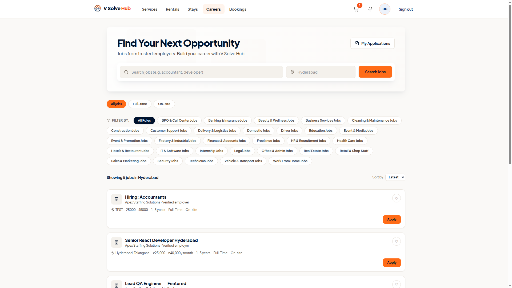
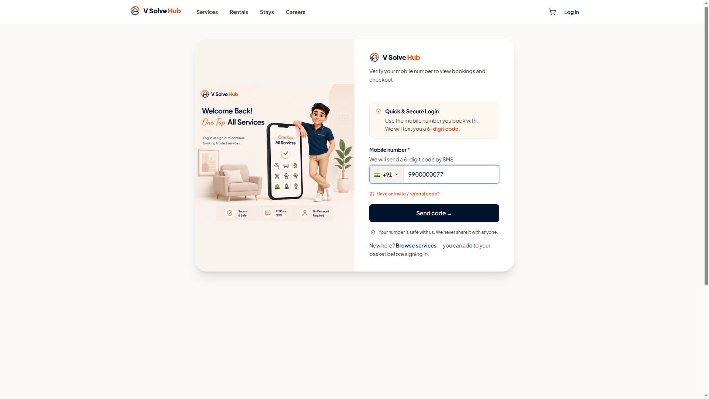
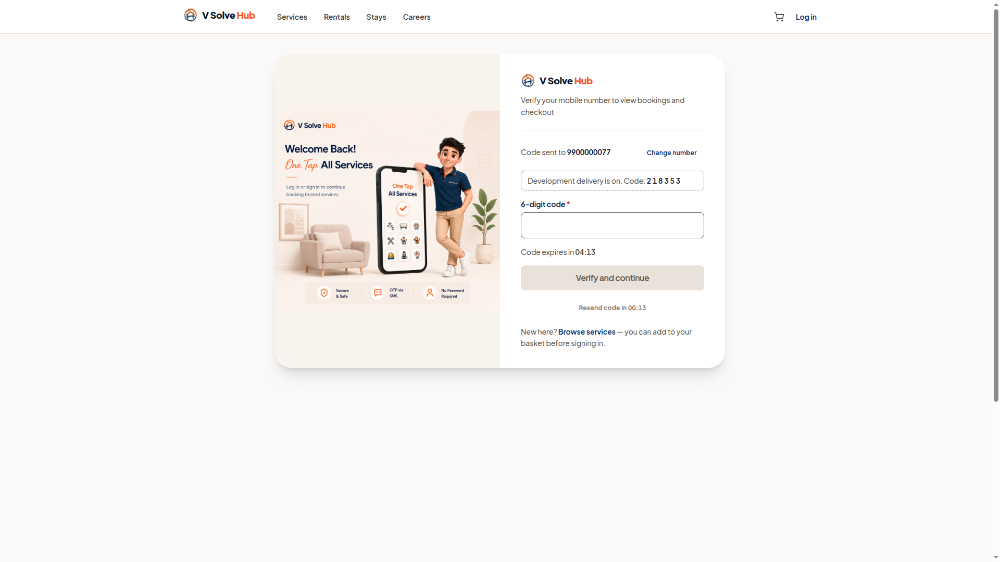

## C0.2

**Who**: Customer  
**Phone**: 9900000077  
**URL**: `http://localhost:3000`  

Entry fields: none on this screen.

**Steps**:
1. Open the URL in the browser.
2. Look at the screen data.
3. Make sure that the correct items show.

**Pass result**:
The system shows the correct output. The next screen opens without errors.

## C1.1

**Who**: Customer  
**Phone**: 9900000077  
**URL**: `http://localhost:3000`  

| Field label | Control | Data type | Required | Allowed entries | Value used |
| --- | --- | --- | --- | --- | --- |
| Search jobs | text | string | no | Free text job keywords. Empty allowed. | none — empty |
| Location | text | string | no | City or area text. Placeholder Hyderabad. Empty allowed. | Hyderabad (placeholder default) |
| Sort by | select | enum | no | Options include at least Latest (value latest). | Latest |
| Job type filters (All jobs / Full-time / On-site) | button | enum | no | Toggle filter chips. Mutually selective per group. | All jobs |
| Role category filters | button | enum | no | One category chip including All Roles and catalog job families. | All Roles |

**Steps**:
1. Open the URL in the browser.
2. Put the required data in the fields.
3. Select the submit button.

**Pass result**:
The system shows the correct output. The next screen opens without errors.

## C1.2

**Who**: Customer  
**Phone**: 9900000077  
**URL**: `http://localhost:3000`  

| Field label | Control | Data type | Required | Allowed entries | Value used |
| --- | --- | --- | --- | --- | --- |
| Full Name | text input | string | yes | Any text string. | Smoke Premium |
| Contact Phone | PhoneField | string | yes | Must be a valid Indian phone number. | 9900000077 |
| Email Address | email input | string | no | Must follow valid email format. | none — empty |
| Experience / Qualification | text input | string | no | Any text string. | none — empty |
| Resume Link / Portfolio URL | url input | string | no | Must follow valid URL format. | none — empty |
| Cover Note / Message to Poster | textarea | string | no | Any text string. | none — empty |

**Steps**:
1. Open the URL in the browser.
2. Put the required data in the fields.
3. Select the submit button.

**Pass result**:
The system shows the correct output. The next screen opens without errors.

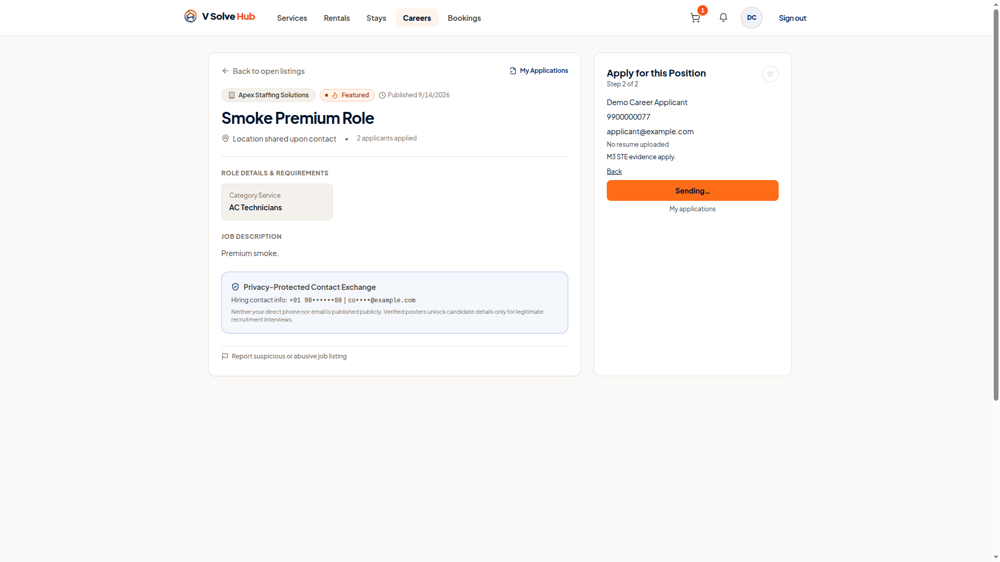
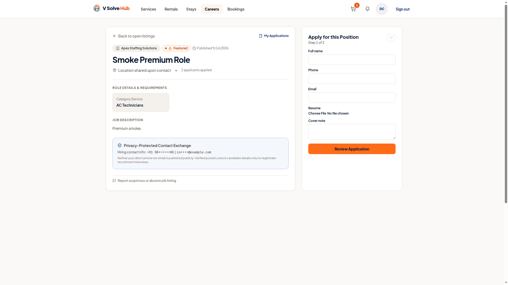

## C1.3

**Who**: Customer  
**Phone**: 9900000077  
**URL**: `http://localhost:3000`  

Entry fields: none on this screen.

**Steps**:
1. Open the URL in the browser.
2. Look at the screen data.
3. Make sure that the correct items show.

**Pass result**:
The system shows the correct output. The next screen opens without errors.

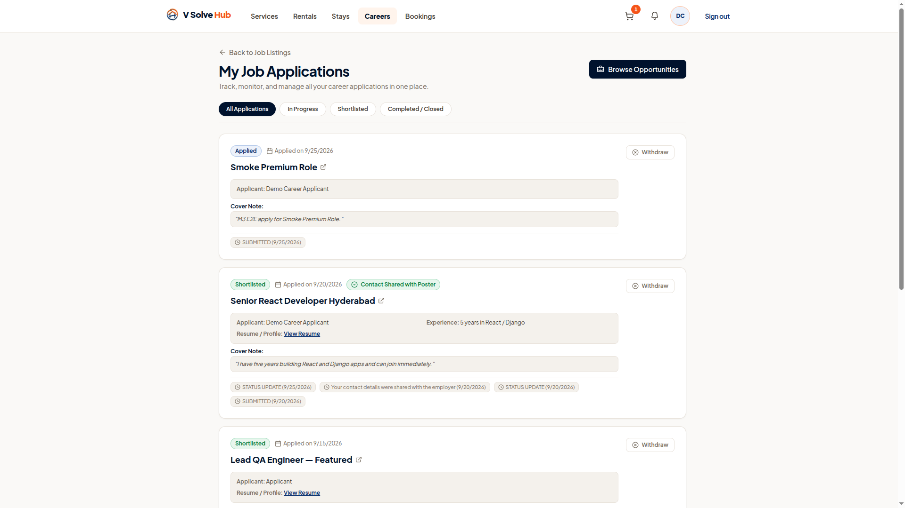

## C2.1

**Who**: Customer  
**Phone**: 9900000077  
**URL**: `http://localhost:3000`  

| Field label | Control | Data type | Required | Allowed entries | Value used |
| --- | --- | --- | --- | --- | --- |
| Quick Select amount buttons | button | enum | no | ₹200, ₹500, ₹1,000, ₹2,000 presets. | ₹500 |
| Or Enter Custom Amount (₹) | number | integer | yes | Min ₹100. Max ₹9,990 per transaction. Whole rupees. | 500 |

**Steps**:
1. Open the URL in the browser.
2. Put the required data in the fields.
3. Select the submit button.

**Pass result**:
The system shows the correct output. The next screen opens without errors.

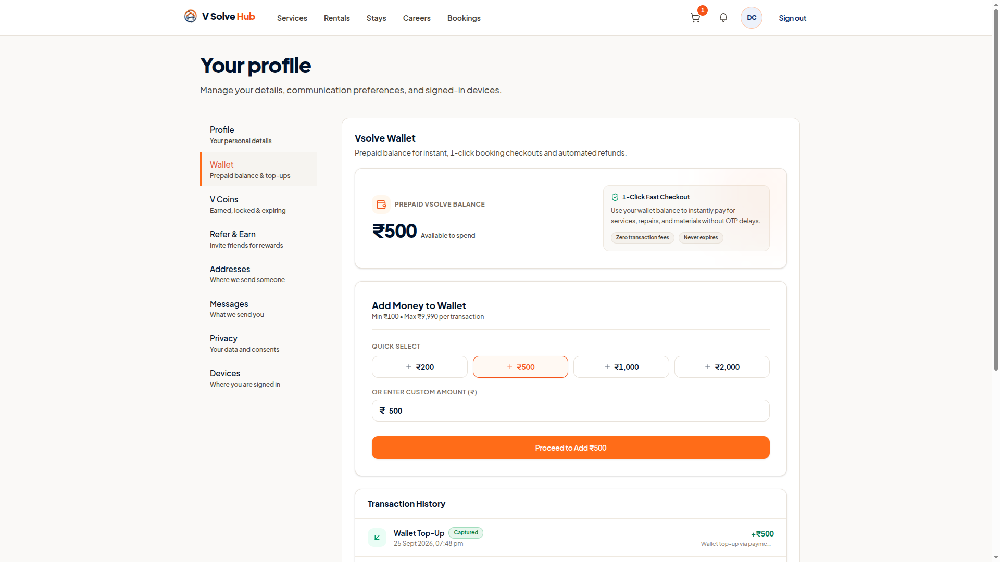

## C2.2

**Who**: Customer  
**Phone**: 9900000077  
**URL**: `http://localhost:3000`  

| Field label | Control | Data type | Required | Allowed entries | Value used |
| --- | --- | --- | --- | --- | --- |
| ENTER SAMPLE BOOKING TOTAL (₹) | number | integer | no | Positive whole rupees for savings preview only. Not a payment. | 1000 |

**Steps**:
1. Open the URL in the browser.
2. Put the required data in the fields.
3. Select the submit button.

**Pass result**:
The system shows the correct output. The next screen opens without errors.

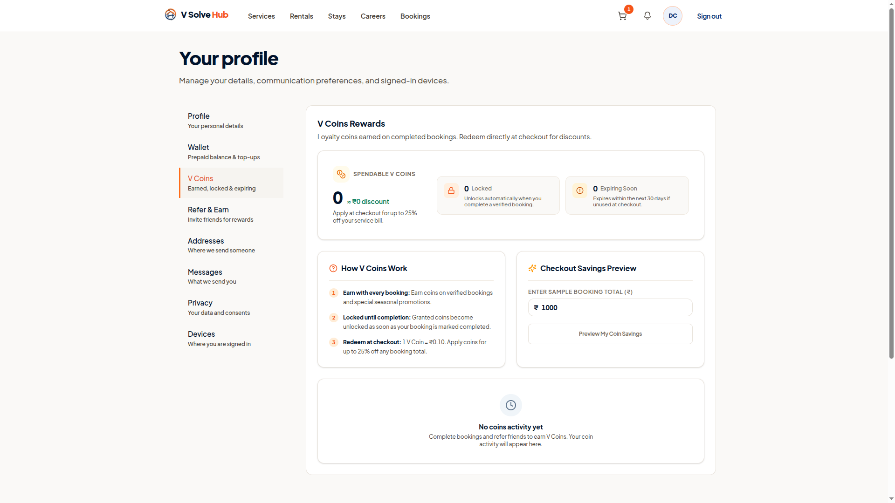

## C2.3

**Who**: Customer  
**Phone**: 9900000077  
**URL**: `http://localhost:3000`  

Entry fields: none on this screen.

**Steps**:
1. Open the URL in the browser.
2. Look at the screen data.
3. Make sure that the correct items show.

**Pass result**:
The system shows the correct output. The next screen opens without errors.

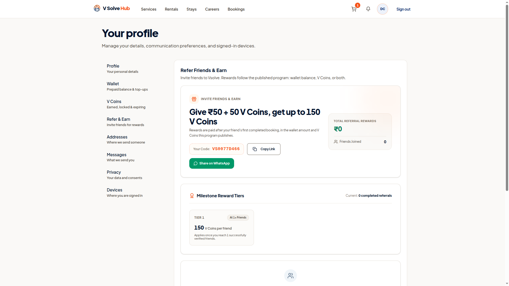

## C3.1

**Who**: Customer  
**Phone**: 9900000055  
**URL**: `http://localhost:3000`  

Entry fields: none on this screen.

**Steps**:
1. Open the URL in the browser.
2. Look at the screen data.
3. Make sure that the correct items show.

**Pass result**:
The system shows the correct output. The next screen opens without errors.

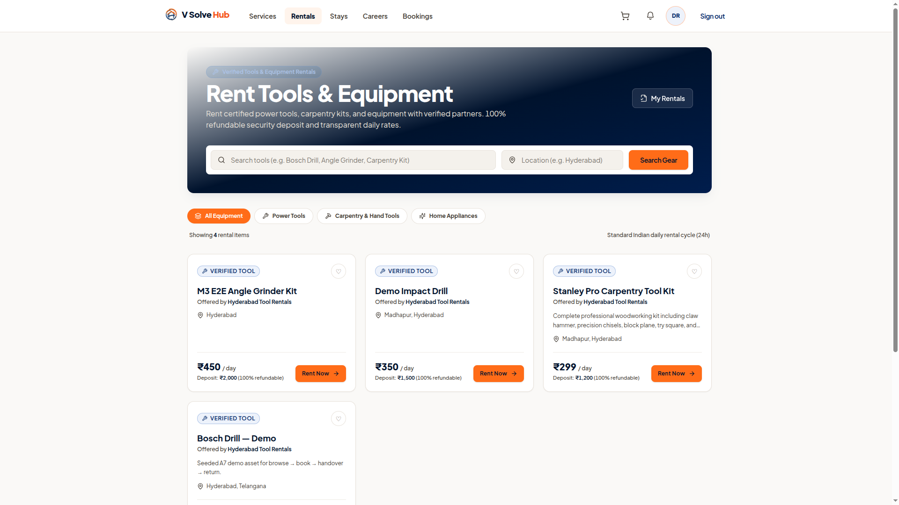

## C3.2

**Who**: Customer  
**Phone**: 9900000055  
**URL**: `http://localhost:3000`  

| Field label | Control | Data type | Required | Allowed entries | Value used |
| --- | --- | --- | --- | --- | --- |
| Pickup Date | date input | ISO 8601 Date | yes | Valid date. Must be equal to or greater than today. | 2026-09-26 |
| Return Date | date input | ISO 8601 Date | yes | Valid date. Must be equal to or greater than the Pickup Date. | 2026-09-28 |
| Handover Preference | button group | string | yes | Options PICKUP or DELIVERY. | PICKUP |
| Notes / Special Instructions (Optional) | textarea | string | no | Any text. | M3 STE evidence booking |

**Steps**:
1. Open the URL in the browser.
2. Put the required data in the fields.
3. Select the submit button.

**Pass result**:
The system shows the correct output. The next screen opens without errors.

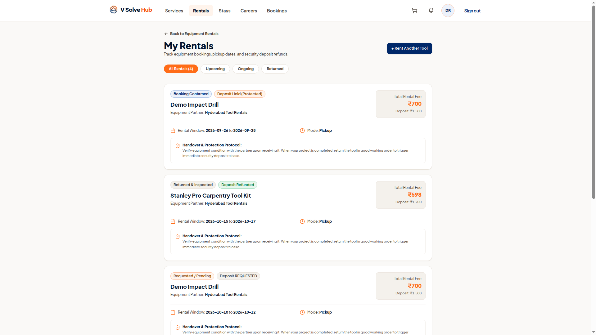
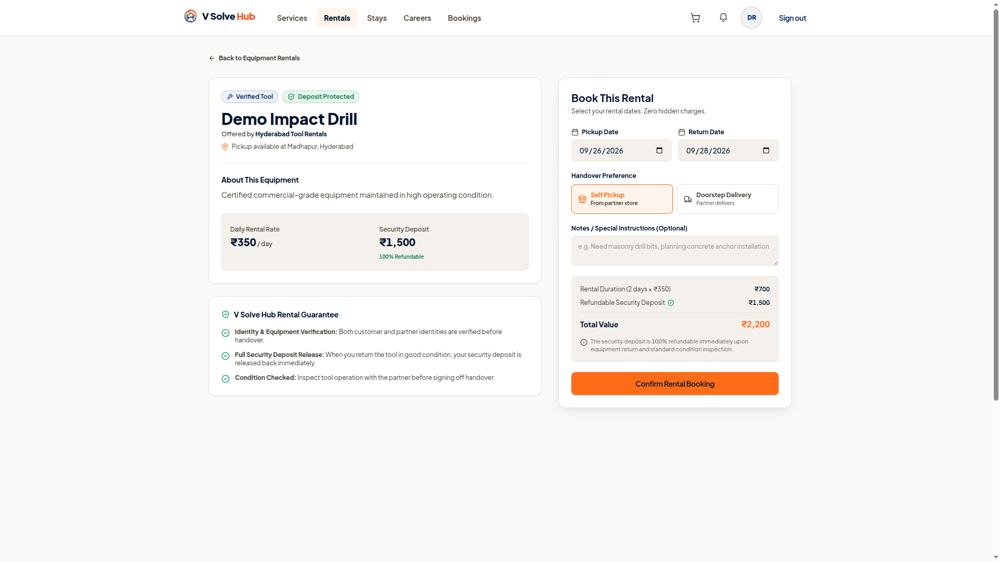

## C3.3

**Who**: Customer  
**Phone**: 9900000055  
**URL**: `http://localhost:3000`  

Entry fields: none on this screen.

**Steps**:
1. Open the URL in the browser.
2. Look at the screen data.
3. Make sure that the correct items show.

**Pass result**:
The system shows the correct output. The next screen opens without errors.

## C4.1

**Who**: Customer  
**Phone**: 9900000033  
**URL**: `http://localhost:3000`  

Entry fields: none on this screen.

**Steps**:
1. Open the URL in the browser.
2. Look at the screen data.
3. Make sure that the correct items show.

**Pass result**:
The system shows the correct output. The next screen opens without errors.

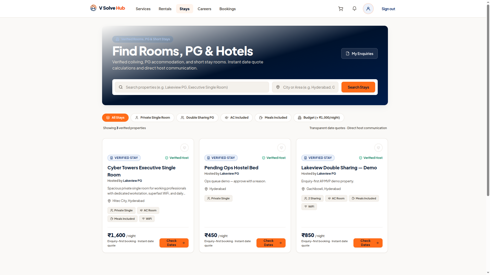

## C4.2

**Who**: Customer  
**Phone**: 9900000033  
**URL**: `http://localhost:3000`  

| Field label | Control | Data type | Required | Allowed entries | Value used |
| --- | --- | --- | --- | --- | --- |
| Select Room Type | button group | string | conditional | Must be a valid Unit ID from the property. | Double Sharing |
| Check-in Date | date input | ISO 8601 Date | yes | Valid date. Must be equal to or greater than today. | 2026-10-02 |
| Check-out Date | date input | ISO 8601 Date | yes | Valid date. Must be strictly after the Check-in Date. | 2026-10-05 |
| Number of Guests | select | integer | yes | Values 1, 2, 3, or 4+. | 1 |
| Message to Host (Optional) | textarea | string | no | Any text. | M3 STE evidence enquiry |

**Steps**:
1. Open the URL in the browser.
2. Put the required data in the fields.
3. Select the submit button.

**Pass result**:
The system shows the correct output. The next screen opens without errors.

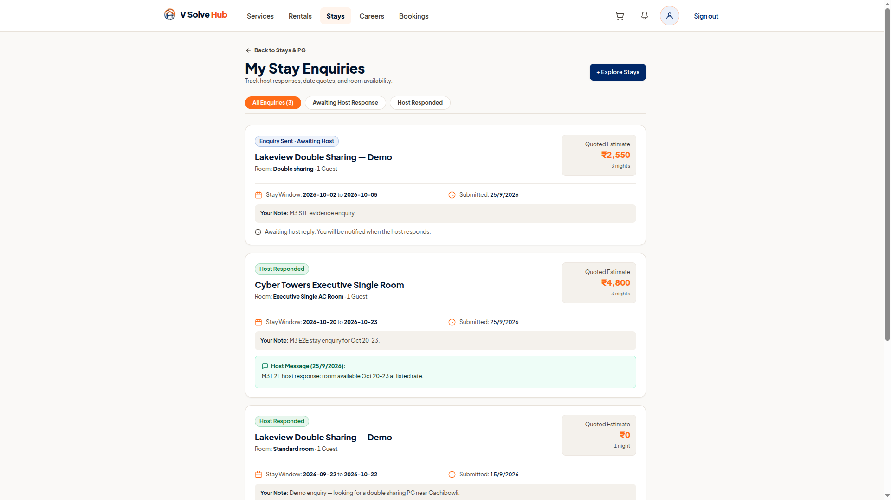
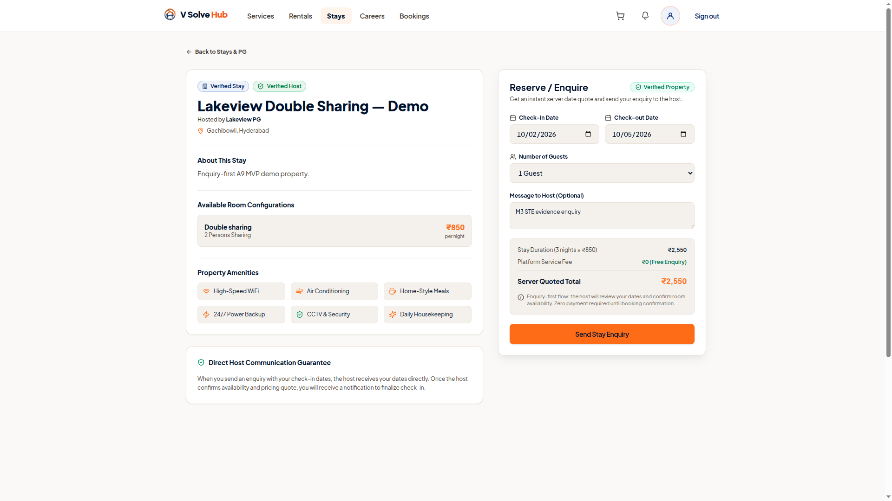

## C4.3

**Who**: Customer  
**Phone**: 9900000033  
**URL**: `http://localhost:3000`  

Entry fields: none on this screen.

**Steps**:
1. Open the URL in the browser.
2. Look at the screen data.
3. Make sure that the correct items show.

**Pass result**:
The system shows the correct output. The next screen opens without errors.

## C5.1

**Who**: Customer  
**Phone**: 9900000033  
**URL**: `http://localhost:3000/activity?tab=booked`  

| Field label | Control | Data type | Required | Allowed entries | Value used |
| --- | --- | --- | --- | --- | --- |
| Search bookings | searchbox | string | no | Free text service name, booking ID, or keyword. Empty allowed. | none — empty |

**Steps**:
1. Open the Bookings page.
2. Look for a payable booking group or pay route.
3. Confirm the empty state when no payable booking exists.

**Pass result**:
N/A. The screen shows “No upcoming bookings” with counts Upcoming & Active 0, Past 0, Cancelled 0. No payable booking group exists in this pass.

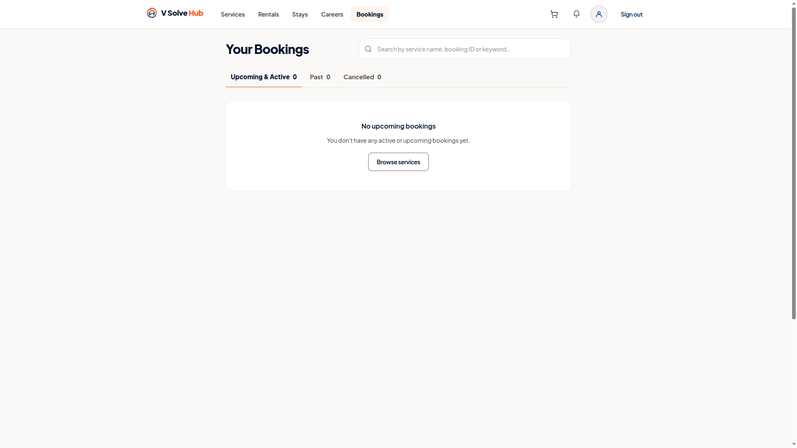

## P0.1

**Who**: Partner  
**Phone**: 9900000088  
**URL**: `http://localhost:3001`  

Entry fields: none on this screen.

**Steps**:
1. Open the URL in the browser.
2. Look at the screen data.
3. Make sure that the correct items show.

**Pass result**:
The system shows the correct output. The next screen opens without errors.

## P1.1

**Who**: Partner  
**Phone**: 9900000088  
**URL**: `http://localhost:3001`  

Entry fields: none on this screen.

**Steps**:
1. Open the URL in the browser.
2. Look at the screen data.
3. Make sure that the correct items show.

**Pass result**:
The system shows the correct output. The next screen opens without errors.

## P1.2

**Who**: Partner  
**Phone**: 9900000088  
**URL**: `http://localhost:3001`  

| Field label | Control | Data type | Required | Allowed entries | Value used |
| --- | --- | --- | --- | --- | --- |
| Career Role / Service | select | string | yes | Must be a valid service ID from the fetched catalog. | Frontend Engineer |
| Listing Title | text input | string | yes | Any text string. | M3 E2E Frontend Engineer |
| Job Description & Requirements | textarea | string | yes | Any text string. | none — empty |
| Location Text | text input | string | yes | Any text string. | none — empty |
| Contact Phone | PhoneField | string | yes | Must be a valid Indian phone number. | 9900000088 |

**Steps**:
1. Open the URL in the browser.
2. Put the required data in the fields.
3. Select the submit button.

**Pass result**:
The system shows the correct output. The next screen opens without errors.

## P1.3

**Who**: Partner  
**Phone**: 9900000088  
**URL**: `http://localhost:3001`  

Entry fields: none on this screen.

**Steps**:
1. Open the URL in the browser.
2. Look at the screen data.
3. Make sure that the correct items show.

**Pass result**:
The system shows the correct output. The next screen opens without errors.

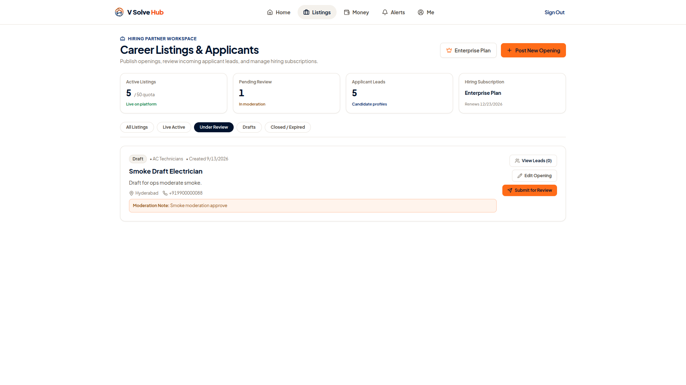

## P1.4

**Who**: Partner  
**Phone**: 9900000088  
**URL**: `http://localhost:3001`  

Entry fields: none on this screen.

**Steps**:
1. Open the URL in the browser.
2. Look at the screen data.
3. Make sure that the correct items show.

**Pass result**:
The system shows the correct output. The next screen opens without errors.

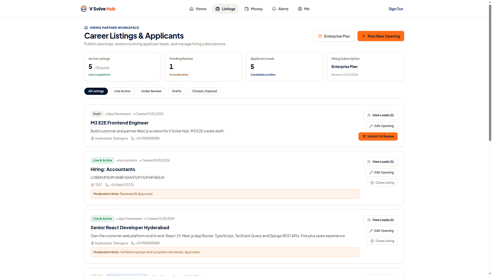

## P1.5

**Who**: Partner  
**Phone**: 9900000088  
**URL**: `http://localhost:3001`  

Entry fields: none on this screen.

**Steps**:
1. Open the URL in the browser.
2. Look at the screen data.
3. Make sure that the correct items show.

**Pass result**:
The system shows the correct output. The next screen opens without errors.

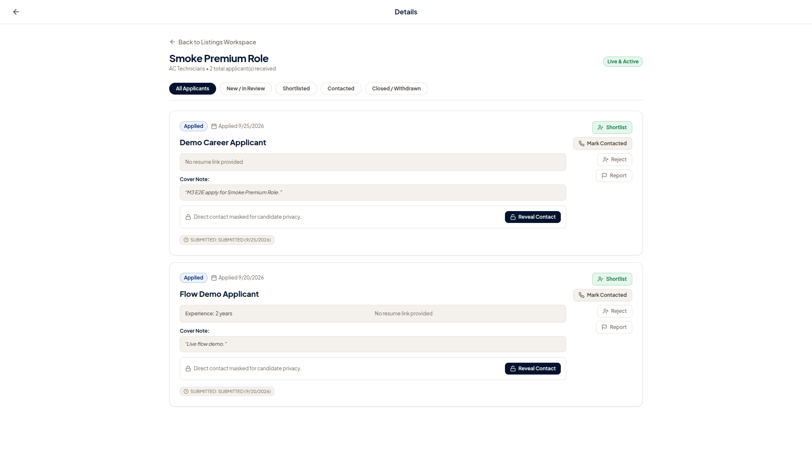

## P0.2

**Who**: Partner  
**Phone**: 9900000066  
**URL**: `http://localhost:3001`  

Entry fields: none on this screen.

**Steps**:
1. Open the URL in the browser.
2. Look at the screen data.
3. Make sure that the correct items show.

**Pass result**:
The system shows the correct output. The next screen opens without errors.

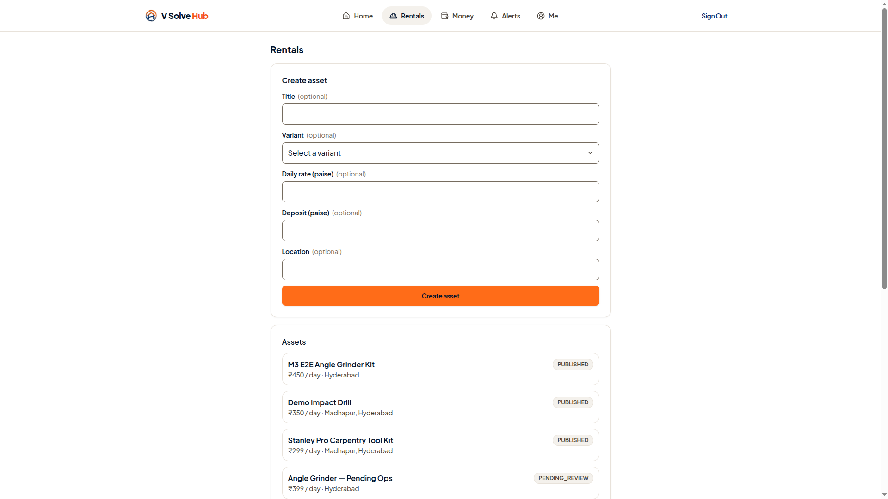

## P2.1

**Who**: Partner  
**Phone**: 9900000066  
**URL**: `http://localhost:3001`  

Entry fields: none on this screen.

**Steps**:
1. Open the URL in the browser.
2. Look at the screen data.
3. Make sure that the correct items show.

**Pass result**:
The system shows the correct output. The next screen opens without errors.

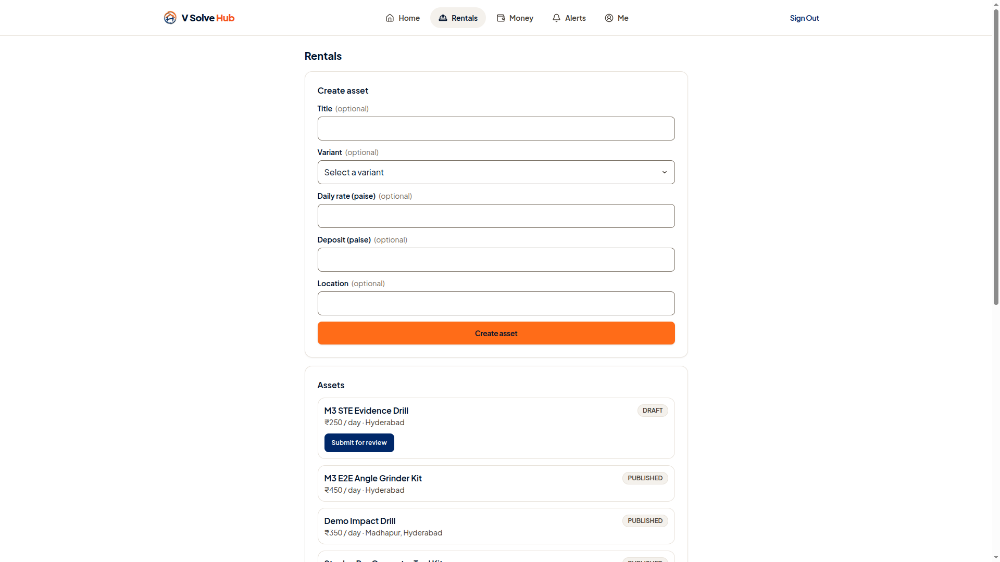

## P2.2

**Who**: Partner  
**Phone**: 9900000066  
**URL**: `http://localhost:3001`  

| Field label | Control | Data type | Required | Allowed entries | Value used |
| --- | --- | --- | --- | --- | --- |
| Variant | select | string | yes | Must be a valid variant ID from the fetched partner capabilities. | Drill Machine |
| Title | text input | string | yes | Any text string. | M3 STE Evidence Drill |
| Daily rate (paise) | numeric input | integer | yes | Numeric value. Minimum 1 paise. | 25000 |
| Deposit (paise) | numeric input | integer | no | Numeric value. Minimum 0 paise. | 100000 |
| Location | text input | string | no | Any text string. | Hyderabad |

**Steps**:
1. Open the URL in the browser.
2. Put the required data in the fields.
3. Select the submit button.

**Pass result**:
The system shows the correct output. The next screen opens without errors.

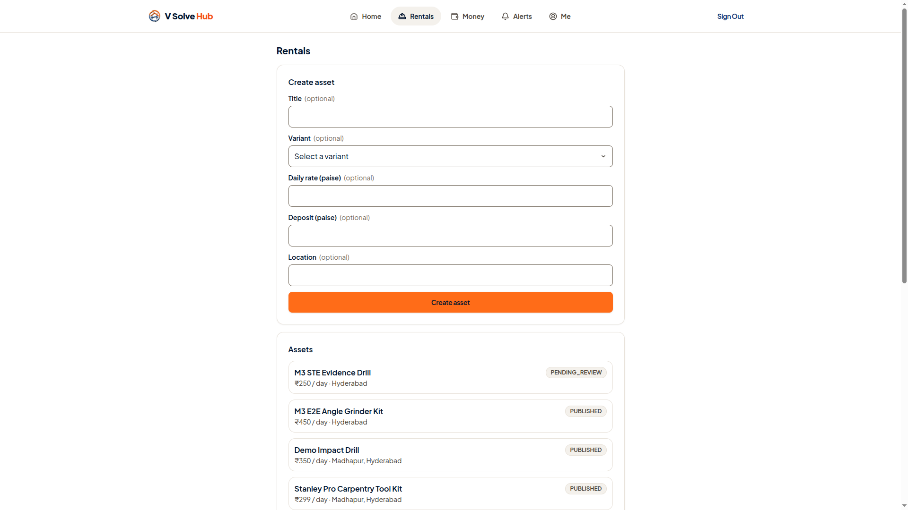

## P2.3

**Who**: Partner  
**Phone**: 9900000066  
**URL**: `http://localhost:3001`  

Entry fields: none on this screen.

**Steps**:
1. Open the URL in the browser.
2. Look at the screen data.
3. Make sure that the correct items show.

**Pass result**:
The system shows the correct output. The next screen opens without errors.

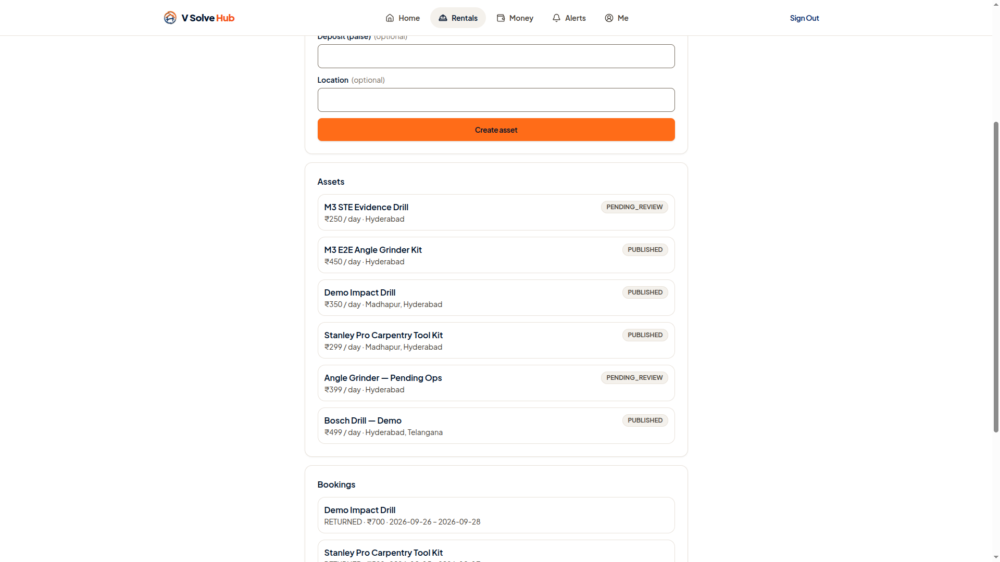

## P0.3

**Who**: Partner  
**Phone**: 9900000044  
**URL**: `http://localhost:3001`  

Entry fields: none on this screen.

**Steps**:
1. Open the URL in the browser.
2. Look at the screen data.
3. Make sure that the correct items show.

**Pass result**:
The system shows the correct output. The next screen opens without errors.

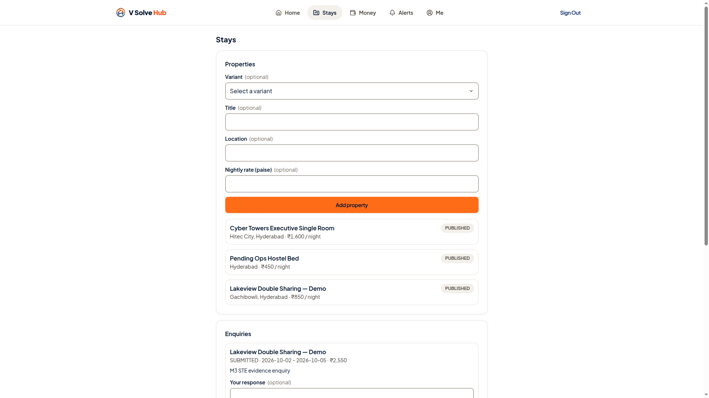

## P3.1

**Who**: Partner  
**Phone**: 9900000044  
**URL**: `http://localhost:3001`  

| Field label | Control | Data type | Required | Allowed entries | Value used |
| --- | --- | --- | --- | --- | --- |
| Variant | select | string | yes | Must be a valid variant ID from the fetched partner capabilities. | Lakeview Double Sharing |
| Title | text input | string | yes | Any text string. | Lakeview |
| Location | text input | string | no | Any text string. | Lakeview |
| Nightly rate (paise) | numeric input | integer | yes | Numeric value. Minimum 1 paise. | 85000 |

**Steps**:
1. Open the URL in the browser.
2. Put the required data in the fields.
3. Select the submit button.

**Pass result**:
The system shows the correct output. The next screen opens without errors.

## P3.2

**Who**: Partner  
**Phone**: 9900000044  
**URL**: `http://localhost:3001`  

| Field label | Control | Data type | Required | Allowed entries | Value used |
| --- | --- | --- | --- | --- | --- |
| Your response | textarea | string | yes | Any non-empty text string. | M3 STE host response: room available Oct 2-5 at listed rate. |

**Steps**:
1. Open the URL in the browser.
2. Put the required data in the fields.
3. Select the submit button.

**Pass result**:
The system shows the correct output. The next screen opens without errors.

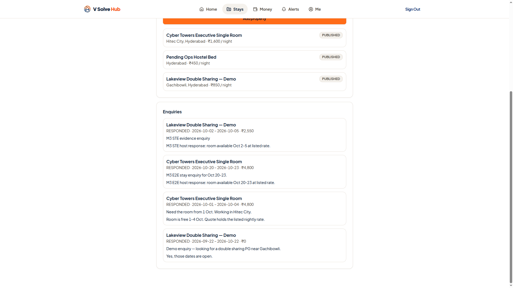

## O0.1

**Who**: Operations  
**Phone**: 8019013032  
**URL**: `http://localhost:3002`  

Entry fields: none on this screen.

**Steps**:
1. Open the URL in the browser.
2. Look at the screen data.
3. Make sure that the correct items show.

**Pass result**:
The system shows the correct output. The next screen opens without errors.

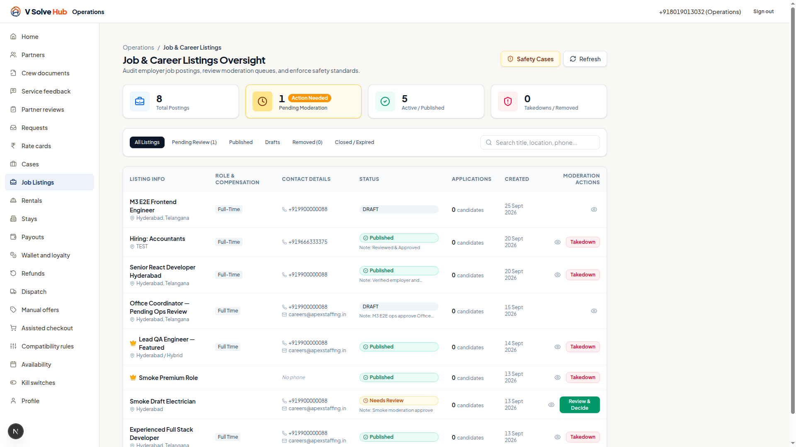

## O1.1

**Who**: Operations  
**Phone**: 8019013032  
**URL**: `http://localhost:3002`  

| Field label | Control | Data type | Required | Allowed entries | Value used |
| --- | --- | --- | --- | --- | --- |
| Decision | button group | boolean | yes | Approve or Reject. | Approve |
| Approval Note / Rejection Reason | textarea | string | conditional | Any text string. Required if decision is Reject. | M3 STE evidence approval for Smoke Draft Electrician |

**Steps**:
1. Open the URL in the browser.
2. Put the required data in the fields.
3. Select the submit button.

**Pass result**:
The system shows the correct output. The next screen opens without errors.

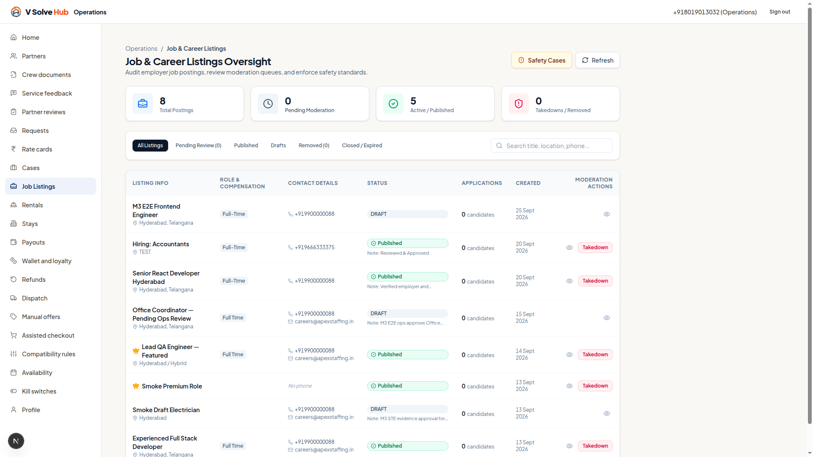

## O2.1

**Who**: Operations  
**Phone**: 8019013032  
**URL**: `http://localhost:3002`  

Entry fields: none on this screen.

**Steps**:
1. Open the URL in the browser.
2. Look at the screen data.
3. Make sure that the correct items show.

**Pass result**:
The system shows the correct output. The next screen opens without errors.

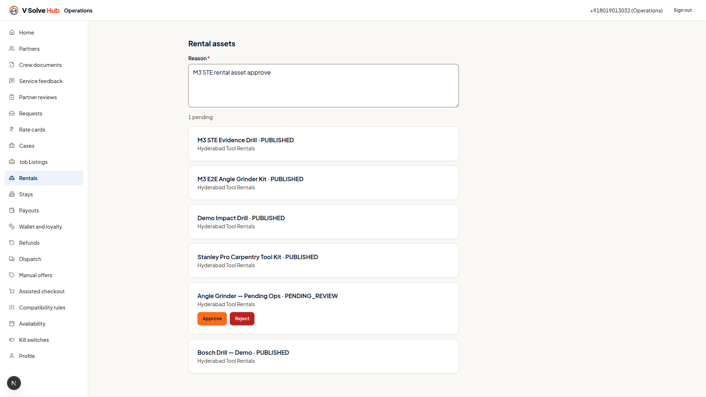

## O2.2

**Who**: Operations  
**Phone**: 8019013032  
**URL**: `http://localhost:3002`  

| Field label | Control | Data type | Required | Allowed entries | Value used |
| --- | --- | --- | --- | --- | --- |
| Reason | textarea | string | yes | Any non-empty text string. | M3 STE rental asset approve |
| Action | button group | string | yes | APPROVE or REJECT. | APPROVE |

**Steps**:
1. Open the URL in the browser.
2. Put the required data in the fields.
3. Select the submit button.

**Pass result**:
The system shows the correct output. The next screen opens without errors.

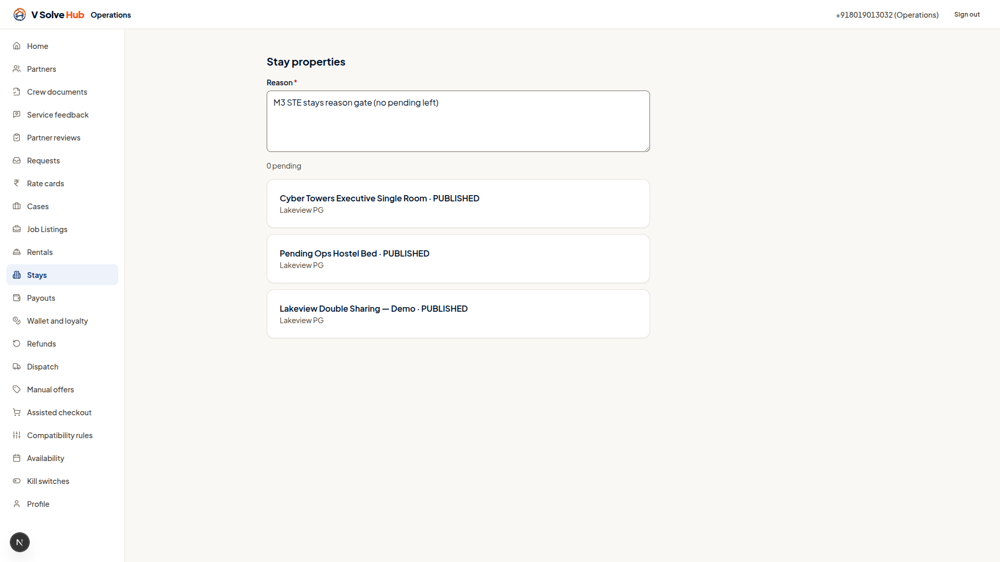

## O3.1

**Who**: Operations  
**Phone**: 8019013032  
**URL**: `http://localhost:3002/operations/loyalty`  

| Field label | Control | Data type | Required | Allowed entries | Value used |
| --- | --- | --- | --- | --- | --- |
| Max burn percent (optional) | number | integer | no | Positive percent for coin burn. Form default 25. | 25 — display default |
| Coin value paise (optional) | number | integer | no | Paise per coin. Form default 10. | 10 — display default |
| Minimum paise (optional) | number | integer | no | Wallet top-up minimum in paise. Form default 10000. | 10000 — display default |
| Maximum paise (optional) | number | integer | no | Wallet top-up maximum in paise. Form default 999000. | 999000 — display default |
| New version code (optional) | text | string | no | Referral program version code. Empty allowed until publish. | none — empty |
| Referee wallet paise (optional) | number | integer | no | Paise awarded to referee. Empty allowed. | none — empty |
| Referee coins (optional) | number | integer | no | Coins awarded to referee. Empty allowed. | none — empty |
| Referrer wallet paise (optional) | number | integer | no | Paise awarded to referrer. Empty allowed. | none — empty |
| Referrer coins (optional) | number | integer | no | Coins awarded to referrer. Empty allowed. | none — empty |

**Steps**:
1. Open Wallet and loyalty.
2. Read liability, burn policy, top-up limits, and referral versions.
3. Leave publish forms unchanged for this evidence capture.

**Pass result**:
Liability shows 150000 paise across 3 wallets. Active burn is 25% · 10 paise/coin. Active top-up is 10000–999000 paise. Active referral version is m3-e2e-2026-09-25.

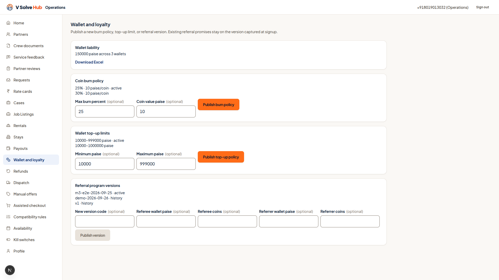

## O3.2

**Who**: Operations  
**Phone**: 8019013032  
**URL**: `http://localhost:3002/operations/loyalty`  

| Field label | Control | Data type | Required | Allowed entries | Value used |
| --- | --- | --- | --- | --- | --- |
| Download Excel | link | string | no | Opens `GET /api/v1/ops/wallet/liability.xlsx` with ops session. | clicked — file saved |

**Steps**:
1. Open Wallet and loyalty.
2. Select Download Excel under Wallet liability.
3. Save the spreadsheet response as evidence.

**Pass result**:
UI shows Download Excel. Authenticated response is HTTP 200, content-type `application/vnd.openxmlformats-officedocument.spreadsheetml.sheet`, 1858 bytes. File saved as `m3-browser-evidence/O3.2-liability.xlsx`.

