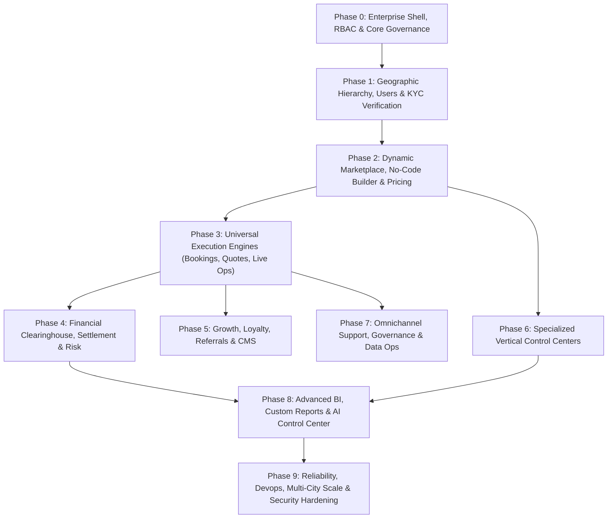

# V Solve Hub — Super App Admin Dashboard: Development Specification & Phased Implementation Roadmap

---

## Executive Summary & Architectural Objective

The **V Solve Hub Admin Dashboard** is designed not merely as a traditional CRUD administrative back-office, but as an enterprise-grade **Super App Control Center**. It serves as the master command and control hub across all business verticals (home services, rides, construction, workforce manpower, healthcare, rentals, events, and education) across multiple cities.

### Core Architectural Principles
1. **Configuration-Driven & Zero Hardcoding:** Dynamic rules engine for categories, services, pricing matrices, commission slabs, fees, geographic zones, and partner tiers to ensure seamless expansion from Hyderabad across Telangana and pan-India without core code rebuilds.
2. **Unified Enterprise Shell & Role-Based Access (RBAC):** Strict operational segregation across 12 distinct administrative personas with two-step authorizations for high-risk and financial transactions.
3. **End-to-End Auditability:** Immutable audit logging for every configuration, status mutation, financial adjustment, and deletion.
4. **Draft-Preview-Test-Publish Lifecycle:** No-code service authoring with multi-client visual preview (Customer App, Partner App, and Web) prior to production deployment.
5. **Human-in-the-Loop AI Control:** Autonomous assistive AI for platform queries, anomaly alerts, matching optimization, and quotation inspections, with strict human approval gates on financial and disciplinary actions.

---

## Complete Scope Coverage Matrix (All 58 Specification Items)

| Spec Section | Title | Primary Development Phase | Navigation Group |
| :--- | :--- | :--- | :--- |
| **§1** | Admin Dashboard Home — Command Center | **Phase 3** | COMMAND CENTER |
| **§2** | Fully Customizable Dashboard | **Phase 3** | COMMAND CENTER |
| **§3** | Live Operations Center | **Phase 3** | COMMAND CENTER |
| **§4** | Customer Management | **Phase 1** | USERS |
| **§5** | Partner / Vendor Management | **Phase 1** | USERS |
| **§6** | KYC & Verification Center | **Phase 1** | USERS |
| **§7** | Service Category Management | **Phase 2** | MARKETPLACE |
| **§8** | No-Code / Dynamic Service Builder | **Phase 2** | MARKETPLACE |
| **§9** | Universal Booking Engine | **Phase 3** | MARKETPLACE |
| **§10** | Universal Quote Management | **Phase 3** | MARKETPLACE |
| **§11** | Quotation Builder | **Phase 3** | MARKETPLACE |
| **§12** | Pricing Engine | **Phase 2** | MARKETPLACE |
| **§13** | Platform Fee / Revenue Engine | **Phase 2** | MARKETPLACE |
| **§14** | Payment Center | **Phase 4** | MONEY |
| **§15** | Settlement Center | **Phase 4** | MONEY |
| **§16** | V Coins Management | **Phase 5** | GROWTH |
| **§17** | Referral Management | **Phase 5** | GROWTH |
| **§18** | QR Campaign Management | **Phase 5** | GROWTH |
| **§19** | City & Service Area Management | **Phase 1** | SYSTEM |
| **§20** | Vehicle & Ride Control Center | **Phase 6** | SERVICES |
| **§21** | Construction Control Center | **Phase 6** | SERVICES |
| **§22** | Manpower Management | **Phase 6** | SERVICES |
| **§23** | Jobs & Careers | **Phase 6** | SERVICES |
| **§24** | Property / Rooms / PG / Hotels | **Phase 6** | SERVICES |
| **§25** | Healthcare | **Phase 6** | SERVICES |
| **§26** | Events & Media | **Phase 6** | SERVICES |
| **§27** | Other / Future Modules | **Phase 6** | SERVICES |
| **§28** | Customer Support Center | **Phase 7** | SUPPORT |
| **§29** | Notification Center | **Phase 5** | GROWTH |
| **§30** | Marketing & Campaign Center | **Phase 5** | GROWTH |
| **§31** | Banner / CMS Management | **Phase 5** | SYSTEM |
| **§32** | Reviews & Ratings | **Phase 7** | USERS |
| **§33** | Partner Ranking Engine | **Phase 2** | MARKETPLACE |
| **§34** | Fraud & Risk Center | **Phase 4** | SYSTEM / USERS |
| **§35** | AI Control Center | **Phase 8** | AI |
| **§36** | Reports & Analytics | **Phase 8** | ANALYTICS |
| **§37** | Custom Report Builder | **Phase 8** | ANALYTICS |
| **§38** | Admin User & Role Management | **Phase 0** | SYSTEM |
| **§39** | Super Admin Security | **Phase 0** | SYSTEM |
| **§40** | Complete Audit Log | **Phase 0** | SYSTEM |
| **§41** | System Health Monitor | **Phase 9** | SYSTEM |
| **§42** | API & Integration Management | **Phase 9** | SYSTEM |
| **§43** | App Version Management | **Phase 9** | SYSTEM |
| **§44** | Feature Flags | **Phase 9** | SYSTEM |
| **§45** | Maintenance Mode | **Phase 9** | SYSTEM |
| **§46** | Data Management | **Phase 7** | SYSTEM |
| **§47** | Backup & Disaster Recovery | **Phase 9** | SYSTEM |
| **§48** | Global Search | **Phase 3** | COMMAND CENTER |
| **§49** | Activity Timeline | **Phase 3** | COMMAND CENTER |
| **§50** | Approval Center | **Phase 1 & 4** | COMMAND CENTER |
| **§51** | Global Control Bar | **Phase 0** | ALL SCREENS |
| **§52** | Final Sidebar Structure | **Phase 0** | NAVIGATION |
| **§53** | Configuration-Driven Architecture | **Phase 0 & 2** | CORE FOUNDATION |
| **§54** | Preview Before Publish | **Phase 2** | MARKETPLACE |
| **§55** | Change History / Version Control | **Phase 0** | CORE FOUNDATION |
| **§56** | Admin UI / UX Design System | **Phase 0** | SHELL & STYLING |
| **§57** | Scalability / Future-Proofing | **Phase 9** | ARCHITECTURE |
| **§58** | Final Admin Philosophy | **Cross-Phase** | GOVERNANCE |

---

## Detailed Development Phases



---

### Phase 0: Enterprise Architecture, UI Shell, RBAC & Core Governance
*The structural foundation upon which all modules and data flows depend.*

#### Modules & Features Covered
* **§38. Admin User & Role Management (RBAC):**
  * Built-in support for 12 roles: *Super Admin, Admin, Operations, Finance, Customer Support, Partner Management, Marketing, HR, Category Manager, City Manager, Auditor, Analyst/Read Only*.
  * Granular authorization matrix: `View`, `Create`, `Edit`, `Delete`, `Approve`, `Export`, `Refund`, `Configure`.
* **§39. Super Admin Security:**
  * Multi-factor Authentication (2FA) / OTP challenge for elevated administrative access.
  * Active session registry, device fingerprinting, IP whitelisting, and login history.
  * Dual-authorization ("four-eyes principle") for sensitive operations (e.g., refunds exceeding ₹10,000, fee restructuring, mass account suspensions).
* **§40. Complete Immutable Audit Log:**
  * Centralized event streaming logging: `actor_id`, `actor_role`, `target_entity_type`, `target_entity_id`, `action_type`, `old_value_json`, `new_value_json`, `ip_address`, `device_agent`, and `timestamp`.
  * Read-only schema guaranteeing non-repudiation and tamper prevention.
* **§55. Change History & Version Control:**
  * Diff viewer for configuration schemas showing Active Version, Previous Version, Author, and Timestamp.
  * One-click rollback capability for business rules and category definitions.
* **§51. Global Control Bar:**
  * Persistent top navigation: Universal Search Trigger, Notification Feed, System Alert Badge, Pending Approvals Counter, AI Assistant Quick Launcher, City/Zone Context Selector, Date Filter, and Admin Profile Switcher.
* **§52. Final Sidebar Structure:**
  * Implementation of the authoritative 10-group navigation architecture.
* **§56. Admin UI / UX Design System:**
  * Strict implementation of V Solve Hub corporate identity: Navy Blue primary (`#0B192C` / `#1E3E62`), Vibrant Orange accents (`#FF6500` / `#E35B00`), Off-White background canvas (`#F8FAFC`).
  * High-density enterprise layout optimized for desktop viewports with tablet/mobile fallback.

#### Technical Deliverables
1. Backend Django models: `AdminUser`, `AdminRole`, `Permission`, `AdminAuditLog`, `ConfigVersionHistory`.
2. OpenAPI Contract extensions in `v1.yaml` for administrative auth and session control.
3. Next.js `apps/admin` shell, layout templates, responsive sidebar, and navigation guards.

---

### Phase 1: Geographic Hierarchy, Master Identities & KYC Verification
*Establishing where services operate, who consumes them, and who fulfills them.*

#### Modules & Features Covered
* **§19. City & Service Area Management:**
  * 6-Tier Geographic Hierarchy: `Country` $\rightarrow$ `State` $\rightarrow$ `City` $\rightarrow$ `Zone` $\rightarrow$ `Area` $\rightarrow$ `Pincode`.
  * Controls: Geospatial boundary definition (GeoJSON polygons), city activation, category whitelisting per zone, service radius, partner availability flags, localized pricing/fee overrides.
* **§4. Customer Management:**
  * 360° Customer Profile: Personal attributes, verification status, student credentials, referral origin/code, V Coins ledger snapshot, lifetime booking/quote history, ratings, active complaints, device fingerprints.
  * Controls: Activate, Deactivate, Suspend, Blacklist, Verify Student status, Credit/Debit V Coins with reason codes, issue promo vouchers, trigger direct in-app/push alerts, and view end-to-end customer journey timeline.
* **§5. Partner / Vendor Management:**
  * Universal persona support across 14 provider types: *Technicians, skilled trades, general labour, drivers/captains, product vendors, commercial businesses, contractors, agencies, healthcare practitioners, tutors, event specialists, real estate brokers, local merchants, corporate service partners*.
  * Comprehensive Provider Profile: KYC status, banking/GST details, trade capabilities, service areas, verified equipment, historical earnings, customer ratings, reliability scores, subscriptions, and commission tiers.
  * Controls: Tier onboarding, suspension, fee rule binding, sponsored badge assignment, and skill verification.
* **§6. KYC & Verification Center:**
  * Multi-document verification engine: Government ID (Aadhaar/Voter), PAN, Driving Licence, Commercial Vehicle Registration/Insurance, GSTIN, Trade Certificates, Educational Qualifications, Bank Cancelled Cheque/Penny Drop, and Police Background Verification.
  * Verification Lifecycle: `Pending` $\rightarrow$ `Under Review` $\rightarrow$ `Verified` $\rightarrow$ `Rejected` $\rightarrow$ `Expired`.
  * Automated document expiry monitors, SLA tracking per reviewer, and automated partner alerts before certificate lapse.
* **§50. Approval Center (Phase 1 Scope):**
  * Central inbox for pending Partner Onboarding, KYC reviews, and Document verifications.

---

### Phase 2: Dynamic Marketplace, No-Code Service Builder & Pricing Engine
*Eliminating hard-coded catalog logic and enabling dynamic service deployment.*

#### Modules & Features Covered
* **§7. Service Category Management:**
  * 5-Tier dynamic taxonomy: `Category` $\rightarrow$ `Subcategory` $\rightarrow$ `Service` $\rightarrow$ `Service Type` $\rightarrow$ `Pricing/Quote Rules`.
  * Rich CMS attributes: SVG icons, hero banners, rich-text guidelines, mandatory customer intake forms, photo upload rules, dynamic FAQs, and cancellation policies.
* **§8. No-Code / Dynamic Service Builder:**
  * Declarative form builder to instantiate new services without writing code.
  * Configurable parameters: Instant booking vs. Quote generation, billable units, minimum order value, custom intake fields, target partner trades, platform commission, and V Coins accrual rates.
* **§54. Preview Before Publish:**
  * Multi-viewport emulator: `Draft` $\rightarrow$ `Preview` (Customer App / Partner App / Web) $\rightarrow$ `Test` $\rightarrow$ `Approval` $\rightarrow$ `Publish`.
* **§12. Pricing Engine:**
  * Matrix pricing engine supporting 11 dynamic calculation models:
    1. *Fixed Price*
    2. *Per Unit*
    3. *Per KM*
    4. *Per Hour*
    5. *Per Day*
    6. *Per Sq.Ft*
    7. *Per KG*
    8. *Per Item*
    9. *Per Point*
    10. *Per Project (Milestone)*
    11. *Quote-Based Custom Estimation*
  * Multi-dimensional pricing overrides across: City-wise, Area-wise, Category-wise, Service-wise, and Partner-tier-wise.
* **§13. Platform Fee & Revenue Engine:**
  * Flexible commission configurations: Flat booking fee, Percentage cut, Monthly/Annual partner subscriptions, Tiered earnings slabs, Daily/Monthly commission caps, and promotional fee waivers.
* **§33. Partner Ranking Engine:**
  * Configurable multi-factor algorithm with customizable weights:
    $$\text{Score} = w_1(\text{Rating}) + w_2(\text{Completion Rate}) + w_3(\text{Response Speed}) - w_4(\text{Cancellation Rate}) + w_5(\text{Proximity}) + w_6(\text{Tier})$$

---

### Phase 3: Universal Execution Engines (Bookings, Quotes, Live Ops & Command Center)
*The core transactional engine managing real-time operations across the ecosystem.*

#### Modules & Features Covered
* **§9. Universal Booking Engine:**
  * Canonical 10-stage execution lifecycle:
    $$\text{Request Created} \rightarrow \text{Matching} \rightarrow \text{Accepted} \rightarrow \text{Scheduled} \rightarrow \text{Arrived} \rightarrow \text{Started} \rightarrow \text{Completed} \rightarrow \text{Payment} \rightarrow \text{Settlement} \rightarrow \text{Review}$$
  * Full administrative override powers: Manual re-dispatch, forced cancellation, instant partial/full refund triggers, fee adjustments, and incident log annotations.
* **§10. Universal Quote Management:**
  * Unified estimation engine for 13 complex project verticals: *Construction, interior design, painting, modular kitchens, event management, catering, packers & movers, heavy electrical/plumbing, waterproofing, solar installations, CCTV/surveillance, security services, and facility management*.
  * Comprehensive 13-stage project workflow:
    $$\text{Inquiry} \rightarrow \text{Intake Specs} \rightarrow \text{Site Visit} \rightarrow \text{Quote V1} \rightarrow \text{Revisions} \rightarrow \text{Final} \rightarrow \text{Client Sign-off} \rightarrow \text{Work Order} \rightarrow \text{Milestone Inspection} \rightarrow \text{Invoicing} \rightarrow \text{Settlement}$$
* **§11. Quotation Builder:**
  * Standardized BOQ (Bill of Quantities) line-item editor: Materials, Skilled Labour, Heavy Equipment, Logistics/Transport, Taxes, Warranties, Terms, and Milestone Delivery Schedules.
  * Support for multi-revision drafts ($V_1, V_2, V_3, \dots, \text{FINAL}$) and vendor-uploaded signed PDF contracts.
* **§3. Live Operations Center:**
  * Real-time geospatial tracking view: Live partner positions, ongoing rides, technician dispatch routes, pending emergency tickets, and high-demand clusters.
  * Dynamic filtering: $\text{City} \rightarrow \text{Zone} \rightarrow \text{Category} \rightarrow \text{Service} \rightarrow \text{Partner} \rightarrow \text{Status}$.
* **§1. Admin Dashboard Home — Command Center:**
  * High-density executive KPI grid: Real-time active users/partners, pending verifications, booking volumes, quotes under negotiation, platform gross turnover, net margins, and complaint escalations.
  * Every metric card acts as an interactive drill-down filter directly into underlying entity tables.
* **§2. Fully Customizable Dashboard:**
  * Drag-and-drop grid system: Add, remove, resize, and configure metric cards and charts.
  * Persona-tailored dashboard templates: Super Admin, City Ops, Finance Officer, Support Lead, and Growth Lead.
* **§48. Global Search & §49. Activity Timeline:**
  * Universal indexing engine capable of searching by Booking ID, Phone, Customer Name, License Plate, Transaction ID, or Invoice Number.
  * Chronological activity timeline unifying all actor interactions on a transaction.

---

### Phase 4: Financial Clearinghouse, Settlement Center & Risk Engine
*Securing the payment pipeline, partner payouts, tax compliance, and fraud mitigation.*

#### Modules & Features Covered
* **§14. Payment Center:**
  * Universal gateway integration hub: Razorpay, UPI AutoPay, Credit/Debit Cards, Net Banking, and Digital Wallets.
  * Comprehensive payment lifecycle monitor:
    $$\text{Initiated} \rightarrow \text{Processing} \rightarrow \text{Success} \rightarrow \text{Failed} \rightarrow \text{Refunded} \rightarrow \text{Partially Refunded}$$
  * Direct payment dispute handling, chargeback audit tracking, and automated webhook reconciliation.
* **§15. Settlement Center:**
  * Automated payment waterfall calculation engine:
    $$\text{Customer Gross} \rightarrow \text{Platform Fee} \rightarrow \text{Taxes (GST/TDS)} \rightarrow \text{Adjustments/Penalties} \rightarrow \text{Net Partner Payable}$$
  * Automated batch payout file generation (NEFT/RTGS/IMPS exports), partner tax deduction reports, invoice repository, and ledger discrepancy reconciliation.
* **§34. Fraud & Risk Center:**
  * Heuristic and rule-based anomaly detection: Self-referral rings, GPS spoofing, synthetic accounts, review manipulation, abnormal cancellation spikes, and velocity abuse on V Coins.
  * Tiered risk mitigation pipeline:
    $$\text{Anomaly Alert} \rightarrow \text{Risk Score Assigned} \rightarrow \text{Investigation Flag} \rightarrow [\text{Warn} \rightarrow \text{Review} \rightarrow \text{Restrict} \rightarrow \text{Suspend} \rightarrow \text{Blacklist}]$$
* **§50. Approval Center (Financial Scope):**
  * Two-person authorization workflow for partner settlement batches, manual tax adjustments, and refunds above threshold limits.

---

### Phase 5: Growth, Loyalty, Omnichannel Comms & CMS Management
*Driving customer acquisition, repeat usage, promotional marketing, and public content.*

#### Modules & Features Covered
* **§16. V Coins Management:**
  * Multi-source reward rules: Welcome bonus, referral credits, completed booking cashback, student incentives, festive campaigns, and QR activation drops.
  * Virtual wallet state machine: `Available`, `Pending`, `Used`, `Expired`, `Frozen`.
  * Administrative controls: Force credit/debit with justification logs, expiration parameters, category spend limitations, and fraud prevention locks.
* **§17. Referral Management:**
  * Two-sided referral program configuration: Referrer rewards vs. Referee incentives.
  * Strict conversion qualification tracking:
    $$\text{App Install} \rightarrow \text{Registration} \rightarrow \text{Referral Code Applied} \rightarrow \text{First Booking Completed} \rightarrow \text{Reward Disbursed}$$
* **§18. QR Campaign Management:**
  * Multi-channel attribution tracking for physical & offline collateral: College activations, Auto/Cab branding, print flyers, train advertisements, partner shop displays, and event kiosks.
  * Metric tracking: Scans $\rightarrow$ Installs $\rightarrow$ Registrations $\rightarrow$ Bookings $\rightarrow$ Net Revenue Generated.
* **§30. Marketing & Campaign Center:**
  * Promo engine: Fixed amount, percentage discounts, first-time booking specials, student-exclusive perks, and festival flash sales.
  * Campaign constraints: Start/End scheduling, total budget caps, per-user usage limits, minimum basket thresholds, and targeted city/category constraints.
* **§29. Notification Center:**
  * Multi-channel delivery engine: Mobile Push (FCM), Transactional SMS (DLT registered), Email (SMTP/SES), and WhatsApp Business API.
  * Centralized template manager with dynamic substitution tokens (`{{customer_name}}`, `{{booking_id}}`, `{{partner_name}}`, `{{eta}}`, `{{amount}}`).
* **§31. Banner / CMS Management:**
  * Direct administrative control over client digital assets: Homepage carousels, service-specific hero banners, promotional modal popups, emergency announcement tickers, FAQs, Terms of Service, Privacy Policies, and Help Center knowledge base.

---

### Phase 6: Specialized Vertical Control Centers
*Dedicated operational modules tailored to the unique domain rules of each industry.*

#### Modules & Features Covered
* **§20. Vehicle & Ride Control Center:**
  * Specialized control for on-demand transit: Bikes, Autos, Cabs, Goods Carriers, Parcel Logistics, Vehicle Rentals, Roadside Assistance, and EV Charging Services.
  * Telematics, captain availability states, driver compliance verifications, and surge pricing controls.
* **§21. Construction Control Center:**
  * Heavy project management: Raw material procurement tracking, heavy machinery leasing, subcontractor assignment, milestone stage-gate approvals, photographic proof of progress, and architect certification uploads.
* **§22. Manpower Management:**
  * Shift-based and bulk workforce dispatch: Daily wage labour, office clerks, retail cashiers, event bouncers, warehouse helpers, and corporate facilities staff.
  * 7-Stage Workforce Pipeline:
    $$\text{Requirement Posted} \rightarrow \text{Candidate Pool Matched} \rightarrow \text{Client Selection} \rightarrow \text{Duty Assignment} \rightarrow \text{Daily Attendance Tracking} \rightarrow \text{Job Completion} \rightarrow \text{Payroll Disbursal}$$
* **§23. Jobs & Careers Portal:**
  * Employer recruitment console: Job vacancy postings, compensation details, skill filters, applicant tracking, and interview scheduling.
  * Administrative moderation of employer profiles and job posting legitimacy checks.
* **§24. Property / Rooms / PG / Hotels:**
  * Real estate management: Hostels, PG accommodations, commercial spaces, and short-term stay inventory.
  * Ownership document verification, calendar availability locks, and rental enquiry management.
* **§25. Healthcare Vertical:**
  * Specialized scheduling for medical professionals, clinics, nurses, physiotherapists, and diagnostic testing at home.
  * HIPAA/DISHA-aligned privacy controls and medical practitioner license verification.
* **§26. Events & Media:**
  * Event orchestration: Photographers, videographers, decorators, sound/lighting engineers, makeup artists, and wedding caterers.
* **§27. Other & Future Industry Modules:**
  * Extensible plugin architecture ready for plug-and-play onboarding of Beauty, Pet Care, CA/Legal, IT Services, Security, and Agro-rural services.

---

### Phase 7: Omnichannel Support, Governance & Data Operations
*Delivering customer satisfaction, dispute resolution, and regulatory compliance.*

#### Modules & Features Covered
* **§28. Customer Support Center:**
  * Unified ticketing inbox covering payment disputes, damaged property claims, partner misconduct, booking cancellations, and safety emergencies.
  * Operational tools: Automated agent assignment, priority classification, SLA countdown timers, internal case notes, joint chat channels with customer/partner, and supervisor escalation trees.
* **§32. Reviews & Ratings Governance:**
  * Reputation management dashboard: Moderation of negative reviews, spam detection, reporting abusive feedback, and customer rating audits.
  * Mandatory audit trail for any hidden or modified review.
* **§46. Data Management & Bulk Operations:**
  * Bulk data tools: CSV/Excel import-export for catalog items, partner records, and price lists.
  * Data lifecycle controls: Archival of stale records, soft-delete management, and GDPR/DPDP-compliant customer data purge requests.

---

### Phase 8: Advanced BI, Custom Reports & AI Control Center
*Harnessing data intelligence, custom reporting, and autonomous assistive AI.*

#### Modules & Features Covered
* **§36. Pre-built Reports & Business Analytics:**
  * 18 Standard enterprise reports: Financial reconciliations, GST/TDS tax summaries, booking velocity, quote win rates, partner retention cohorts, customer churn, and marketing CAC/LTV.
  * Export options in XLSX, CSV, and formatted PDF, with automated recurring email delivery schedules.
* **§37. Custom Report Builder:**
  * Self-service ad-hoc query interface:
    $$\text{Select Data Source} \rightarrow \text{Choose Columns} \rightarrow \text{Apply Filters} \rightarrow \text{Group By Dimension} \rightarrow \text{Visualize as Chart} \rightarrow \text{Save \& Share}$$
* **§35. AI Control Center:**
  * **AI Admin Assistant:** Natural language query interface allowing administrators to ask: *"Show me all high-value quote requests in Gachibowli that failed to receive a vendor bid within 24 hours."*
  * **AI Predictive Analytics:** Automated demand forecasting, churn risk identification, and price elasticity suggestions.
  * **AI Proactive Anomaly Alerts:** Real-time push alerts triggered by sudden cancellation rate spikes, unexpected gateway error surges, or abnormal wallet balance changes.
  * **AI Support Co-Pilot:** Instant summarization of complex dispute threads, sentiment detection, and automated draft replies based on standard operating procedures.
  * **AI Quote & BOQ Assistant:** Automatic parsing of uploaded construction estimates, comparing component costs against historical market averages, and flagging overpriced line items.
  * **AI Automation Layer:** Declarative workflow automation:
    $$\text{Trigger} \rightarrow \text{Condition} \rightarrow \text{Automated Action (with Human Fallback)}$$
    *(e.g., KYC expired $\rightarrow$ 3-day grace period SMS $\rightarrow$ automatic service suspension on Day 4 if unverified).*

---

### Phase 9: Enterprise Devops, Reliability, Scalability & Disaster Recovery
*Hardening system performance, multi-region failover, feature governance, and platform resilience.*

#### Modules & Features Covered
* **§41. System Health Monitor:**
  * Comprehensive status dashboard tracking Django REST APIs, Celery workers, Redis brokers, PostgreSQL connection pools, Payment Gateway latency, SMS/Email delivery queues, and Cloud Storage connectivity.
  * Tri-state operational indicators: `Healthy`, `Degraded/Warning`, `Critical Down`.
* **§42. API & Integration Management:**
  * Secure credential vault and rate-limit monitor for all external providers (Razorpay, Supabase, Google Maps, OpenStreetMap, WhatsApp, Sendgrid, Firebase).
  * Strict credential masking preventing access keys from being displayed to non-superadmin users.
* **§43. App Version Management:**
  * Version orchestration across Android, iOS, and Web clients.
  * Enforcement flags: Minimum supported build, recommended upgrade, mandatory Force-Update modal, and maintenance screen redirects.
* **§44. Feature Flags:**
  * Zero-downtime runtime toggles with targeted release parameters: Global, City-specific, Category-specific, User-segment-specific, or Percentage canary rollout (e.g., 10% pilot).
* **§45. Granular Maintenance Mode:**
  * Surgical platform controls: Full system lockdown, individual client freeze (Customer vs. Partner app), single-vertical maintenance (e.g., temporary suspension of ride services during rainstorms), or checkout/payment gateway maintenance.
* **§47. Backup & Disaster Recovery:**
  * Automated periodic database snapshot verification, WAL replication health checks, cross-region storage backups, and automated recovery runbook validation.
* **§57. Scalability & Multi-City Expansion:**
  * Stress-tested database indices, query caching strategies, and partition schemas designed to scale effortlessly to 100+ categories and millions of monthly bookings across India.

---

## High-Level Technical Architecture

```
                               ┌──────────────────────────────────────────────┐
                               │       SUPER APP ADMIN CONTROL CENTER         │
                               │           (Next.js 16 App Router)            │
                               │  Navy Blue / Orange / Responsive Enterprise  │
                               └──────────────────────┬───────────────────────┘
                                                      │
                                                      │  Secure REST / SSE / WebSockets
                                                      │  v1.yaml OpenAPI Contract Gated
                                                      ▼
                               ┌──────────────────────────────────────────────┐
                               │           DJANGO CORE SERVICES ENGINE        │
                               │        Django 5 + Django REST Framework      │
                               │   (Authentication, RBAC, Business Rules)     │
                               └───────┬──────────────┬──────────────┬────────┘
                                       │              │              │
                   ┌───────────────────┴──┐   ┌───────┴──────┐   ┌───┴────────────────┐
                   ▼                      ▼   ▼              ▼   ▼                    ▼
             PostgreSQL 17              Redis 7.4          Celery Worker & Beat   Supabase Storage
      (Core DB + Audit Logs + GIS) (Cache, Rate Limits)  (Background Jobs, SLA) (KYC & Documents)
```

---

## Suggested Implementation Sequence & Timeline Estimates

| Phase | Milestone Name | Key Focus Areas | Dependencies |
| :--- | :--- | :--- | :--- |
| **Phase 0** | Enterprise Shell & RBAC | Design system, 12 RBAC roles, audit logs, 2FA security, global control bar | None |
| **Phase 1** | Geo & Master Identity Hub | Cities/Zones, Customers, 14 Partner personas, KYC verification center | Phase 0 |
| **Phase 2** | Dynamic Marketplace Engine | No-Code service builder, 11 pricing models, fee engine, preview sandbox | Phase 0, 1 |
| **Phase 3** | Core Execution Engines | Universal bookings, 13-vertical quotes, Live Ops map, Command Center | Phase 1, 2 |
| **Phase 4** | Financial Clearinghouse | Gateway tracking, automated settlements, GST/TDS, fraud/risk center | Phase 3 |
| **Phase 5** | Growth & Omnichannel Comms | V Coins, 2-sided referrals, QR campaigns, notifications, CMS | Phase 1, 2, 4 |
| **Phase 6** | Specialized Verticals | Rides, Construction BOQ, Manpower shifts, Healthcare, Real Estate | Phase 2, 3 |
| **Phase 7** | Support & Governance | Omnichannel ticketing, review moderation, bulk data operations | Phase 1, 3 |
| **Phase 8** | BI & AI Control Center | 18 Core reports, Custom report builder, AI assistant & automation | Phase 3, 4, 7 |
| **Phase 9** | Enterprise Reliability | System health, feature flags, versioning, maintenance, scale test | All Phases |

---

*This specification document serves as the authoritative architectural blueprint for the V Solve Hub Admin Dashboard development team.*
