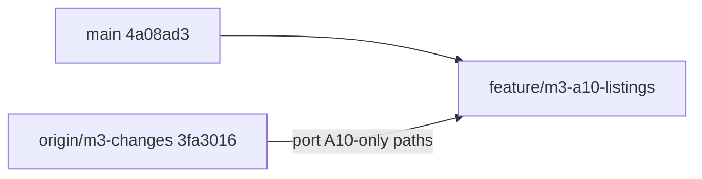

# A10 Career/Jobs — complete implementation plan

## Recommended approach (locked)

**Do not work on `main`, `m3-changes`, or `m3-planing` directly.**

| Question | Decision |
|---|---|
| First step | Create and check out `feature/m3-a10-listings` from **current `main`** (`4a08ad3`) |
| Source of A10 code | **Port A10-only files** from `origin/m3-changes` commit `3fa3016` |
| Do not | Merge `m3-changes` / `m3-planing`, or cherry-pick `3fa3016` (that commit mixes A10 with A7/A9, OpenAPI, and generated client) |
| Do not | Rebuild A10 from scratch (the listings engine already exists and already encodes `M3-A10-01`…`16`) |
| Migrations | **Renumber after `main` tips.** Do not replay M3 filenames (`partners.0017`, `catalog.0023`, `commerce.0014`) — they collide with main’s M2-revamp chain |
| Scope | Phase D3 Career/Jobs only: listing + application + moderation + contact reveal + reports + expiry + vendor subscription/premium + customer/partner/ops UI |
| Out of scope | Wallet/V Coins/referral (`M3-BE-371`), A7 rentals, A9 stays, MSG91, mobile, vehicle, analytics dashboards |

`origin/m3-planing` has A7/A9 and the design doc, but **no** `backend/apps/listings`. `origin/m3-changes` is the only branch with a working A10 stack. `main` is the integration target and already has later M1/M2 work that `m3-changes` lacks.



## What created the skills and markdown (and the closest public architecture)

This repo is **not GPT Cowork**. Cowork is ChatGPT’s file-workspace agent. V Solve Hub is a **Cursor + Codex/Claude dual-agent engineering system** built from three open conventions plus one local invention.

| What you see | What created it | Closest public standard |
|---|---|---|
| [`AGENTS.md`](AGENTS.md) | Written into the repo so every agent session loads the same law: Django owns money, OpenAPI is generated, path ownership, quality gates | [OpenAI Codex `AGENTS.md`](https://developers.openai.com/codex/guides/agents-md) — the portable agent README |
| [`.agents/skills/*/SKILL.md`](.agents/skills) | On-demand playbooks (Next.js App Router, TypeScript, Turborepo, UI/UX, Playwright). Loaded only when the task matches | [Agent Skills spec](https://agentskills.io/specification) — Anthropic-origin, now cross-vendor (Cursor, Codex, Claude Code, Gemini). Path `.agents/skills/` is the vendor-neutral location Codex/Cursor scan |
| [`.claude/launch.json`](.claude/launch.json) | Cursor/Claude Code app launchers for customer `:3000` and partner `:3001` | Cursor Cloud Agents / Claude Code project config — **not** a product architecture |
| [`Django_Next.js_Plan/**`](Django_Next.js_Plan) | Owner + agents wrote phased product specs, task boards, ADRs. This is how M1/M2 were actually built | Spec-driven / plan-then-build (similar to Superpowers `docs/superpowers/` in this repo, and to tools like agentflow’s planner→implementer, but **this repo’s split is custom**: Codex backend vs Claude frontend) |
| [`docs/adr/`](docs/adr) | Human-reviewed architecture locks | Standard ADR practice; numbering allocated **at merge**, next free on `main` is **0010** |
| [`contracts/proposals/`](contracts/proposals) | Claude documents the endpoint the UI needs; Codex implements Django and publishes generated OpenAPI | Contract-first modular monolith (same idea as TrueFoundry/Refract `AGENTS.md` + generated OpenAPI; this repo forbids hand-editing `v1.yaml` and generated clients) |

The Git forensics already showed the operating model: **one architect (`reddy-gopal`) orchestrating Codex/Claude/Cursor**, with `Co-authored-by` trailers on ~48% of commits, `AGENTS.md` as the session contract, and category replication after platform primitives existed.

**Implication for A10:** implement the same way later categories were shipped — proposal → domain commands in a Django app → `spectacular --validate` → generated client → App Router + TanStack Query → tests in `backend/tests/` → static quality. Do not invent a second payment system, a chat product, or Elasticsearch.

## Development standards we must copy (from M1/M2 + A7/A9)

From [`AGENTS.md`](AGENTS.md), [`CONTRIBUTING.md`](CONTRIBUTING.md), [`contracts/proposals/README.md`](contracts/proposals/README.md), and the listings code on `m3-changes`:

- Django is the only business backend. Integer paise. Thin views, invariants in `services.py`.
- Explicit domain commands (`create_listing`, `submit_listing`, `moderate_listing`, …). No silent success, no fallback listings.
- Database constraints in addition to Python (unique active application already exists on `m3-changes`).
- Idempotent money: `A10_VENDOR_SUBSCRIPTION` / `A10_PREMIUM_LISTING` as checkout-free `PaymentAttempt` purposes; capture reducer calls `complete_subscription_payment`; webhook replay must not double-extend.
- **Never model Listing as Booking.** No `BookingGroup`, no fulfilment unit, no applicant payment.
- Frontends consume generated OpenAPI only. No Prisma. No mock catalog rows in UI.
- Partner A1 `/jobs` is **task visits**. A10 uses `/listings` and workspace key `A10_LISTING`. Unknown workspace keys render nothing — never fall back to Jobs.
- Stage **explicit paths only**. Never `git add -A`.
- Agents run `backend\scripts\quality-static.cmd`, `pnpm lint`, `pnpm typecheck`, `pnpm build`. Agents do **not** run pytest/vitest unless the owner re-authorizes. Report **built — owner verification pending**.
- Feature branch name: `feature/m3-*` per [`Django_Next.js_Plan/M3/README.md`](Django_Next.js_Plan/M3/README.md).

## Product law (from `03-rental-stay-jobs-categories.md` on the M3 branches)

Launch subcategory is **Career/Jobs only** (OQ-D4). Archetype code is **`A10_LISTING`**.

Happy path: poster (approved `PartnerCapability` `A10_LISTING`) creates listing → submit → Operations moderate → publish → customer apply → poster shortlist → contact reveal (rate-limited, audited) → close/expire.

Money: poster → platform only (subscription / premium). Applicant never pays.

## What already exists on `m3-changes` vs what we must fix after the port

**Port these paths** (A10-only; do not copy `apps/rentals` or `apps/stays`):

- `backend/apps/listings/**`
- `backend/tests/listings/test_a10_flow.py`
- `backend/apps/catalog/management/commands/seed_listing_catalog.py`
- catalog / commerce / partners / cases **A10 slices** (enum, `A10VariantConfiguration`, purposes, capability, case subjects) — merge into current `main` files, do not overwrite M1/M2
- `frontend/apps/{customer,partner,admin}` listings routes + `features/listings/queries.ts`
- partner `workspace/registry.ts` `A10_LISTING` nav block
- `docs/runbooks/m3-rental-stay-listing-smoke.md` (trim to A10-only smoke)
- Bring the design doc onto the branch: `Django_Next.js_Plan/M3/03-rental-stay-jobs-categories.md` from `origin/m3-planing` / `m3-changes`

**Close these gaps after port** (spec vs `m3-changes` code):

- **Status-machine drift:** backend `Listing.Status` is `DRAFT/PUBLISHED/CLOSED/EXPIRED/REMOVED/ARCHIVED` plus a separate `moderation_status`. Partner UI badges already mention `SUBMITTED_FOR_MODERATION` / `MODERATION_APPROVED`. Align serializer/API so the UI never invents states. Keep two fields if that is cleaner, but expose one public listing state machine the FE can render.
- **Premium:** `A10_PREMIUM_LISTING` exists in commerce; `activate_premium_feature` / premium purchase command is missing in `listings/services.py`. Implement it or remove the purpose from checkout-free until it works — no dead success path.
- **Contract proposal missing:** no `contracts/proposals/*a10*` on `m3-changes`. Write one (next free ID after 0015), then generate OpenAPI. Do not hand-edit `v1.yaml` or `schema.d.ts`.
- **Notifications:** plan requires outbox `listing.published|expired|removed` and `application.submitted|status_changed`. Confirm handlers exist; add notification templates if the port only enqueues events.
- **Ops plan config:** seed three `VendorSubscriptionPlan` rows via `seed_listing_catalog`. Full Phase E dashboards (`M3-OPS-404` analytics) stay out of scope; Operations listing moderate/remove/reinstate (`M3-OPS-331`) is in scope (admin page already exists).
- **Partner Billing:** Home/Listings/Leads exist; Billing is a subscription modal on the listings page. Keep that for M3 unless the registry already has a Billing tab — do not build a second billing product.
- **Search:** ORM filters over `structured_fields` + indexes only. No Elasticsearch.

## Implementation sequence (fool-proof)

### 0. Branch (first command, before any file edit)

```powershell
git checkout main
git pull
git checkout -b feature/m3-a10-listings
```

Leave `srikar-prompts/` untracked and unstaged.

### 1. Bring design authority onto the branch

Copy `Django_Next.js_Plan/M3/03-rental-stay-jobs-categories.md` from `origin/m3-changes`. Write **`docs/adr/0012-a10-listing-engine.md`** (Proposed → Accepted at merge). Leave **0010** for wallet (Phase C, still owed) and **0011** for A7/A9 (`0011-a7-a9-archetype-engines.md` on M3 remotes — A7/A9 only, not A10). Update `docs/adr/README.md` index. Rewrite main [`Django_Next.js_Plan/M3/task.md`](Django_Next.js_Plan/M3/task.md) Phase D to Wave D3 IDs `M3-BE-351`…`361` / `M3-FE-331`/`332` (do not use the stub `M3-BE-303` Careers line).

### 2. Contract proposal (Claude-owned path)

Add `contracts/proposals/0016-a10-listing-careers.md`: customer browse/apply/withdraw/report, partner CRUD/submit/publish/close/applications/reveal/subscription purchase, ops moderate/remove/reinstate. Include roles, example JSON, typed errors (`APPLICATION_DUPLICATE`, rate-limit, plan-cap), idempotency keys.

### 3. Backend port + merge (Codex-owned paths)

Register `apps.listings` in [`backend/config/settings/base.py`](backend/config/settings/base.py), mount URLs, extend:

- `ServiceVariant.BookingArchetype.A10_LISTING`
- `A10VariantConfiguration` (same versioned ACTIVE uniqueness as A1/M2 configs)
- Partner capability actions: `listing.*`, `application.*`, `subscription.manage`
- `PaymentAttempt.Purpose` + `CHECKOUT_FREE_PURPOSES` + capture/failure branches
- `OperationsCase` subject FKs / kinds `LISTING_ABUSE`, `APPLICATION_ABUSE`
- Celery beat: `expire_published_listings`, `expire_vendor_subscriptions`

Keep domain commands in `services.py`; views stay thin. Add `exceptions.py` if missing.

**Migration numbering on `main` (must not copy M3 filenames):**

- `catalog`: after current tip `0019` → next is `0020_a10variantconfiguration`
- `commerce`: after `0011` → next is `0012_a10_payment_purposes`
- `partners`: after `0016` (crew roster on main) → next is `0017_a10_listing_archetype`
- `cases`: after `0002` → next is `0003_listing_application_subjects`
- `listings`: new app `0001_initial` (safe; app does not exist on main)
- `payouts`: skip A7/A9 ledger FKs; A10 money is poster subscription, not partner earning-per-booking

Read M3 files with `git show 3fa3016:path` and rewrite migrations against current `main` models. Exclude `backend/celerybeat-schedule*` if present in that commit.

### 4. Publish contract

```powershell
cd backend
.\.venv\Scripts\python.exe manage.py spectacular --file ..\contracts\openapi\v1.yaml --validate
```

Then regenerate the frontend client the way this repo already does (`pnpm generate` in `frontend`). Never patch `schema.d.ts` by hand.

### 5. Frontend (Claude-owned paths)

Implement against the UI spec below (not a pixel Figma dump). Reuse `@vsolve/ui` primitives, existing partner shell, catalog tiles, and TanStack Query. Public browse may SSR; apply/manage/moderate are client components. Fix FE/BE status labels so badges match the serializer. Never invent a Jobs fallback tab.

## UI specifications (were missing; now locked)

This project specifies UI the M2 way: **routes, nouns, empty/error states, and which server fields render** — see [`Django_Next.js_Plan/M2/08-frontend-information-architecture.md`](Django_Next.js_Plan/M2/08-frontend-information-architecture.md). Partner nav truth is `frontend/apps/partner/features/workspace/registry.ts`. There is no separate Figma-to-code pack for A10.

**Copy rules:** say “job listing / application / employer”, never reuse A1 “Jobs” (that is visit work at `/work/jobs`). Applicant does not see a Pay button. Contact phone/email stay masked until reveal succeeds.

### Customer — `frontend/apps/customer` (`localhost:3000`)

Catalog tile slug `career-jobs` → `/listings` (via `service-href`).

| Route | What the user sees | Data / actions | Empty / error |
|---|---|---|---|
| `/listings` | Browse published Career listings. Filters from `structured_fields` (role, location text, employment type if seeded). Search is ORM filters, not a search product. | `GET /api/v1/listings`. Cards: title, location, published time, premium badge if `is_premium`. | Honest empty: “No live listings”. Never show DRAFT/REMOVED/ARCHIVED. |
| `/listings/[listingId]` | Public detail: title, description, structured fields, poster display name (no raw phone). Apply form: cover note + resume URL/attachment. Report listing. | Apply `POST .../applications`. Unauthenticated → OTP login then return. Duplicate → typed error, not a second row. | 404 if not public. Rate-limit message if apply cap hit. |
| `/listings/my-applications` | Applicant’s applications with status (Submitted → Under review → Shortlisted → Contacted / Rejected / Withdrawn). Withdraw while allowed. | `GET /api/v1/my/listing-applications`, withdraw command. Revealed contact only after poster reveal. | Empty: “You have not applied yet”. Cannot see another applicant’s row. |

No customer checkout, cart, or wallet on this flow.

### Partner (employer) — `frontend/apps/partner` (`localhost:3001`)

Workspace key `A10_LISTING` only if the server grant includes it. Product nav (Phase D §6.9 / M2 README): **Home, Listings, Leads, Billing, You**.

`m3-changes` currently ships only **Home / Job Listings / Me**. After port, add Leads and Billing as real destinations (not a second product): Leads can be listing-detail applications board; Billing can be the plan/purchase surface (modal on listings is acceptable if the Billing tab opens it).

| Route | What the poster sees | Commands |
|---|---|---|
| `/listings` (Home for this workspace) | Counts: active vs plan limit, pending moderation, new applications. Create listing. Status badges aligned to API (`DRAFT`, in-review, live, closed, expired, removed). | create, edit (draft/rejected only), submit, publish (after approve), close, republish. Plan-cap block with upgrade prompt, not silent publish. |
| `/listings/[listingId]` | Listing editor + application inbox (status board). Shortlist / reject / reveal contact (rate-limited). | `update_application_status`, `reveal_contact`. Other poster’s listing → 404/403, not an empty fake. |
| Billing surface | Current `VendorSubscription`, Starter/Growth/Enterprise comparison, purchase (fake Razorpay locally). | `start_subscription_purchase` → existing payment handoff. No applicant charge. |
| `/me` | Unchanged account shell. | — |

Capability missing: workspace hidden (fail closed), no generic Jobs tabs.

### Operations — `frontend/apps/admin` (`localhost:3002`)

Product label Operations. Route `/operations/listings`.

| Surface | What ops sees | Commands |
|---|---|---|
| Queue | Listings in pending moderation + open `LISTING_ABUSE` / `APPLICATION_ABUSE` cases. | Approve / reject with required reason. |
| Detail | Listing body, moderation history, reports. | Remove (reason required), reinstate (reason required; poster cannot self-reinstate). |

No analytics dashboards in this task.

### Visual system

Reuse existing Tailwind + `@vsolve/ui` (Button, Card, EmptyState, badges). Status colours already sketched on `m3-changes` partner page (slate draft, amber review, emerald live, rose removed). Do not introduce a new design system. Mobile-width partner shell already exists; A10 tabs must fit that shell.

## How to set up the project on a PC and check the UI

Follow [`CONTRIBUTING.md`](CONTRIBUTING.md) exactly. Python **3.13** (not 3.14). Paths below assume this machine’s repo `d:\srikar\V_SOLVE_HUB\vsolvehub`.

### One-time

1. Install Python 3.13, Node 20+, pnpm 11.2.2 (`corepack enable && corepack prepare pnpm@11.2.2 --activate`), Docker Desktop, Git.
2. Start databases: `docker compose --env-file infra\.env.example -f infra\compose.yaml up -d` (Postgres `127.0.0.1:15432`, Redis `127.0.0.1:56379`).
3. Backend: `cd backend` → `.\scripts\bootstrap.cmd` → copy `.env.example` to `.env` → `.\.venv\Scripts\python.exe manage.py migrate`.
4. Seed M1/M2 **in this order**: `seed_console_demo_data`, `seed_task_catalog`, `seed_trade_partners`, `seed_m2_demo --i-understand-this-is-dev-only`. After A10 lands, also `seed_listing_catalog`.
5. Frontend: `cd frontend` → `pnpm install`. No `.env` required; apps default to `http://localhost:8000`.

If you re-run `seed_console_demo_data`, re-run the later seeds — it pauses unknown services.

### Every day (four terminals)

1. Docker compose (if not running)
2. `backend\scripts\server.cmd` → API `http://localhost:8000` (Swagger: `/api/v1/docs/`)
3. `backend\scripts\worker.cmd` **and** `beat.cmd` once listing expiry / outbox delivery matters (UI that waits on expire/notifications looks “broken” without them)
4. `pnpm dev:customer` `:3000` · `pnpm dev:partner` `:3001` · `pnpm dev:admin` `:3002`

Local OTP is printed on the login screen. No SMS.

| Who | Phone | App |
|---|---|---|
| Operations | `+918019013032` | `:3002` |
| All-trades partner | `+919900000099` | `:3001` |
| A10 employer (after `seed_listing_catalog`) | `+919900000088` | `:3001` |
| Customer | register yourself; address pin **`500032`** | `:3000` |

### How we check UI elements (after A10 is on the branch)

This is **not** a screenshot of a cold page. Per project rules: click the real flow.

1. Customer `:3000` → catalog Career tile → `/listings` → open a live listing → apply → `/listings/my-applications` → withdraw. Confirm drafts never appear in browse.
2. Partner `:3001` as `+919900000088` → Listings workspace only → create/submit listing → see in-review (not live). Confirm A1 Jobs tab is absent for this capability.
3. Operations `:3002` → `/operations/listings` → approve with reason → listing goes live for customer.
4. Partner shortlist + reveal contact; second reveal beyond daily cap shows the server error, not a fake success.
5. Purchase Starter/Growth with **simulated/fake** payment locally; publish beyond plan max is blocked.
6. Agent verification: Cursor browser tools against those URLs, or the repo `webapp-testing` Playwright skill. Agents still do not run vitest/Playwright suites unless the owner extends the test-execution exception to this work.
7. API check: Swagger `http://localhost:8000/api/v1/docs/` for the same commands.

Write `docs/runbooks/m3-a10-listing-smoke.md` with this click-path so the owner can repeat it.

## Cursor Cloud — yes, with a committed environment (locked)

You can run **Cursor Cloud Agents** on this GitHub repo. That is not the same as hosting git on `origin.cursor.com`, and it is not a replacement for the PC UI click-through above.

**What already exists:** commit `9a33d8c` on `origin/m3-planing` added `.cursor/environment.json` + `.cursor/install.sh` (“Tell Cloud Agents how this repo is built.”). Those files **are not on `main`**, and [`.gitignore`](.gitignore) ignores the whole `.cursor/` directory, so a Cloud Agent started from `main` gets no repo-managed bootstrap.

**What we will do on `feature/m3-a10-listings`:**

1. Change `.gitignore` to ignore `.cursor/*` but **keep** `.cursor/environment.json` and `.cursor/install.sh` (and later a Dockerfile if required).
2. Commit an idempotent environment:
   - `install`: Python 3.13 venv + `pip install --require-hashes -r backend/requirements/dev.txt` (or documented fallback if the cloud image cannot hash-install) + `pnpm install --frozen-lockfile` in `frontend`. Copy `backend/.env.example` → `backend/.env` (no secrets).
   - `start`: start Docker daemon if the image supports it.
   - `terminals`: `docker compose --env-file infra/.env.example -f infra/compose.yaml up -d`, then migrate; do **not** put `runserver` in `install`.
3. Dashboard: [Cloud Agents environments](https://cursor.com/dashboard/cloud-agents#environments) — after the files are on the branch, create/update the environment from that revision and snapshot a working VM.

**Limits (do not pretend Cloud is a full laptop):**

- Compose needs Docker-in-the-agent (often DinD). If the default image cannot run `infra/compose.yaml`, Cloud Agents can still lint/typecheck/edit; they cannot migrate or seed until Docker/Postgres works.
- Hashed pip + Python version: image must be **3.13**. 3.14 is already a local mismatch on this PC.
- Three Next apps on 3000/3001/3002 are for **your PC** (and Cursor’s local browser). Cloud Agent UI checks are best-effort; the acceptance click-path in the runbook stays owner-on-PC.
- Never put Razorpay/MSG91 secrets in `environment.json` or `install.sh`. Use Cursor environment secrets if staging keys are needed.

**Daily PC setup in CONTRIBUTING.md remains the source of truth for you.** Cloud is how agents get a matching machine so they do not invent a second stack.

### 6. Tests (write, do not claim green)

Keep and extend [`backend/tests/listings/test_a10_flow.py`](backend/tests/listings/test_a10_flow.py) for `M3-A10-01`…`16` plus partner isolation, ops moderate, subscription webhook replay. Add frontend query/unit tests beside existing listing pages if the port has none.

### 7. Seed + static quality

`python manage.py seed_listing_catalog` after migrate. Run `backend\scripts\quality-static.cmd`, `pnpm lint`, `pnpm typecheck`, `pnpm build`.

### 8. Handoff

Report **built — owner verification pending**. Owner commands:

```powershell
cd backend
.\.venv\Scripts\python.exe -m pytest tests/listings/test_a10_flow.py -q
.\scripts\quality.cmd
```

Plus seed + click through customer apply, partner moderate path (ops user), subscription purchase with **fake** Razorpay (no live network in automated tests).

## Hard rules while coding

- Listing is not a Booking. Application is not a Booking.
- No applicant marketplace payment.
- No chat inbox. Contact reveal is a command + audit event.
- No hidden default subscription plan that auto-publishes.
- Fail closed without `A10VariantConfiguration` ACTIVE and without approved `A10_LISTING` capability.
- Do not log contact phone/email in application dumps.
- Do not commit `.env`, secrets, or `srikar-prompts/`.

## Exit criteria

A10 is complete for this task when a seeded Career/Jobs category can: post → moderate → publish → apply → shortlist → reveal contact → close/expire; duplicate apply and rate limits refuse with stable errors; public search never leaks DRAFT/REMOVED; subscription activates once and webhook replay is safe; plan listing-cap blocks publish; customer/partner/ops surfaces work against generated OpenAPI; `M3-A10-01`…`16` are written and listed for the owner to run.
